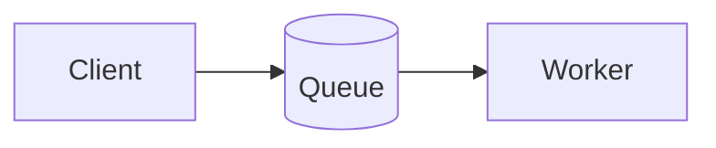

# Document Authoring & Export

Ziya can author **work-product documents** — reports, memos, specs — as a
first-class artifact distinct from conversation transcripts, and export them
as high-fidelity PDFs rendered through the real chat renderer (KaTeX math,
mermaid/graphviz/vega-lite/packet diagrams, chemfig/tikz LaTeX, Prism
syntax highlighting).

## The document IR

A document is a plain markdown file with YAML front-matter, stored in
`<project>/.ziya/documents/`. The file is the single editing surface: the
model (or you) revises it with ordinary edits, and rendering happens only at
export time. The file stays portable — it renders sensibly on GitHub or any
markdown viewer.

```markdown
---
ziya-doc: 1
title: "Queue Depth Analysis — Q3"
subtitle: "Capacity headroom for the ingest tier"   # optional
author: "yourname"        # optional; byline + PDF /Author
date: 2026-09-19          # optional; ISO date or free text; default today
layout: report            # report = title block on page 1;
                          # titlepage = title block on its own page;
                          # plain = no chrome
numbering:                # optional; `numbering: true|false` sets all
  sections: false         # 1 / 1.1 / 1.1.1 prefixes on h1–h3 (and bookmarks)
  figures: true           # "Figure N" under every diagram/image
  tables: true            # "Table N" above every table
page:
  margin: 19mm            # one value, or {top, bottom, left, right};
                          # keep left/right at 19-20mm
---

# Executive Summary

Ordinary Ziya markdown: math like $\rho = 0.85$, tables, code, diffs,
and diagram fences all render at full fidelity.



Figure: Request path. A `Figure:` paragraph directly below a diagram
becomes its caption.

Table: Depth by utilization. A `Table:` paragraph directly above (or
below) a table becomes its caption.

| Utilization | Mean depth |
|------------:|-----------:|
| 0.85 | 5.7 |

<!-- ziya:pagebreak -->

# Model

Starts on a new page. The pagebreak directive is an HTML comment —
invisible in every other markdown viewer.
```

Front-matter keys are all optional; invalid values fall back to defaults
rather than failing the export. Keep semantic sources in the IR (LaTeX,
diagram DSLs) — never pre-rendered images — so future export targets can
choose native mappings per construct.

## Typesetting

The document export is typeset, not a screen dump. Everything below is
automatic; the front-matter above is the only control surface.

- **Title block** — title, optional subtitle, and a byline (author ·
  formatted date, e.g. `September 19, 2026`, never a locale-numeric date)
  under a rule. `layout: titlepage` gives the block its own first page.
- **Heading scale** — body `h1`/`h2`/`h3` step down from the title
  (17/13.5/11.5 pt) so the document title dominates; `h4` is a small-caps
  run-in. With `numbering.sections`, headings carry `1`, `1.1`, `1.1.1`
  and the PDF bookmarks carry the same numbers.
- **Figures** — every diagram or image is centred at its natural size
  (never up-scaled; down-scaled only if wider than the column), kept whole
  with its caption, and labelled `Figure N.` A `Figure:` line supplies the
  caption text; without one the label alone is emitted so prose can still
  refer to it. `numbering.figures: false` drops the labels and keeps only
  explicit captions.
- **Tables** — report style: a header rule, hairline rows, zebra fill,
  lining tabular digits, `Table N.` caption above. A table taller than
  ~45 % of the page flows across pages with its header row repeated on
  each page instead of being pushed whole onto a fresh page behind a
  blank band.
- **Pagination** — a heading is never stranded at a page bottom: it moves
  with the stacked headings under it and with the first following block
  (paragraph, list, quote, short table, code, figure, display math).
  Orphans/widows are held to three lines; figures and short tables are
  atomic. Use `<!-- ziya:pagebreak -->` only for parts that should open a
  page (appendices, major sections of a long report).
- **Running footer** — `Title · Author · Date` on the left, `Page N of M`
  on the right, with a small Ziya credit (version · model) on a lighter
  second line. Chromium draws the same footer on every page, including a
  title page.

### Figures that print well

The pipeline keeps figures whole, never up-scales them, and — since the
doc-aesthetics loop iteration 3 — wraps an over-long chart title/subtitle
line, shrinks an overflowing text mark (never below 6.5pt) and grows the
drawing so nothing is clipped by the page, and trims dead margins of a
down-scaled drawing. Those are safety nets; a figure sized for print is
still the author's job. The text column is ~673 px (178 mm) and a figure's
smallest text should stay >= 6.5pt at print size.

1. **Mermaid flowcharts** — a subgraph's `direction` is honoured only if no
   edge crosses the subgraph boundary. Connect subgraphs to each other
   (`GROUND -->|feeder RF| SPACE`), not node-to-node across them, or every
   node stacks into one tall column. Then pick the outer direction so each
   subgraph is short: with wide multi-line labels use `flowchart LR` with
   `direction TB` subgraphs (one column per stage), at most 4–5 nodes per
   subgraph. A row of four wide-label nodes is ~1400 px and prints below
   6.5pt (measured 5.8pt); the same eight nodes as two columns printed at
   7.3pt with the caption on the same page. Split a figure that is still
   taller than half a page.
2. **Mermaid `timeline`** — every period line (`Name : event : event`) is
   its own ~250 px column, whatever section it sits in, and labels do not
   wrap. Keep at most 4 periods in total (so at most 4 sections of one
   period each) and 3 short events per period; for more milestones use two
   timelines (each with its own `**Figure N — …**` title line) or a table
   (Phase | When | What), which prints at body size. A 7-period timeline
   printed at 4.0pt; split 4 + 3 it printed at 6.9pt.
3. **Vega-lite titles** — give `title.subtitle` as an array of lines, each
   at most ~80 characters for a 560 px wide chart (roughly width / 7).
   Longer explanations belong in the caption.
4. **Vega-lite text marks** — explain series in the legend or caption; an
   essential text mark stays under 40 characters, in empty plot space,
   inside the plotted domain.
5. **Back-to-back figures and stacked charts** — a figure prints as one
   unbreakable unit (title + drawing + caption), so the page before it ends
   early whenever the unit does not fit. Do not end a section with figures
   back to back: follow each figure with the prose that discusses it. Since
   doc-aesthetics iteration 8 the PDF fills a large gap (>= 20% of the
   page) above a figure that moved to the next page with the prose that
   follows the figure — whole paragraphs, same section, never across a
   heading — and keeps the result only if the gaps shrink overall and no
   page is added. Split a stacked chart (vega-lite `vconcat`) taller than
   about half a page into separate figures only when prose goes between the
   parts. Measured on the mir-shaper document: its two-panel Figure 5
   (~0.8 page) ends section 2 and leaves p6 a third blank; split into two
   back-to-back figures it left p6 unchanged (0.32), added a 0.51 band on
   p7 and one page. Floating the paragraph after Figure 6 closed the p12
   gap (0.26 -> 0.06) but left Figures 6 and 7 back to back, which opened
   a 0.32 gap on p13, so the float was declined.

### Tables and notes

Since doc-aesthetics iteration 4 the pipeline also sets table column
widths itself: it estimates how many lines each cell wraps to and gives
width to the columns that most shorten the table. The widths are fixed
with a `<colgroup>`, and if the result would make the table taller, the
original layout is kept. Tables whose columns already have widths set, and
tables with fewer than three columns, are left alone. Blockquotes that
start with a note label print as a tinted amber call-out.

1. **Tables** — at most 5 columns and short cells (a label, a number, a
   phrase). Put qualifiers and citations in the prose after the table.
   Column balancing cut the mir-shaper Table 1 from 8 to 6 cells wrapping 5
   or more lines, but its ~190-character cell still wraps to about 11 lines
   in a 5-column table.
2. **Editorial notes** — start the blockquote with its label in bold:
   `> **Reviewer note:** …`, `> **Note:** …` or `> **TODO:** …` (also
   *Editorial comment*, *FIXME*, *Draft*). These print as a note call-out.
   Any other blockquote, such as a glossary, prints as a quotation.
3. **Lists and notes** — Never interrupt a list with a column-0
   blockquote or paragraph: markdown ends the list there, and the items
   after it restart as a new top-level list. Put the note after the whole
   list, or indent it under its item (`  > **Note:** …`) so it stays inside
   the list.

### Page margins and line length

The PDF body prints at 11pt, the largest size the heading scale allows,
so the side margins are the only thing that sets the line length. On A4,
16mm side margins (which is also what you get when the front-matter sets no
margin) give 95-98 characters per line, past the 95-character limit for
comfortable reading. In doc-aesthetics iteration 6 the mir-shaper document
ran 95.5-98 characters on five pages at 16mm and still 96 on one page at
18mm. At 19mm side margins every page was at or under 95 characters (median
92), with the same 16 pages.

1. **Side margins** — set `page: margin:` explicitly with left and right at
   19-20mm, for example
   `margin: {top: 16mm, bottom: 16mm, left: 19mm, right: 19mm}`. Never
   narrow the side margins to save pages; cut words instead.

A related pipeline behaviour: if a document ends on a near-empty page (fewer
than 80 words) that no page break put there, the export recaptures it with
about 25% less paragraph, list and caption spacing, and then with
line-height 1.40. It keeps a recapture only if it has fewer pages. The font
size never changes.

## Exporting

`POST /api/export/document` returns PDF bytes:

```bash
# By stored name (relative to .ziya/documents/):
curl -X POST localhost:6969/api/export/document \
  -H 'Content-Type: application/json' \
  -d '{"name": "q3-report.md"}' -o report.pdf

# Or inline:
curl -X POST localhost:6969/api/export/document \
  -H 'Content-Type: application/json' \
  -d '{"markdown": "---\ntitle: X\n---\n# Hello"}' -o out.pdf
```

Optional body fields: `title` (overrides front-matter), `includeFooter`
(default **true**, matching the other export routes — the running footer
is always drawn unless you pass `"includeFooter": false`).

The PDF gets:
- A **nested outline** (bookmarks) generated from the h1–h4 heading tree
  (with section numbers when `numbering.sections` is on).
- Document metadata: front-matter `title` as /Title, front-matter `author`
  (or the model/provider) as /Author.
- Real page breaks at each `<!-- ziya:pagebreak -->`.

Under the hood (`app/utils/document_print_decor.py`): the shared `/print`
route renders the body, then the exporter injects the document stylesheet
and runs a decoration pass (numbering, captions, long-table flow, title
block) before the keep-with-next and outline passes, so every capture
shares one pagination. Documents render under **print** media at a
viewport matched to the printable box — Chromium only repeats table
headers under print media, and matching the viewport makes the in-page
measurements agree with the pages it paginates. Conversation transcripts
keep the screen-media path unchanged.

Requires Playwright (`pip install playwright && playwright install
chromium`); the endpoint returns HTTP 501 when it is absent.

## Citing numbers from the evidence ledger

A document can cite numbers recorded in the project's evidence ledger
(`ledger_record`; see `design/evidence-ledger.md`) instead of carrying them
as typed literals. Declare the namespace and policy in the front-matter and
write citations in the body:

```markdown
---
title: Latency audit, March 2026
evidence:
  namespace: audit-2026-03
  policy: warn        # strict | warn (default) | off
---
The error rate on retried requests was {{claim:s1.error_rate|fmt=.2%}}.
The median affected host loses {{claim:s1.per_unit.distribution.median|fmt=,.0f|unit}} per day.
```

- `KEY` is a claim id relative to the namespace, optionally followed by a
  field (`.distribution.median`, `.population.n`) and pinned to a version
  with `@v2`. `fmt=` is a Python format spec (default: the claim's own
  format); `unit` appends the claim's unit, `unit=X` a literal.
- Export substitutes the claim's current value and appends an **Evidence**
  appendix: claim, rendered value, status, population, source (query, file
  and hash), and as-of time. Each substituted claim is recorded in
  `.ziya/ledger/citations.jsonl`.
- Policy: under `warn`, an unknown id renders as `⟦missing: id⟧` and a
  drifted or refuted claim renders with a ⚠ and is listed in the appendix.
  Under `strict`, either case fails the export with HTTP 400 whose body
  lists every offending id (`evidence_problems`). A claim never re-checked
  exports under both policies, marked "unverified". `off` substitutes
  values and does nothing else; a document with no `evidence:` block is
  untouched.
- The response header `X-Ziya-Evidence` carries the report as JSON: citation
  count, missing and flagged ids, and a count (with samples) of numeric
  literals in prose and tables that are not citations. That lint never
  blocks an export; it is a hint that a number was typed by hand.
- Citations inside code fences are left as written, and task-card templating
  never touches them (`{{claim:…}}` is not a template placeholder).

Claims can be recorded by the model (`ledger_record`) or from a script run
through Ziya's shell tool. Such a script finds `ZIYA_LEDGER_URL` and a
short-lived `ZIYA_LEDGER_SCOPE` token in its environment and can use
`ziya ledger observe … ` / `ziya ledger claim …` (or import
`app/utils/ziya_ledger_client.py`, which needs only the standard library).
The token names the project and the conversation, run and block the command
came from, so the record's provenance is never typed by hand; outside such a
shell the command explains that the variables are missing.

## The `document_authoring` skill

A built-in model-discoverable skill teaches the model the IR contract and
the workflow: author into `.ziya/documents/`, revise with targeted edits
(never full regeneration), extract-and-restructure when promoting a
conversation into a document, caption every figure and table with a
`Figure:` / `Table:` line and refer to them by number, reserve
`<!-- ziya:pagebreak -->` for major parts, and render via the export
endpoint.

## Relationship to conversation export

Conversation export (Export Conversation modal: markdown / HTML / PDF /
paste targets) is transcript-shaped and unchanged. Document export shares
the same headless render session and `/print` route in document mode — no
message chrome, no role labels — so the two paths cannot drift in rendering
fidelity.
