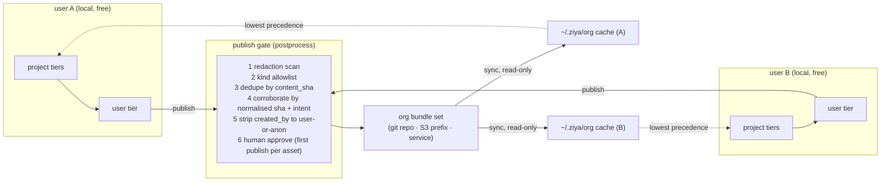

# Asset Substrate — one model for everything a conversation leaves behind

**Status:** Direction accepted 2026-10-17 on four points: project data lives
outside the repo tree (§2); the workspace is the model's default write root
(§2); org transport v1 is a synced directory (§6); **facts publish through
the gate like every other kind** (§6a — an earlier draft excluded them, which
was wrong: the shared framework an org wants is mostly facts). Supersedes the
storage parts of `dataset-store.md`; amends `recipe-store.md` (tiers,
lifecycle, publish) and `structured-memory-system.md` (lifecycle
generalised). Reconciled against the full design history 2026-10-17: §12
lists where the first draft duplicated or contradicted an accepted spec and
what changed. Nothing here is built.

---

## 0. Why this is a substrate problem, not a feature problem

Every store in Ziya today was designed well in isolation and badly in
aggregate. The symptom the user sees is a drive filling with
`<project>/.ziya/<tool>/<run>/<guid>/{cache,scripts,docs}` that nothing will
ever read again, while the question "did we already work this out?" has no
place to be asked. The cause is five independent decisions that every store
made differently:

| Decision | memory | datasets | outputs/ledger | skills/recipes | task-run artifacts | card-invented dirs |
|---|---|---|---|---|---|---|
| **Identity** (what makes two things the same) | content + embedding | random id | append position | directory name | run id | path the author chose |
| **Placement** (which disk location) | `~/.ziya` | `~/.ziya` | `<proj>/.ziya` | both, shadowed | `<proj>/.ziya` | anywhere under `<proj>/.ziya` |
| **Visibility** (who can find it) | mind-map + search | `dataset_list` (by conversation) | nothing | discovery scan | nothing | nothing |
| **Lifecycle** (how it stops existing) | probation → archive → expire | never | never | never | never | never |
| **Portability** (how it travels) | encrypted blob | none | none | directory | none | none |

The author-chosen path is doing the work of all five at once, and a path can
do none of them. The substrate separates them, makes each a property of an
*asset* rather than of a location, and makes the location an implementation
detail the model and the user never see.

The user-facing contract is a single sentence: **the chat gets better over
time and nothing the model keeps is ever a mystery or a mess.** Everything
below exists to make that sentence true without exposing any of it.

---

## 1. The asset model

An **asset** is anything a conversation or run produces that could be worth
having later. Six kinds, chosen so that every existing store maps onto exactly
one and every new thing has an obvious home:

| Kind | Body | Existing store | Example |
|---|---|---|---|
| `fact` | short text + structure | memory | "the `stack=` param must be `mls-gamma` for Grafana panel 42" |
| `table` | rows (parquet) + describe | datasets, `store_output` JSONL | a 523-row defect backlog; nightly finding records |
| `procedure` | files + signature | recipes, skill `scripts/` | a log parser; a ClickHouse query template |
| `skill` | SKILL.md + resources | skills | "statistical_charts"; an extracted bundle |
| `document` | blob + extracted text/index | pdf_index, (web research: none) | a fetched page; a 400-page PDF and its page index |
| `evidence` | claim/observation pointers | ledger | "n=278 derived from table X by SQL Y" |

Plus one non-asset: **`scratch`** — anything produced on the way to an asset
(iteration PNGs, probe PDFs, intermediate JSON, half-written scripts). Scratch
is the category that fills the drive, and the single most important rule in
this design is that scratch has a different default location, a budget, and a
clock, and becomes an asset only by being *deposited* with a kind.

Every asset, regardless of kind, carries the same `meta.json`:

```json
{
  "kind": "table",
  "id": "tbl_7c2f…",                 // kind-prefixed; stable for the asset's life
  "content_sha": "…",                // sha256 of the body; changes on edit
  "source_key": "sql:…#…",           // §3 — what question this answers; null for scratch-born assets
  "intent": "Defects by severity from the gfx sweep backlog",   // one line, model-written
  "tier": "project",                 // §2
  "project_id": "e0fb…",             // the project UUID (multi-root-projects.md); the key
  "project_remote": "git@…/ziya.git", // equivalence HINT only (multi-root Appendix A), never a key
  "created_by": {"conversation_id": "…", "run_id": null, "user": "dcohn"},
  "created_at": "…", "last_used_at": "…", "use_count": 3,
  "used_by": [{"conversation_id": "…", "project_id": "…", "user": "…"}],  // the corroboration record
  "status": "probationary",          // §4
  "reproducible_from": {"procedure": "prc_…", "inputs": ["tbl_…"]},  // null if raw
  "references": ["evd_…", "skl_…"],  // what cites this; §4 uses it
  "size_bytes": 184320,
  "redaction": {"scanned_at": "…", "clean": true},   // §6 gate
  "layout": "dataset-v1"             // which kind-specific layout the body uses
}
```

Kind-specific layouts stay as they are (a skill is still a `SKILL.md`
directory other harnesses can read; a table is still parquet + describe). The
substrate is the common meta, the common roots, the catalog, and the verbs.

### Rejected shape: one uniform `assets/<kind>/<id>/` tree
Tempting, and wrong for skills and recipes, which are read by other tools that
expect `SKILL.md` at a predictable path, and wrong for memory, whose encrypted
blob store is a plugin extension point. Uniform *meta* and uniform *roots*
give the catalog everything it needs; uniform *layout* would break
interoperability for no gain.

---

## 2. Tiers and placement

Four tiers, composed with fixed precedence. The model and the user never name
a tier; verbs move assets between them.

```
precedence:  project  >  user  >  org  >  builtin
```

| Tier | Root | What belongs | Travels with |
|---|---|---|---|
| `builtin` | the package | shipped skills, schemas | the release |
| `org` | `~/.ziya/org/<org>/` — a **read-only local cache** of a published bundle set (§6) | vetted procedures, skills, overlays, schemas, published findings | the org's sync channel |
| `user` | `~/.ziya/{facts,tables,procedures,skills,documents,evidence}/` | things proven useful in ≥2 projects, or the user promoted | the user (export bundle) |
| `project` | two sub-locations, by *intent*, below | things specific to one codebase | see below |

**Project tier has two homes, and this is the one placement rule the model
must learn:**

- `<root>/.ziya/{skills,recipes,schemas,tasks,overlays}/` — **committable**.
  Procedures and definitions a team shares through the repository. Small, text,
  reviewable in a PR. This is where a project's self-developed skills live.
- `~/.ziya/projects/<project_id>/{tables,documents,evidence,outputs}/` —
  **local data**. Never in the repo tree. This is the directory
  `get_project_dir(project_id)` already owns (chats, task cards, task runs,
  contexts, bindings live there today); the substrate adds siblings, it does
  not invent a root. Keyed by the project UUID, which survives moves and
  repoints (`multi-root-projects.md`); the git remote is recorded as an
  equivalence hint for clone detection, as that design's Appendix A plans.

Rationale: a repository is already the organisation's sharing channel for
*procedures*; nobody wants parquet, PDFs or ledgers in it; and keeping data out
of the tree means `git clean`, a read-only checkout, or deleting a worktree
never destroys learned data. Today `outputs/` and `ledger/` are in the tree —
migrating them is a one-time move with a path index entry.

**Scratch has exactly one home: `~/.ziya/work/<project_id>/<owner>/`** where
`owner` is a run id, a conversation id, or a job id. Not in the project tree.
It is reached through the `paths.scratch_dir` accessor the storage-layout
consolidation already landed (`backlog-storage-layout-consolidation.md`), and
this section is that backlog's pending half — migrating the write sites and
adding the sweeper — under that document's five classes: user-durable,
project-durable-committed, project-durable-local, cache, scratch.
Every file the model writes that is not a deposit lands here by default
(`{{workspace}}` in card instructions; `file_write` default root for
non-policy paths; `job_start` cwd). It has a per-owner size budget (default
500 MB, cards may raise it in scope) and a clock (default 14 days after the
owner finishes; held runs keep theirs). Nothing in it is catalogued. Reclaim is
automatic and silent because nothing in it was ever promised to anyone.

### Rejected shape: datasets stay user-level only (today)
Good for cross-project reuse, but a table that only makes sense for one repo
pollutes every other project's listings, and the user cannot hand a project to
a colleague with its data. Tiers with promotion fix both; the 54 existing
datasets migrate to `project` of whichever project's conversation created them.

### Rejected shape: project data inside `<root>/.ziya/`
That is the current state, and it is why a 3 GB sweep lives next to the
source code. It also makes "delete the checkout" a data-loss event.

---

## 3. Identity and the question "do we already have this?"

Two identities per asset, for two different questions:

- `content_sha` answers *is this the same thing* — dedupe, drift detection,
  provenance. Changes when the body changes.
- `source_key` answers *does this answer the same question* — the cache key.
  Computed from what produced the asset, before the work is done:

| Producer | source_key |
|---|---|
| `nova_web_search` / `fetch` | `web:` + sha(normalised URL/query + params) |
| `analyze` | `sql:` + sha(normalised SQL) + `#` + sha of each input's `content_sha` |
| `pdf_outline` / page index | `doc:` + sha(file bytes) |
| `recipe_run` | `recipe:<name>@<sha>#` + sha(params) |
| `store_output` | none (findings are events, not answers) |
| model `file_write` of a script | none until harvested; then `recipe:` |

Every producing tool does a **catalog lookup on its source_key before doing
the work** and, on a hit within the kind's freshness window, returns the
existing asset with its age (`"cached": true, "age_h": 31`). The model can
force a refresh. This is what makes research cacheable across queries,
conversations and projects without the model having to remember anything:
the lookup is in the tool, not in the prompt. The user sees only that the
second answer arrives faster and says "as of yesterday".

Freshness windows live with the kind, not the tool: web documents 7 d (served
stale with age up to 30 d), derived tables fresh while every input's
`content_sha` is unchanged, PDF indexes fresh while the file sha is unchanged,
recipe results fresh while recipe sha and params match.

**The query broker owns this cache; the substrate extends it, not replaces
it.** `query-broker.md` already specifies a user-level cache keyed by source
fingerprint with TTLs (24 h; 30 min for volatile sources; 7 d for settled
slices), single flight, `nocache`, `include_other_projects`, and the
cross-project rule from `research-harness.md` conflict 3: a hit filled by
another project records a *new* observation in the requesting project's
ledger with `cache_of: {project_id, obs_id}`, because ledger decision 3
forbids cross-project citation. `sql:` keys are therefore the broker's.
`web:`, `doc:` and `recipe:` keys use the same cache and the same
cross-project rule, and the catalog indexes every entry so `find` sees them.
`analyze` results already land as datasets with recorded lineage
(`local-analytics.md`), which is what makes a derived table reproducible.

---

## 4. Lifecycle, expiry and reclaim

One state machine for all kinds, borrowed from memory:

```mermaid
stateDiagram-v2
    [*] --> probationary : deposited / harvested
    probationary --> active : corroborated (kind-specific signal)
    probationary --> archived : TTL with no corroboration
    active --> archived : unused for AGE and unreferenced
    archived --> active : used again
    archived --> [*] : reproducible AND unreferenced AND past hold
    active --> active : promoted to a higher tier (copy; origin stays)
```



**Corroboration signal is the only kind-specific part**, and the signal for
*promotion* is deliberately one scope wider than the signal for *activation*:

| Kind | activates when | promotes to `user` when | promotes to `org` when |
|---|---|---|---|
| table | read by a second conversation | read from a second **project** | — (tables publish only by explicit choice) |
| procedure | run a second time successfully | run from a second project | run by a second **user** after publish |
| skill | loaded by a second conversation | loaded from a second project | loaded by a second user |
| document | referenced by a second conversation | fetched for a second project | — |
| fact | memory's existing rules | — (no project tier: memory is one global store, and `scope.project_paths` is a fact's project affinity, per `structured-memory-system.md` §6.3) | its **domain** is published and a second user corroborates it (§6a) |
| evidence | cited by a reply or a finding | follows its table | follows its table |

The *second-project* requirement is what stops a project-specific trick from
leaking into every other project because one project used it in three chats.

**Reclaim is two-axis, not per-kind TTLs.** An asset is deleted only when all
three hold: it is **reproducible** (its `reproducible_from` chain resolves to
assets that still exist), it is **unreferenced** (no evidence, finding, skill
or card cites it), and it has been archived past the hold (default 90 d). An
asset failing any one is archived, never deleted. Raw ingests, documents the
user dropped in, facts and evidence are therefore never auto-deleted. The
reproducibility check walks the chain: a derived table whose input was
deleted is *not* reproducible and is kept.

Scratch is outside this machine entirely (§2): budget + clock, no states.

Task-run artifacts: a run's `final/` deposits are assets; everything else a
run wrote is scratch. The run record keeps pointers to the deposited ids, so
the inspector still shows the result after the workspace is reclaimed.

### Rejected shape: per-kind TTL tables
The first draft had "derived dataset: archive 30 d, delete 90 d". It deletes a
table whose only input has since been deleted (unreproducible) and keeps a
one-off probe nobody ever referenced. Reproducible × referenced is the right
pair of questions; TTLs only set the pace.

### Rejected shape: nothing is ever deleted without a click
Honest, and it reproduces today's disk. A click is required for exactly one
thing: deleting something that is not reproducible. Everything else is a
Library tab the user can look at if they want to.

---

## 5. Verbs — how assets move

Eight verbs, all `[DIRECT]`, all catalog-backed, all also CLI (`ziya assets`).
Existing tools *are* the kind-specific deposit verbs and keep their names.

| Verb | Does | Existing |
|---|---|---|
| **deposit** | scratch → asset of a kind, in `project` tier, probationary | `dataset_register`, `store_output`, `ledger_record`, `recipe_bank`, skill bank |
| **find** | one search across all kinds and tiers: intent text, source_key, kind, shape, project | new: `asset_find`; `memory_search` and `dataset_list` become views of it |
| **use** | records `used_by`; every reading tool does this implicitly | implicit |
| **promote** | copy to the next tier up; origin keeps a `promoted_to` pointer | skills have fork; generalised |
| **publish** | user → org through the gate (§6) | new |
| **extract** | directed assembly of a skill bundle from a span (§7) | new: `skill_extract` |
| **overlay** | additive fragment on a builtin/org/MCP definition (§7) | new: `overlay_add` |
| **adopt** | register an existing unmanaged directory as assets; the migration path for today's piles | new: `ziya assets adopt` |

Precedence on `find`: the catalog returns all tiers; the composing surface
(skill loader, `get_skill_details`, recipe search) applies project > user >
org > builtin and labels each hit with its tier so "there is a newer org
version of this" is visible but never applied silently.

---

## 6. The org tier — shared learning for many users

The requirement: tens of thousands of users; a technical organisation wants
what its members learn to accumulate into a shared framework, without any
member's local learning being exposed, slowed, or overwritten.



Design points that make this safe enough to turn on:

1. **Local learning is untouched.** Nothing in project or user tier is read by
   the gate except what `publish` names. The org cache is read-only and lowest
   precedence; a user's own version always wins locally.
2. **Kinds are allowlisted at the org.** Default: `procedure`, `skill`,
   `overlay`, `schema`, `fact` (by domain, §6a), and `table`/`document` only
   with an explicit `publishable: true`. Sensitivity is judged per asset by
   the gate, never by kind: excluding a whole kind because some of its
   members are sensitive would exclude exactly the content the framework is
   made of.
3. **Redaction runs twice**: at deposit (`meta.redaction.clean`) using the
   shadow journal's credential patterns plus absolute-path and hostname
   patterns, and again at publish. A dirty asset cannot publish; the gate says
   which pattern matched.
4. **Corroboration across users is the org's promotion signal.** Two users
   publishing equivalent procedures (normalised sha, or intent embedding above
   threshold) produce one org asset with `corroborated_by: 2`, which is what a
   third user's `find` ranks first. This is the "learned framework": not a
   curated wiki but the intersection of what several people independently
   found worth keeping.
5. **Transport is a bundle format, not a protocol.** A published asset is a
   directory `<kind>/<id>/{meta.json, body…}` plus a signed `index.jsonl`.
   v1 syncs a directory (git repository or S3 prefix the org controls); a
   service that serves the same bundles can replace it without changing the
   client. This is the same bundle `export`/`import` uses for a single user.
6. **Encryption at rest and access control stay plugin hooks.** The gate and
   the sync call the existing enterprise extension points; with no plugin the
   gate is redaction + approve and the sync is a directory copy.

### Rejected shape: shared tier as a live database
Many users writing to one store needs a service, auth, conflict resolution and
an availability story before anyone benefits. Publish-as-bundle gives the
accumulation effect on day one with a git repo, and the service is a later
transport.

### Rejected shape: auto-publish anything that reached `user` tier
`user` tier is reached by cross-*project* use, which is a strong signal of
generality but says nothing about sensitivity. Publish stays explicit per
asset (or per kind, by org policy) with a human approve on first publish.

### Rejected shape: facts never publish (first draft)
Facts were excluded on the grounds that memory holds personal and customer
context. That gates on the wrong axis. The shared framework an organisation
wants — "panel 42 means X", "this condition is the signature of ticket Y",
"build Z breaks on AL2" — *is* facts; procedures and skills are how you act
on them. The fix is to publish facts by **domain** with the controls below,
not to withhold the kind.

## 6a. Publishing facts

Memory already has the two structures publishing needs: a **layer**
(domain_context, architecture, lexicon, decision, process, negative_constraint,
preference, active_thread) and a **mind-map domain** (`domain_srm_rollout`,
`domain_ipv6`, …). Publication is decided at the domain, applied per fact:

1. **Unit of publication is a domain, not a fact.** The user (or org policy)
   marks a domain `publishable`. The gate then considers every *active* fact
   in that domain; probationary and archived facts never publish. A fact
   outside a published domain is never considered, however general it looks.
2. **Layer allowlist.** Default publishable layers: `domain_context`,
   `architecture`, `lexicon`, `decision`, `process`, `negative_constraint`.
   Never: `preference` (about the user) and `active_thread` (about in-flight
   work). An org may narrow this, not widen it past `preference`.
3. **Redaction for facts is stricter than for procedures.** In addition to
   credential, path and hostname patterns: person names and aliases other
   than the publishing user's own (resolved against the org directory when a
   plugin provides one, else a name-shape heuristic), ticket ids unless the
   domain is marked `tickets_ok`, and anything the structured-memory
   extractor tagged `customer` or `personal`. A fact that trips any pattern
   is held with the pattern named; it is not silently dropped, because the
   user may want to rewrite it in a publishable form.
4. **Corroboration is the org-side promotion signal, as for every kind.** A
   fact published by one user lands in the org bundle as `corroborated_by: 1`
   and is ranked below local facts. A second user publishing an equivalent
   fact (same domain, embedding above threshold, no contradiction) raises it;
   a second user publishing a *contradicting* fact marks both `contested`,
   which `find` shows and never resolves on its own. Contested facts are the
   most valuable thing the gate produces — they are where the organisation
   disagrees with itself — so they surface in the Library, not in a log.
5. **Local shadows org, always.** A user's own fact in the same domain wins
   at project and user precedence; the org fact is visible as "the org also
   says…". Workflow H in §9 is unchanged by this: a fact true in project A
   and false in B is a *project*-tier matter before it is ever an org one.
6. **First publish per domain needs a human approve; later facts in the same
   domain publish on the lifecycle pass** unless the org sets
   `approve: every`. Retraction is immediate and propagates on the next sync
   as a tombstone in `index.jsonl`; the local cache removes it.

What this gives the multi-user environment: after a few months, a new
engineer's first question in a domain is answered from the facts several
colleagues independently kept, labelled as such, with the contradictions
shown rather than averaged away.

---

## 7. Directed assembly: `skill_extract` and overlays

**`skill_extract(scope, name?)`** runs the recipe-store harvest logic over a
named span (this conversation, turns N–M, a bead, a task run) on demand,
never waits for a second use, and writes a complete skill bundle to the
project's committable location:

```
.ziya/skills/<name>/
  SKILL.md         intent · when to use · procedure in prose · caveats   (model-written from the span)
  scripts/         every file_write→run→run script in the span, with the recipe signature
  recipes/         every analyze SQL the span reported from, as query recipes
  schemas/         derived from describe_dataframe of the tables the span produced
  resources/       describes (not data) of example tables; documents the span read, by id
  provenance.json  conversation · turns · project · created_by · span content_sha
```

The model proposes name and intent; the user confirms (one Ask). Redaction
runs before write. The result is an ordinary skill: `skill_discovery` finds
it, `publish` can send it to the org, another harness can read `SKILL.md`.

**Overlays** are additive fragments on definitions the user does not own —
builtin skills, org skills, MCP tool descriptions — composed at load time and
never written into the target:

```
~/.ziya/overlays/skill/statistical_charts/notes.md        → appended as "## Local notes (user)"
<root>/.ziya/overlays/mcp/kuiper-grafana/get_panel_data/usage.md  → appended to the tool description, labelled "(project overlay)"
```

Rules: append-only (sections and resources; never remove or replace); tiered
and composed project > user > org, each fragment labelled with its tier;
provenance and lifecycle like any asset (an overlay nobody's conversation
benefited from archives); catalogued as `kind=overlay`. **MCP overlays compose
after the rug-pull fingerprint is taken and are marked in the prompt**, so a
local note can never look like a server changing its definition and a server
can never disguise a change as an overlay.

Harvest and `skill_extract` both emit overlay candidates when a span's lesson
is "tool X needs Y" rather than a new procedure.

---

## 8. What the model sees and what the user sees

**The model** sees three things and nothing else about the substrate:

1. The `### Working with data` section (already shipping) extended with the
   placement rule: *write scratch to `{{workspace}}`; keep something by
   depositing it with a kind; never choose a path under `.ziya/`.*
2. A per-turn, zero-cost nudge line when `find` has hits for the current
   domain: `Library: 2 procedures, 1 table match this domain (asset_find).`
3. Tool results that say `"cached": true, "age_h": 31` when a source_key hit.

**The user** sees a chat that answers faster the second time and says when a
number is from yesterday. If they open the Bench there is a **Library** tab:
assets by kind and tier with size, last use and status; one button each for
promote, publish, reclaim-now; an **Unmanaged** section listing directories
under `.ziya/` the substrate does not own, with sizes, and an *adopt* action.
Approvals the user is ever asked for: first publish of an asset; deleting
anything unreproducible. That is all.

**The card author** gets `{{workspace}}`, a validator warning when a task
writes under `.ziya/` outside a deposit (extends the warning added
2026-10-16), and `final_outputs: [...]` on a task to name what gets deposited
from the workspace when the block finishes.

---

## 9. Workflow permutations checked against the design

| # | Workflow | Where it breaks today | Under the substrate |
|---|---|---|---|
| A | Chat fetches a price list, computes, answers; same question next week in another project | refetched, recomputed, numbers may differ | `web:` key hits in `user` tier (promoted by second-project use); answer says "as of 6 d ago" |
| B | Card sweeps 523 items, renders a PNG per judgement, 5,000 iterations | 2.4 GB in the project tree forever | PNGs in workspace, reclaimed at run end + 14 d; verdict rows deposited as one table; goldens deposited as documents with `references` from the regression table so they are never reclaimed |
| C | Model writes a log parser, runs it 3× in one chat; next month another project has the same logs | script in `/tmp`, gone | harvested as `procedure` (probationary); second project's `find` by intent hits; use from that project promotes to `user` |
| D | "Make this a skill for my teammate" | hand-author a SKILL.md | `skill_extract(scope=this conversation)` → confirm name → `publish` or commit `.ziya/skills/<name>` |
| E | Two users at one org independently work out the same telemetry query | neither knows | both publish; gate corroborates to one org asset; a third user's `find` ranks it first |
| F | Project directory moved, cloned or deleted | skills travel if committed; data in tree is lost or orphaned | committable tier travels with the repo; local data keyed by project id + remote survives a move and is found by a clone; deleting a checkout loses nothing |
| G | 400-page PDF read in project A; project B needs it | re-extracted, re-indexed | `doc:` key hits user tier; the index is a derived table, reproducible if ever reclaimed |
| H | Fact true in project A, false in project B | memory is global, weighting by `project_paths` | unchanged mechanism: both facts live in the global store with their `scope.project_paths`; in B, B's fact outranks A's. The first draft's "project tier for facts" is withdrawn — it re-created the trapped-knowledge problem memory's design rejected |
| I | Disk pressure | nothing reclaims | workspaces by budget and clock; archived-reproducible-unreferenced past hold; Library shows the rest with a button |
| J | User's local learning contains a credential path | nothing stops it leaving | redaction at deposit marks it dirty; publish refuses and names the pattern |
| K | Nightly headless card writes a report | lands wherever the card says | `final_outputs` deposits a `document`; run record points at the id; `find` by intent locates it from any project |
| L | Org publishes an improved version of a procedure the user already has | n/a | local copy wins; `find` labels the org hit as newer; user chooses |
| M | Two Ziya processes (server + `ziya task` CLI) deposit concurrently | shared JSON files race | one `meta.json` per asset dir, append-only JSONL logs, SQLite catalog in WAL mode, catalog is derived and rebuildable |

Permutations that still look weak (not solved here):

- **Intent search quality.** `find` by one-line intent text is FTS; it will
  miss paraphrases. Embeddings are optional and local-model dependent. The
  design accepts that the source_key cache (exact) carries most of the value
  and intent search improves separately.
- **Who owns org policy.** Kind allowlist, approver, redaction patterns and
  hold periods are per-org configuration; the design names the knobs but not
  the admin surface.
- **Fact redaction quality.** §6a's name/alias and customer-context patterns
  are heuristics until an org directory plugin exists. The gate fails closed
  (hold, name the pattern), so the cost of a weak heuristic is a fact the user
  has to rewrite, not a leak — but the false-positive rate against real
  memory content is unmeasured. Measure it on the existing 3,758 memories
  before slice 6.
- **Contested facts need a resolution surface.** §6a marks them and shows
  them; nothing lets two users converge. A Library action ("adopt theirs",
  "keep mine", "both are true, in different conditions → split the domain")
  is the obvious next step and is not designed here.
- **Migration of the existing 3 GB.** `adopt` can recognise JSONL and the JSON
  shapes now accepted by `dataset_register`; it cannot infer intent. Expect a
  one-time pass where the user archives most of it.

---

## 10. Catalog

`~/.ziya/catalog.sqlite` (WAL) — one row per asset, all tiers, FTS5 over
`intent` + kind-specific text (SKILL.md body, column names, SQL). **Derived**:
rebuildable at any time from the `meta.json` files by `ziya assets reindex`;
a missing or corrupt catalog is an inconvenience, never a loss. Writers insert
on deposit and update on use; readers never trust the catalog over the meta
file for anything but search. SQLite rather than DuckDB because several
processes write (server, CLI task runner, shadow) and the per-asset meta files
already give `analyze` a DuckDB view when one is wanted (`analyze` over
`~/.ziya/**/meta.json` is a legitimate reporting path).

---

## 11. Slices (each mergeable; tests named are the seam tests)

1. **Meta + roots + catalog + `find`.** Common `meta.json` writer/reader;
   tier roots; project id + remote resolution; catalog with reindex;
   `asset_find`; `dataset_list`/`memory_search` report through it.
   *Tests:* an asset deposited by any existing tool appears in `find` with the
   right tier; reindex from meta files reproduces the catalog byte-for-byte;
   two processes depositing concurrently both land.
2. **Workspace.** `~/.ziya/work/<project>/<owner>/`; `{{workspace}}`;
   `file_write` default root; budget + clock reclaim; run record keeps
   deposited ids; `final_outputs` on task blocks; validator warning for
   un-deposited `.ziya/` writes.
   *Tests:* a card writing 1,000 PNGs leaves nothing in the project tree;
   `final_outputs` survives reclaim and is in `find`; a held run's workspace
   is not reclaimed.
3. **Source keys + cache-before-work.** `web:`, `sql:`, `doc:`, `recipe:`;
   lookup in each producing tool; `cached`/`age_h` in results; freshness per
   kind.
   *Tests:* second `analyze` with identical SQL and unchanged inputs returns
   the first result without running DuckDB; an input edit invalidates;
   `fetch` twice in two projects fetches once.
4. **Lifecycle + reclaim.** Generalise memory's pass; corroboration per kind;
   project-then-user promotion; reproducible × referenced reclaim with hold.
   *Tests:* a derived table whose input was deleted is never deleted; a
   referenced one is never deleted; an unreproducible one is archived and
   surfaces in Library, not removed.
5. **Promote / export / import bundles.** Directory + signed `index.jsonl`;
   `ziya assets export|import`; migration of the 54 user-level datasets and
   of `outputs/`+`ledger/` out of the tree; `adopt`.
6. **Org tier.** Read-only cache + sync (directory transport); publish gate
   with redaction, allowlist, dedupe, corroboration, approve; precedence in
   every composing surface.
   *Tests:* a dirty asset cannot publish and the reason names the pattern; two
   equivalent publishes become one corroborated org asset; the org copy never
   shadows a local one. Facts: a fact outside a published domain is never
   considered; a `preference`-layer fact in a published domain is refused; a
   fact naming another person is held with the pattern named, not dropped;
   two contradicting published facts are both marked `contested` and both
   returned by `find`; a retraction tombstones on the next sync.
7. **`skill_extract` + overlays.** Directed assembly; overlay composition
   after MCP fingerprinting, labelled by tier.
   *Tests:* an extracted bundle is discovered by `skill_discovery` unchanged;
   an MCP overlay does not change the tool's fingerprint; overlay text is
   labelled in the prompt.
8. **Library tab + nudge line.** Bench surface; Unmanaged section; per-turn
   count line.

Recipe-store slices 2–5 resume after slice 3 here, on top of the catalog and
workspace rather than their own roots. Against the research-harness build
order, slice 1 depends on M0 (`server_only_paths`), slice 3 merges with M4
(the broker cache), and slice 2 is independent of both.

---

## 12. Reconciliation with the design history (2026-10-17)

Read against every document in `design/`, the first draft duplicated three
accepted specs and contradicted two. Each is fixed above; this section records
the mapping so the next reader does not re-derive it.

| Draft said | Prior spec | Resolution |
|---|---|---|
| New project-local root `~/.ziya/projects/<id>/`, keyed by id + remote | `get_project_dir` already holds chats, cards, runs, contexts; projects are UUIDs, remote is a future equivalence hint (`multi-root-projects.md`) | Extend the existing dir; key by UUID; remote is a hint (§2) |
| New workspace root with its own accessor | `paths.scratch_dir` / `cache_dir` landed; migration + sweeper pending (`backlog-storage-layout-consolidation.md`) | Slice 2 *is* that pending work, in that doc's vocabulary (§2) |
| Own `source_key` cache with per-kind freshness | Query broker: fingerprint-keyed user cache, TTLs, single flight, `cache_of` cross-project rule (`query-broker.md`, `research-harness.md` conflict 3) | Broker cache is the implementation; substrate adds `web:`/`doc:`/`recipe:` keys and catalog indexing (§3) |
| Facts get a project tier, promote on cross-project use | Memory is one global store; `scope.project_paths` is project affinity; project-hints.json is the relevance prior (`structured-memory-system.md` §6.3) | No project tier for facts; §4 row and workflow H corrected |
| Pitfall notes unmentioned | User-level facts about a source, fingerprint identity, origin-annotated (`data-source-connectors.md`) | A `fact` kind with `domain = source fingerprint`; its origin-annotation pattern is adopted substrate-wide (`created_by` on every asset) |
| Org tier as a bespoke sync | `SkillSourceProvider` (`list/detail/fetch_bundle/current_version`), `.provenance.json`, enterprise registration, "browse is a query, not a shelf" (`capabilities-hub.md` 8a/8b) | The org bundle set is one provider generalised to all kinds; `find` over org is a query; the redaction gate is 8a's "candidate second gate" (§6) |
| Catalog write path unspecified | `server_only_paths` for ledger/jobs/datasources (`research-harness.md` M0) | Catalog, `meta.json`, and reclaim are server-only; the model reaches assets only through deposit verbs (§10) |
| Human approve on every first publish | "Nothing waits on a human queue; measured results accept at once" (`research-harness.md` UX rule 3) | Contracted outputs and attested observations publish without approval; the approve stays only for model-written facts and procedures, because publication crosses users (§6, §6a) |
| Task-run `final/` deposits as a new mechanism | Artifacts dir under the run, `from_run`, 50/400 part budgets, blob route (`artifact-gallery.md`) | `final_outputs` deposits are `emit_artifact` file parts; the catalog indexes them. The piles were card-invented dirs in `<root>/.ziya/`, not the artifacts dir — `.ziya/task-runs/` and `.ziya/sweep/ledger.json` in this repo are two instances |
| Ledger moves with the data | Project-scoped ledger, attestation key in `~/.ziya`, blobs deferred (`evidence-ledger.md` decisions 5, 12) | Ledger stays project-scoped under the project dir; the `document` kind is where deferred blobs land |
| New kinds beside beads/work items/memory | Work must not flow into memory; recipes are the fourth primitive on the knowledge axis (`work-primitives-taxonomy.md`) | Assets generalise the knowledge axis; deposit is explicit and harvest is evidence-driven, so the forbidden flow is preserved |

Confirmed rather than changed: the catalog is derived and rebuildable
(`bead-backlog-browser.md` rejected a write-through index because other
writers mutate the records; `CostModel.md` is the precedent for one global
SQLite with project as an attribution column); content-addressed identity
matches the `tr-`/`tb-` handles of `tool-result-aging.md` and
`tributary-fold.md`; and `job_start`'s declared `outputs` are already the
deposit shape for a job (`job-runner.md`).
