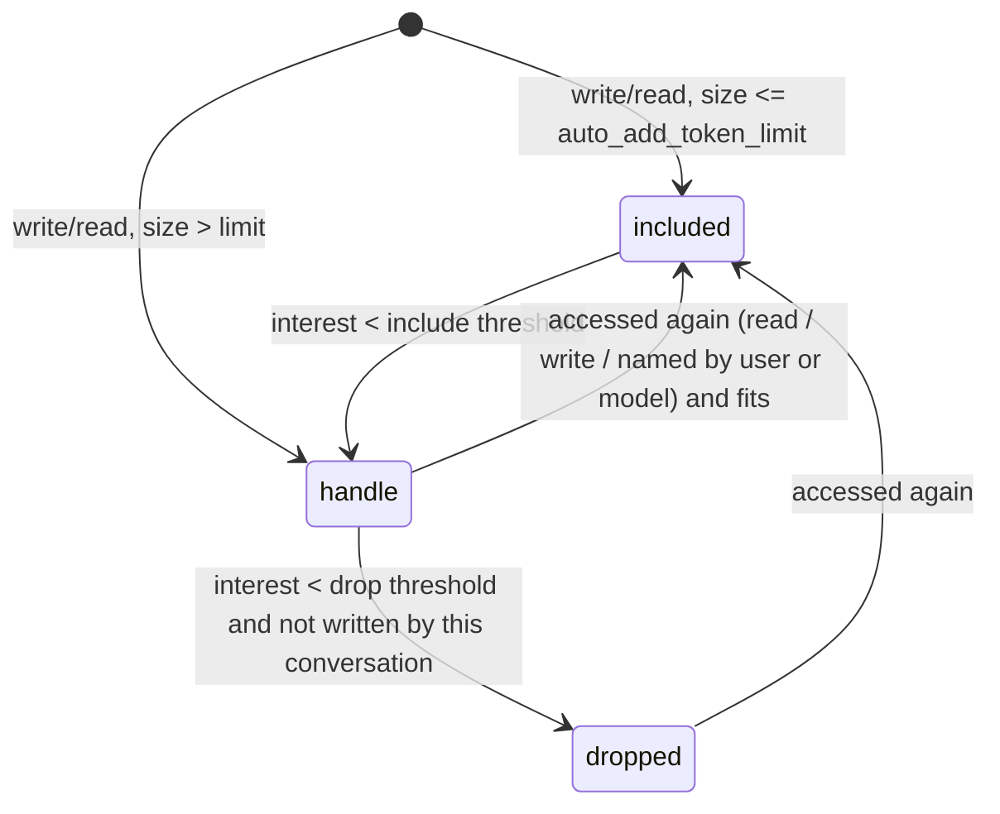

# Automatic context tiers: auto-include, decay, and handles

Status: proposed (2026-09-24). Owner: dcohn.

## Problem

A conversation that writes a file does not know it wrote it. Neither the
apply button (`POST /api/apply-changes` — the request carries no
`conversation_id`) nor the `file_write` tool registers the file with the
conversation's `FileStateManager` or its context. The diff validation hook adds
a file only when a diff *fails*. So the files a conversation changes, which are
the ones it most needs to track, get no change markers, and the README's
"come back months later and the model knows what changed" holds only for files
someone added by hand. Observed 2026-09-24 with `pyproject.toml`.

Longer term, context should edit itself: large or stale elements collapse to
pointers the system can resolve by handle, without the user managing it.

## Principle, and how it fits Design Philosophy

"The user controls context, not the machine" is about **what the user put
there**. This design never touches user-pinned content. It manages only the
content the *system* chose to include, and when it lets go of something it
leaves a **handle, not a summary**: nothing is paraphrased, and the full
content is one tool call away. The user never has to act, but every tier is
visible in the file index.

So three owners, each with its own rules:

| Owner | How it got in | Decays? |
|---|---|---|
| `user` | file tree | Never |
| `model` | `context_add_file` (`_modelAddedFiles`, exists today) | Yes |
| `auto` | the conversation read or wrote it (new, `_autoAddedFiles`) | Yes |

## Tiers

| Tier | In the prompt | Change tracking |
|---|---|---|
| **included** | full content with line annotations | yes |
| **handle** | one line: path, size, last-access turn, "changed since turn N" | yes |
| **dropped** | nothing | no (only after long disuse, and never for files this conversation wrote) |

## Interest score

For each system-owned file, `interest = w_access * decay(turns_since_access)`,
where an access is any of: the file was read or written by a tool, a diff
targeted it, or the user or model named its path in a message.

- `decay(t)` is exponential with a half-life in turns (initial proposal: 6).
- The **include threshold rises with context pressure** (fraction of the
  model's input budget used by the assembled prompt). Low pressure: files
  stay included for a long time. High pressure: the stalest system-owned files
  demote first. This replaces the flat size cutoff as the only lever.
- The size tier from `contextManagement.auto_add_token_limit` (default 12,500
  tokens, already used by `context_add_file`) still decides the *entry* tier.

## Prompt caching

Demotion changes the prompt prefix and invalidates the provider cache from that
point on. So demotions are **batched** and applied only when (a) pressure
crosses a threshold, or (b) at most once every K turns. Promotions (a file
becoming relevant again) take effect immediately, since the model needs them.
The ordering of included system-owned files stays stable between batches.

## Visibility

The file index shows each file's owner and tier (badge: included / tracked /
handle), and hovering shows last-access turn and why it moved. Clicking a
system-owned file pins it, which changes the owner to `user` and exempts it from
decay. No prompts, no confirmations.

## Phases

1. **Write-path registration** (fixes the observed bug). *Implemented
   2026-09-24* (`app/utils/auto_context.py`, `tests/test_auto_context_writes.py`).
   As built: tracked-file state lives on the chat record (`_autoTrackedFiles`:
   pre-write and post-write sha256, size, timestamps), not in
   `FileStateManager`, whose authority message walks every file it holds and
   so could pull a not-in-context file into the prompt. The per-turn notice
   rides with the volatile handoff part on the final user message, keeping it
   out of the cached system prompt. No chat record is created as a side
   effect; a write that can't be attributed to a persisted conversation is not
   recorded. Not yet built: the file-index "tracked" badge, and the CLI diff
   applicator path (it has no conversation id in scope).
   Original plan: The apply request
   sends `conversation_id`; `file_write` receives it through a context var. On a
   successful write: small file → `auto` owner, **included**; large file →
   `auto` owner, **handle**, registered with `FileStateManager` using the
   pre-write content as the baseline. File index shows the tier.
2. **Decay and pressure-driven demotion** for `model` and `auto` files, with
   batching for cache stability, and reads counted as accesses.
3. **Generalize handles** beyond files: large tool results and old turns
   collapse to handles resolvable through the existing chat-history tools.

## Open questions

- Does a read by the model (e.g. `file_read`) auto-include, or only writes?
  Proposal: writes always; reads only in phase 2, as accesses on files already
  tracked, so a `grep` sweep doesn't flood context.
- Does a file this conversation *wrote* ever drop below **handle**? Proposal:
  no — its change tracking is the point.
- Delegates and task cards: same rules, scoped to their own conversation.

## Documentation to update when phase 2 lands

README ("No automatic context compaction") and Design Philosophy ("The User
Controls Context") must say plainly that system-added files are managed
automatically and collapse to handles, while user-pinned content is never
touched and nothing is summarized.
