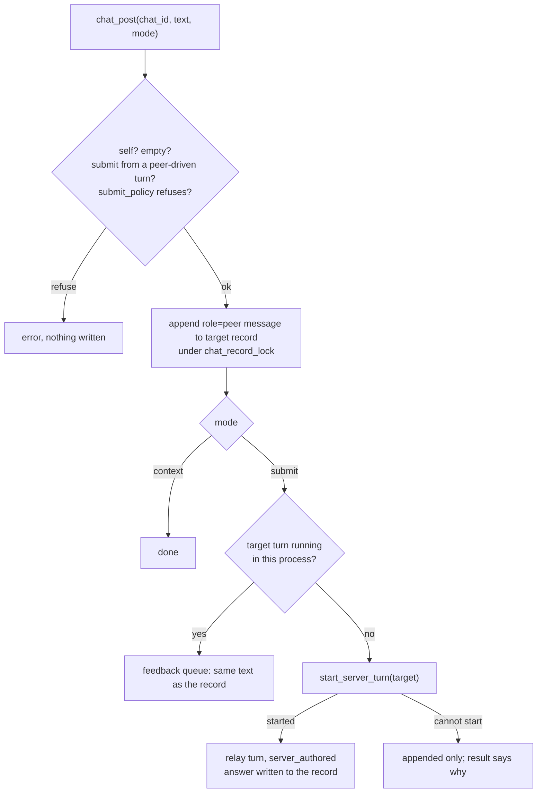
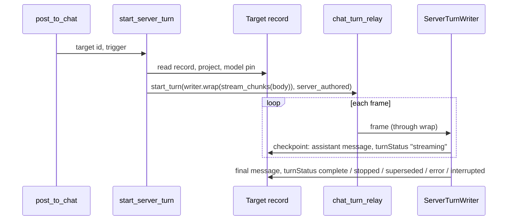

# Conversation post: one conversation writes into another

Status: built 2026-11-15. Slice 1 (post, live feedback): `app/utils/chat_post.py`,
`chat_post` tool, `POST /api/v1/chats/{id}/posts`, transcript row. Slice 2
(server-started turn for an idle target): `app/utils/server_turn.py`,
`server_authored` turns in `app/agents/chat_turn_relay.py`. Open items at the end.

## What it is

A conversation (its model through the `chat_post` tool, or later a user
action) appends one message to another conversation's record. The message
is visible in the target's transcript, marked with where it came from.

| Mode | Target record | Turn |
|---|---|---|
| `context` | message appended | none; read on the target's next turn |
| `submit`, target mid-turn | message appended | delivered into the running turn as live feedback |
| `submit`, target idle | message appended | the server starts a turn there and saves its answer |

## Decisions

1. A post is a **visible message**, not a hidden prelude.
2. `submit` to an idle target is a **server-started turn**. No browser is
   involved in starting, running or saving it.
3. `submit` to a target with a turn running is **live feedback**.
4. Reach is cross-project. A post to self is refused.
5. Loop depth 1: a turn that received a `submit` post cannot itself
   `submit` elsewhere (`context` is still allowed). Tracked in memory by
   relay turn id, so it ends with the turn.
6. Message role **`peer`**.
7. `submit` is **not gated** (2026-11-15). Two hooks exist for later:
   - `chat_post.submit_policy(source, target)` returns a refusal reason or
     None. Rules about who may start work where go there.
   - The tool declares `consent_op_key = "mode"`, so
     `consent.tools.chat_post.ops.submit = "ask"` in `permissions.json`
     puts a submit behind the consent prompt with no code change.

## Shape



## The post message

```json
{ "id": "…", "role": "peer", "timestamp": 0, "_serverAuthored": true,
  "content": "[Ziya: posted from conversation “Title” (ziya://chat/<id>/<idx>) at <time>. …]\n\n<text>",
  "peerPost": { "fromChatId": "…", "fromTitle": "…", "fromProjectId": "…",
                "fromMessageIndex": 0, "link": "ziya://chat/…", "mode": "context", "text": "…" } }
```

- `content` is what the model is sent; `peerPost` is what the transcript renders.
- `_serverAuthored` plus id-merge in bulk-sync: a browser copy can mute the
  message but cannot remove or rewrite it.
- `fold_peer_posts` turns peer entries into human-role text for the model:
  appended to a preceding human entry, else prepended to a following one,
  else a human entry of its own.

## The server-started turn



- **Body from the record** (`body_from_record`): non-muted history, scope
  notes and posts folded as `/api/chat` folds them, the last human-role
  entry as the question, the target project's root, the model pin
  (conversation, then folder, then project). `files` is empty: the file
  selection is browser state. Files the model pinned (`additionalFiles`)
  are merged by the prompt builder as on any turn.
- **No diff-apply hold**: the body sets `hold_for_diff_apply: false`. With
  nobody at the Apply buttons the hold would never end. Diffs in the answer
  can still be applied later from the saved message.
- **No viewer needed**: a `server_authored` turn never arms the disconnect
  grace timer.
- **One writer**: the relay status carries `server_authored`, and the
  browser's `decideReattach` refuses such a turn. A reattach would run the
  send pipeline and save a second copy of the answer. The browser gets the
  server's message through its normal sync.
- **Saved message**: `{role: assistant, _serverAuthored, turnStatus,
  serverTurn: {turnId, kind, messageId}}`. A checkpoint is written at most
  every 5 s and after each tool result. A message the user deletes
  mid-turn is not written again.
- **Assembly** (`TurnAssembler`): text, tool calls as the four-backtick
  `tool:NAME|HEADER|SYNTAX` fence (the form MarkdownRenderer shows as a
  tool block and `tool_history_rewrite` re-encodes for the model), and both
  rewind forms. Tool bodies are cut at 10,000 characters, as the browser's
  formatter does.
- **Clean context**: the turn's task is created in an empty `contextvars`
  context, so the posting turn's project root, conversation id and task
  grants do not reach it.

## Open

- **No live view.** A browser showing the target sees the answer grow only
  as sync pulls each checkpoint, and shows no "running" mark or Stop button
  for it. Sending a message there supersedes the server turn; the partial
  answer is saved as `superseded`.
- **A tool that asks for consent** in a server-started turn waits with no
  prompt on screen until someone opens a surface that shows it.
- **Display-only formatting is not reproduced**: hierarchical search
  results, inline rendered images, parallel-group containers. Those tool
  results are saved as plain blocks.
- **Per-window state is not used**: files checked in a browser window, and
  a tab-only model pin.
- A user-facing "send to conversation…" action (the endpoint exists).
- `reference` mode (pin a `chat` reference instead of appending text).
- Cross-project navigation from the transcript row is untested.
- This is the first server-authored turn path. Moving browser-started turns
  onto it is the rest of "Turn authorship" in
  `design/conversation-single-writer.md`; `design/model-spawned-subthreads.md`
  can now use `start_server_turn` for a child's first turn.
