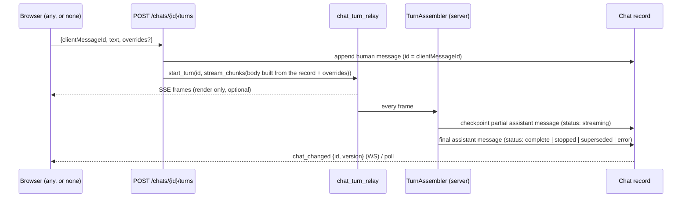

# Conversation State: Single Writer, One-Commit Startup

Status: proposed · 2026-09-20

## The bar

This work is only worth doing if, on **cold load** and on **project switch**:

1. The sidebar is populated **exactly once** with the **full and correct** set
   of conversations for the project (project-local + effectively-global), with
   no intermediate list ever committed to React state.
2. The **landing conversation is chosen once**, by one deterministic rule, and
   its **full message body is present in the same commit** that populates the
   list.
3. Neither (1) nor (2) waits on, or is delayed by, the **file-tree scan**.

Everything below is in service of those three sentences. Phase 0 turns them
into a failing test before anything is changed.

## Why it has been a slog

Not one buggy loader. Five independent loaders commit to the same list, and
four separate places choose the landing conversation, each on its own timing:

| # | Loader / chooser | Where (ChatContext.tsx) | Commits list? | Chooses landing? |
|---|---|---|---|---|
| a | `initializeWithRecovery` — IDB shells (all projects, cursor scan), filtered by a `localStorage` guess at the project id | ~2420–2640 | yes (up to 4×: shells, IDB_REPAIR, GC, lazy body) | yes (`ORPHANED` branch) |
| b | Restore-current-id effect | 246–277 | no | yes |
| c | `PROJECT_CLEAR` layout effect → `setConversations([])` | ~2705 | yes (empties) | – |
| d | `preloadForSwitch` — IDB shells **again**, filtered; hydrates body | ~2895–3010 | yes (2×) | yes |
| e | `syncWithServer` — `listChats`, merge against IDB with guards; refetch on version mismatch | 3033–4084 | yes (several) | yes (section 7) |
| f | `loadFoldersIndependently` — IDB folders then server merge | ~2720–2845 | (folders, 2×) | – |

Count: the sync `useEffect` is **1,236 lines**; **15** `setConversations`
calls lie on the init/switch path; `getConversationShells()` has no
`projectId` index so (a) and (d) both scan every project's records; the
"landing" rule is evaluated with three different input sets (IDB shells,
IDB shells again, server-merged list).

Each fix so far — epochs, `userSelectedConversationRef`, the ten
message-count guards, `hasLoadedConversations`, `isProjectSwitching`,
`RECOVERY_GRACE` — is a guard between two of these loaders. Deleting the
loaders deletes the need for the guards.

The IDB-first "instant paint" is **not** a mitigation of the flicker; it is
its source. The list the user sees first is one that will be revised, and the
landing choice it makes is one that may be reversed.

### Coupling to the file scan

`/api/folders` and the chat list do not share a code path, but they share
three scarce resources at exactly the moment both are hot:

- the browser's per-origin connection pool (HTTP/1.1: 6) — `/api/folders`,
  `/folder-progress` at 1 Hz, mid-scan `fetchFolders` refetches, the two
  `listServerFolders`, `listChats`, `getChat`, `/api/v1/projects/*`;
- the uvicorn event loop — the scan itself is on `to_thread`, but
  `list_summaries` is synchronous file I/O called from a sync handler (fine on
  cache hit, not on a cold project);
- React's render budget — each `/folder-progress` tick that refetches the tree
  runs `convertToTreeData`, and each list commit re-runs `treeDataRaw`.

`ProjectContext` already dispatches `listProjects` *before* anything that could
start the scan, with a comment explaining why. That ordering is the right idea
and is currently enforced by comment only.

## Target design

**The server is the single writer of conversation truth.** It already is for
the CLI, task runs, delegates, and every second window; the browser is the one
client that keeps a competing master. IndexedDB becomes (i) a write-behind
cache used only when the server is unreachable and (ii) an outbox for
optimistic local writes.

```
                    ┌──────────────────────────────────────────┐
  cold load /       │  GET /api/v1/projects/{pid}/bootstrap    │  one round trip
  project switch ──▶│    ?prefer=<tabId>&prefer=<projectSaved> │──────────────┐
                    └──────────────────────────────────────────┘              │
                                                                              ▼
                    { summaries[] (local + global), folders[],
                      landing: { id, reason }, landingChat: Chat (full) }
                                                                              │
                    dispatch({ type: 'BOOTSTRAP', epoch, payload })  ◀────────┘
                                          │
                              ONE React commit: list + folders +
                              selected id + full body, atomically
```

### Landing rule (one place, server-evaluated)

Given `prefer[]` in priority order, the server returns the first candidate
that exists, is `isActive`, and belongs to the project or is effectively
global; else the active chat with the greatest `lastActiveAt`; else `null`
(client mints a blank id). `reason ∈ {tab, project_saved, most_recent, none}`
is returned for the debug log. The client sends:

1. `sessionStorage ZIYA_CURRENT_CONVERSATION_ID` (this tab's current view)
2. `localStorage ZIYA_PROJECT_CONV_<pid>` (what this browser last viewed here)

After bootstrap, only an explicit user action (`loadConversation`,
`startNewChat`) changes the selection. Sync never does. The four current
choosers are deleted.

### Store shape

`conversationStore` — a `useReducer` behind the existing slice contexts, so
consumers do not change:

```ts
type Status = 'idle' | 'loading' | 'ready' | 'offline' | 'error';
interface State { epoch: number; status: Status; projectId?: string;
                  byId: Map<string, Conversation>; order: string[];
                  folders: ConversationFolder[]; currentId: string | null; }

type Action =
  | { type: 'SWITCH_BEGIN'; epoch; projectId }             // status='loading', list cleared
  | { type: 'BOOTSTRAP'; epoch; payload }                  // the one commit
  | { type: 'BOOTSTRAP_FAILED'; epoch; fromCache?: payload } // → 'offline' with IDB snapshot
  | { type: 'SERVER_UPSERT'; epoch; chats: ChatSummary[] | Chat[] } // live/poll updates
  | { type: 'SERVER_DELETE'; epoch; ids }
  | { type: 'LOCAL_APPEND'; convId; message }              // optimistic, outbox
  | { type: 'LOCAL_ACK'; convId; serverVersion }
  | { type: 'STREAM_*' ... }                                // unchanged streaming maps
  | { type: 'SELECT'; id; source: 'user' }
```

Invariants enforced in the reducer, not at 40 call sites:

- An action whose `epoch !== state.epoch` is dropped. This replaces
  `isStale()`, `syncEpochRef`, `serverSyncedForProject`, and the
  `currentProject?.id !== projectId` bail-outs.
- `SERVER_UPSERT` applies iff `incoming._version > existing._version`; a
  summary (no messages) never replaces a record that has messages — it updates
  metadata only. This is the one rule that replaces the ten message-count
  guards, and it is a property of the *data model* (summaries are typed
  without `messages`), not a heuristic on `messages.length`.
- `SELECT` is only ever dispatched from a user action.

### Write path

All mutations already have server endpoints (`add_message`, `update`,
`bulk-sync`, folders). Frontend writes become optimistic `LOCAL_*` actions
appended to an IDB **outbox**; a single drainer posts them and dispatches
`LOCAL_ACK`. The direct `db.saveConversations()` callers (`ChatHistory.tsx`,
`MUIChatHistory.tsx` rename/delete/fork — the documented TOCTOU) go through
the same path. `queueSave`'s 300 ms coalescing survives as the outbox flush
interval.

### Live updates

The project WebSocket that already carries `file_added` / `scan_complete`
gains `chat_changed {id, version}` / `chat_deleted` / `folder_changed`, emitted
by `ChatStorage` writes. The 30 s poll drops to a 60 s reconciliation using the
same `SERVER_UPSERT` action. Cross-tab `BroadcastChannel` merging is deleted:
two tabs are two clients of one server and learn about each other through it.

### Decoupling from the scan

- The bootstrap fetch is issued in `ProjectContext` **before**
  `setCurrentProject` (which is what triggers `FolderContext`'s scan), with
  the result handed to the store. A test asserts request order.
- `bootstrap` runs `list_summaries` + `get_chat` under `asyncio.to_thread`
  so a cold project never occupies the loop while the scan's `to_thread`
  results are queued behind it.
- `/folder-progress` polling and mid-scan refetches are unchanged, but the
  tree rebuild they cause no longer coincides with list commits, because there
  is one list commit and it has already happened.
- Measure: number of in-flight requests at `t = bootstrap dispatch`; target
  ≤ 3 (bootstrap, folders, startup info).

## Phases

Each phase ships on its own and leaves the tree green. Phase 1 alone
satisfies the bar; 2–5 make it stay satisfied.

### Phase 0 — the acceptance test (no product change)

`frontend/src/context/__tests__/startupOneCommit.test.tsx` (jsdom, real
`ChatProvider` + `ProjectProvider`, mocked fetch and IDB with a **fixture of
40 chats across 3 projects, 2 of them global**):

- `commits`: instrument `setConversations` (later: reducer `BOOTSTRAP`) and
  assert exactly **one** non-empty list commit before `status === 'ready'`,
  and that its id set equals the fixture's expected set for the project.
- `landing`: assert `currentConversationId` equals the rule's answer for each
  of the four `reason` cases, and that `messages.length` of that record equals
  the fixture's full count **in the same commit**.
- `scan-independence`: make `/api/folders` hang forever; assert `ready` is
  reached and the timings above hold. Then make it resolve *first*; assert
  the same. Then assert bootstrap was requested before `/api/folders`.
- `switch`: repeat all of the above across `switchProject(A→B→A)`, and assert
  a stale bootstrap for A arriving after `B` began is dropped.

This test must **fail against the current tree** on `commits` (it will see
≥ 3) and on `landing` (body arrives in a later commit). Record the numbers.

Also: a Python seam test for the bootstrap endpoint (Phase 1) against a real
`ChatStorage` in `tmp_path`.

### Phase 1 — bootstrap endpoint + one-commit load

Server (`app/api/chats.py`):
`GET /api/v1/projects/{pid}/bootstrap?prefer=a&prefer=b` →
`{summaries, folders, landing, landingChat}`. Reuses `list_summaries`
(cache-warmed at startup), `collect_global_chat_summaries`, `ChatGroupStorage`,
`get_chat`. Off-loop via `to_thread`.

Frontend:
- `apis/chatApi.ts`: `bootstrapProject(pid, prefer[])`.
- `ChatContext.tsx`: new `useProjectBootstrap(projectId)` replaces **(a) the
  shell/lazy-load portion of `initializeWithRecovery`, (b) the restore-id
  effect, (d) `preloadForSwitch`, and section 7 of (e)**. `PROJECT_CLEAR` (c)
  becomes `SWITCH_BEGIN`. `syncWithServer` keeps only its periodic merge role
  for now.
- `isInitialized`, `isProjectSwitching`, `hasLoadedConversations` become
  derived from `status`.
- IDB is read **only** in `BOOTSTRAP_FAILED`. `db.getConversationShells()`
  gains a `projectId` index so the offline path stops scanning every project.

Deletions in this phase: the two shell scans, the two body hydrations, three
of the four landing choosers, `conversationIdRestored`, `ORPHANED` branch,
`IDB_REPAIR` (server is the repair). Est. −900 lines in `ChatContext.tsx`.

Exit: Phase 0 test green; `startupOneCommit` numbers recorded in CHANGELOG.

### Phase 2 — the reducer

Move list state into `conversationStore` with the action set above. Convert
the 47 `setConversations` sites in `ChatContext.tsx` and 11 files elsewhere
to actions; most streaming sites are mechanical. The epoch check and the
summary-cannot-replace-body rule go into the reducer.

Deletions: `syncEpochRef` and `isStale()`, `serverSyncedForProject`,
`userSelectedConversationRef`, `recentlyFetchedFullIds`, `knownServerIds`,
and the message-count guard table entries that live in `ChatContext.tsx`
(SERVER_SYNC merge, in-memory preservation, lazy-load guard, delegate fetch
guard, shell append guard). Their tests are rewritten as reducer tests:
same assertions, one input surface.

### Phase 3 — write path through the server

Outbox in IDB; drainer; `LOCAL_APPEND`/`LOCAL_ACK`. Route the direct
`db.saveConversations()` callers through it. Then remove `queueSave`'s
"save the whole array" IDB write and the `_isShell` / `_fullMessageCount`
markers (there are no shells in state any more — summaries are typed).

Deletions: the shell-marker guard table (save blocker, fast-path disable,
write guard, flag clearing), `otherProjectConvsCache`, cross-tab IDB dedup
guard, IDB read-before-write guard. `db.ts` shrinks to cache + outbox.

### Phase 4 — live updates (additive only)

`chat_changed {id, version}` over the existing project WebSocket, dispatched
as `SERVER_UPSERT`. This is a **latency improvement for tabs on the same
server**, not a replacement for any existing reconciliation path:

- The 30 s poll is **unchanged**. It is the only path between two browsers
  (or two tabs) attached to *different* servers sharing `~/.ziya`, and that
  is a first-class usage pattern. The WebSocket is per-server and cannot
  carry it.
- The `BroadcastChannel` conversation merge is **kept**, re-routed through
  the reducer as `SERVER_UPSERT` so it obeys the same `_version` rule. Two
  tabs in one browser may point at different backends; the channel is the
  only sub-second path between them. Streaming mirroring and
  `remoteStreamingIdsRef` are untouched.

An earlier draft of this phase deleted the channel merge and lengthened the
poll; both were wrong for the multi-server case and are withdrawn.

### Concurrency invariant (all phases)

Nothing in this plan changes *what* wins a conflict — only *where* the rule
lives. Today `_version`-newer-wins plus summary-never-replaces-body is
implemented at six sites in `ChatContext.tsx` (~926, 945, 3403, 3421, 3550,
3807) and in `bulk_sync_chats` (chats.py:439–474). Phase 2 collapses the
frontend six into one reducer rule with identical semantics; the server rule
is untouched. Phase 0 gains a case: two writers (a second mocked server and a
second tab via `BroadcastChannel`) racing a bootstrap; the record with the
highest `_version` that carries the most messages must win, and a summary
arriving after a body must update metadata only — exactly what the current
guards enforce.

### Phase 5 — scan decoupling hardening

Order assertion test (bootstrap before folders) becomes a permanent seam test;
request-count budget at bootstrap; `list_summaries` cold-path timing logged
so a regression to "blocks the loop" is visible.

## What is deliberately not done

- **No IDB-first paint.** A skeleton for the ~100–300 ms the warmed bootstrap
  takes is the correct experience; a list that will be revised is not.
- **No server-side "current conversation".** Which chat a *tab* is looking at
  is a tab concern; the server only validates candidates.
- **No change to the streaming maps** (`streamedContentMap` etc.) used for
  live rendering. *Correction (2026-09-24):* an earlier draft also excluded
  "how messages are appended mid-stream" on the grounds that it already had
  one owner. It does, but the owner is the browser, which is the largest
  violation of this document's own target. See **Turn authorship** below.
- **Not in scope:** the other flaws from the architecture review (provider
  migration, `StreamingToolExecutor` shape, orchestration engines, prompt
  layout, env-var config) — tracked separately.

## Turn authorship (server-authored turns)

Added 2026-09-24. This is a prerequisite for model-spawned subthreads
(`design/model-spawned-subthreads.md`), but the defect is general.

### The rule

A conversation must exist, run and finish correctly with **no browser
attached, ever**. A client can leave any chat in any state at any time
without affecting it. The server writes every message of a turn; clients
render and request, they do not author.

### What the code does today

| Step of a turn | Who does it | Where |
|---|---|---|
| Choose history, files, system addition, model | Browser, sent in the request body | `/api/chat` reads `messages`, `question`, `files`, `systemPromptAddition`, `modelSelection` from `body` (`app/server.py` ~1303); the stored record is read only to place task-run bindings |
| Save the human message | Browser (IDB, then bulk-sync) | no server write on `/api/chat` |
| Run the turn | Server, as a relay task | `chat_turn_relay.start_turn` |
| Assemble the persisted assistant message: tool blocks (`TOOL_BLOCK_START` markers), rewinds (`REWIND_MARKER`), output-limit continuations | Browser | `frontend/src/apis/chatApi.ts` (~1755, ~2349), `continuationProtocol.ts` |
| Save the assistant message | Browser (IDB, then bulk-sync) | stated in `chat_turn_relay.py`, `chat_turn_status`, `chatTurnReattach.ts` |
| Cancel a turn with no viewer | Server, after 60 s | `_grace_cancel`, `ZIYA_CHAT_TURN_DISCONNECT_GRACE_SECS` |

So "click away" is safe only because the stream reader is tab-scoped
rather than view-scoped. With no tab reading, the turn is cancelled after
60 s. If it does finish, its text lives only in the relay buffer for 5 minutes.
The reattach decision table, the count/content-length regression guards in
`bulk_sync_chats`, and cross-tab mirroring all exist to reconstruct server
truth from a browser that authored it.

### Target



1. **Turn endpoint.** `POST /api/v1/projects/{pid}/chats/{id}/turns`. The
   server appends the human message, keeping the client-supplied id so the
   optimistic copy in the browser is matched rather than duplicated. The
   server then builds the request body **from the record** and starts the
   relay turn. `/api/chat` becomes a thin wrapper over the same function
   during migration.
2. **Prompt from the record.** History (muted turns excluded), `contextIds`,
   `additionalFiles`, `additionalPrompt` and `modelPreference` come from the
   record. Per-window state is sent as **overrides**: files in this window's
   context, and a model pin that differs from the conversation's. The
   multi-window model ("several windows on one conversation, each with its
   own files and provider") needs these. A server-started turn (subthread,
   scheduled, CLI) sends none and gets the conversation's defaults.
3. **Server-side assembly.** A `TurnAssembler` consumes the same frames the
   browser does and produces the persisted assistant message in the existing
   display encoding (tool blocks, rewinds applied, continuations joined).
   The encoding already has server-side readers (`tool_history_rewrite.py`,
   `conversation_exporter.py`, `memory/extractor.py`), so the format is shared,
   not new. Port the logic from `chatApi.ts` and `continuationProtocol.ts`.
   Build a golden test corpus from recorded frame streams and assert the server
   output is identical to what the browser saves today before switching the
   writer.
4. **Checkpoints.** The partial assistant message is written every N chars
   and at every tool boundary, with `status: streaming`. A server crash then
   leaves an inspectable partial turn instead of nothing. This is the same
   policy as `DelegateManager`'s 2000-char flush.
5. **Terminal states are written, not inferred.** Stop, supersede (a new
   message while a turn runs), provider error and server shutdown each write
   the partial message with a terminal status. The frontend's
   "partial message preserved" warning paths become rendering of that status.
6. **No viewerless cancel.** Remove `_grace_cancel` as the default. Runaway
   cost is bounded by the executor's existing iteration and continuation caps,
   not by the presence of a viewer. Keep the env var as an opt-in cost ceiling
   only if a real need appears.
7. **Browser becomes a reader.** It renders the live stream for the view, and
   on `stream_end` it refetches the record (or applies `chat_changed`) and
   replaces its local copy. It no longer saves assistant messages, and no
   longer pushes message arrays it did not author.
8. **Relay retention** is kept for replay only. It stops being "the only copy
   of the answer". `decideReattach` loses its "answer already persisted" and
   "resurrected answer" cases, because the record is truth.

### Decision (2026-09-25): save facts, render at display time

This replaces item 3 ("Server-side assembly", the `TurnAssembler` port) and
the shadow-mode step.

The saved assistant message today is not the model's text. It is the
browser's *presentation* of the turn:
- `mcpFormatter.ts` (1,576 lines) formats each tool result: `$ cmd` headers,
  the 🔐 verified mark, hierarchical results, 10k truncation, syntax hints;
- `chatApi.ts` wraps the result in tool fences or `TOOL_BLOCK` markers and
  applies rewinds and continuations.

Porting that presentation to the server would leave two formatters that
drift apart. Instead:

- **The server saves facts.** An assistant message gains `parts`, in emission
  order: text segments, tool calls (`toolId`, name, args, raw result,
  verified, syntax hint, image ref) and a terminal status. Rewinds and
  continuations are already applied, because the server performed them.
  `stream_chunks` builds the parts as it forwards events; it already sees
  the whole turn.
- **The browser renders parts** through the same formatter it uses today.
  Old messages keep their marker-encoded `content` and render as they do now.
- **Model history is built from parts.** `tool_history_rewrite.py` only
  handles legacy messages.
- `content` is kept as a plain-text projection (text parts only) for readers
  that only want prose: search, memory extraction, export.

#### Constraint: the live streaming experience does not change

- **Live rendering stays as it is.** The browser keeps building the streamed
  string from SSE frames exactly as today. The server-side part building
  is an O(1) append per frame, done after the frame is published to the relay,
  so it adds no latency to the first token or to any delta.
- **No visual jump at stream end.** The tool-block string construction in
  `chatApi.ts` (~2290–2360) is extracted into a pure
  `renderToolPart(part, precedingText)` function. The live path calls it
  per `tool_display` event, and the saved-message renderer calls it per part.
  Before a reload and after it, the message is the same string by
  construction, not by comparison.
- **Id-matched hand-off.** The server announces the assistant message id at
  turn start (a new SSE event). The browser's optimistic message uses that
  id, so replacing it with the server's record at `stream_end` is a
  same-id update. If the rendered string is unchanged, React does not
  re-render the row, so scroll position and highlighting stay put.
- **Checkpoints are off the event loop.** They are written from
  `asyncio.to_thread`, throttled (N chars or each tool boundary, never per
  delta), and coalesced if a write is already in flight.

#### Revision (2026-09-26): save the turn's events, not rebuilt parts

Rebuilding the saved text on the server (the `parts` plan) would mean a
Python copy of `sendPayload`'s content handling in `chatApi.ts`, which
changes the text at 33 sites (rewinds, placeholder splices, hallucination
drops, thinking markers, end-of-turn fence repair). Any drift shows up as a
visual change when the saved copy replaces the live one. Instead:

- **Server** saves the frames that affect the message (content, tool
  start/result, rewinds, continuation rewinds, thinking, errors), in order,
  on the message as `events`, plus `turnStatus`. Hooked at
  `chat_turn_relay._pump`, which already sees every frame. It interprets
  nothing. It also keeps a plain-text projection (text plus tool calls and
  results) for model history, search and export.
- **Browser** renders a saved turn by feeding those events to the same code
  that renders them live.

**How that code is reused: extract a pure reducer, not replay through
`sendPayload`.** Replaying stored frames through the existing reader
(`processSingleDataMessage`, ~1,500 lines) would need every side effect in
it suppressed on load. There are ~100 interleaved with the text handling:
17 `flushStreamedContent`, 11 `removeStreamingConversation`, 5
`addMessageToConversation`, ~15 DOM/window events (task-binding-created,
handoff notices, …), streaming-state setters and toasts. A forgotten one, or
one added later, fires silently when an old conversation is opened (a
duplicate saved message, a re-dispatched binding event). Rejected as fragile.

The extraction instead: `applyStreamEvent(state, event) → { state, effects }`.
Text changes live in `state`; every side effect becomes a typed entry in
`effects`. The live path executes the effects; the saved-message renderer
discards them. A new side effect cannot leak into load, because load never
executes effects. `renderToolPart` stays, called from the reducer. `parts` is
dropped from the TS `Message` type once `events` lands (it is unused).

**Equivalence check:** mock `fetch`, feed recorded frame sequences into the
real `sendPayload`, and capture the saved message plus every dispatched
effect. The reducer, driven over the same frames, must produce the identical
text and the identical ordered effect list. Cases: plain text, tool calls
(including `sequentialthinking`), rewind by marker, continuation rewind,
hallucination drop, thinking, error mid-stream, stop, unclosed-fence repair.
Then planted mutations, each of which must fail the check.

#### Revised steps (replace steps 2–3 of "Where this sits in the phases")

Superseded by the event-log revision above:

1. Extract `applyStreamEvent` with the equivalence check. No behaviour change.
2. Server records events, checkpoints off the loop, writes the final message
   with its end state.
3. Same change as 2: browser renders saved events through the reducer
   (effects discarded), stops saving assistant messages, swaps in the server
   copy by id at stream end.
4. Remove the viewerless 60 s cancel.

Original list, kept for reference:

1. **Built (2026-09-25).** Parts schema (`MessagePart`, `ToolPart`,
   `TurnStatus` in `frontend/src/utils/renderToolPart.ts`; optional on the TS
   `Message`; `parts`/`turnStatus` are id-merge core fields). `renderToolPart`
   extracted from chatApi.ts and checked equal to the verbatim original
   across 95 cases. Not declared on the Python `Message` model: `extra="allow"`
   round-trips them, and a declared field defaulting to None would write
   `"parts": null` into every dumped message. Two notes for step 3:
   - The `sequentialthinking` tool has a specialized `tool_display` handler
     (`mcpToolHandlers.ts`) that runs **before** `renderToolPart`. The saved
     renderer must dispatch through the same handler table.
   - Carried over unchanged from the original: a shell tool whose result
     parses as JSON reaches `displayContent.startsWith('$ ')` on an object and
     throws. It was left as is so the extraction stays exact; fix it
     separately with a test.
2. `stream_chunks` builds parts, announces the message id, checkpoints, and
   writes the final message with its terminal status.
3. In the same change: the browser renders saved parts, stops saving assistant
   messages, and refetches at `stream_end`.
4. Model history from parts; legacy messages go through `tool_history_rewrite`.
5. Remove the viewerless cancel; simplify `decideReattach`.

### Concurrency: merge by message id, not by count

`bulk_sync_chats` overwrites `messages` wholesale when the incoming
`_version` is not older, guarded only by "count may not drop" and "content may
not shrink below a quarter". Once the server appends messages, that allows
silent loss. A browser holding `[… h2]` that never received `a2` adds `h3` and
pushes `[… h2, h3]`. The count is equal to the server's `[… h2, a2]`, the
content-length guard doesn't fire, and `a2` is overwritten.

Required before the server writes turns:

- Messages are merged **by id**. Server-authored messages (assistant,
  checkpoints) are never replaced by a client copy. A client may add messages
  and change metadata, like `muted` and edits to its own human messages.
- Shrinkage (edit-and-resubmit truncation, message delete) goes through an
  explicit endpoint. The existing comment in `bulk_sync_chats` already
  requires this, but **no such endpoint exists** (audited 2026-09-25, below).

**Audit of shrink paths (2026-09-25).** The frontend has three, and all of
them only mutate local state and rely on `bulkSync`:

| User action | Site | What it does locally |
|---|---|---|
| Edit a question, resubmit | `EditSection.handleSubmit` | `messages.slice(0, index + 1)`, edited text |
| Resubmit an earlier question | `Conversation.handleResubmit` | `messages.slice(0, actualIndex + 1)` |
| Delete a muted message / discard an unanswered question | `Conversation.handleDiscard` | `messages.filter(i !== actualIndex)` |

The server has no message delete or truncate route (`app/api/chats.py`
routes: chat DELETE, chat PUT for metadata, `POST …/messages` append,
bulk-sync). `bulk_sync_chats` blocks any push that lowers the count and
**keeps the old messages while accepting the incoming `_version`**.
Reproduced against the real router with the `tests/test_api_chats.py`
fixtures:

- **Delete:** local `[m0 m1 m2 m4 m5]`, disk stays `[m0 … m5]` forever.
- **Edit earlier question:** local `[m0' m9]`, disk stays `[m0 … m5]`, with
  the pre-edit text, until the local copy grows back to 6 messages. At that
  point the whole array replaces the disk copy in one push.
- In both cases the disk record carries the newer `_version`, so the
  browser's pull sees nothing newer and never corrects itself. The browser
  and the server disagree without either one noticing.

Every server-side reader of the record sees the phantom history: another
browser, a reload with a cleared cache, `chat_search`/`chat_read`, handoff
preludes, memory extraction, export, task-binding placement, and the
subthread frozen prefix. The prompt is unaffected today only because the
browser sends history in the request body.

So the explicit endpoints are a prerequisite of id-merge, not a follow-up:
`POST …/chats/{id}/truncate {afterMessageId}` and
`DELETE …/chats/{id}/messages/{messageId}`. Once they exist, the three sites
call them, and bulk-sync can merge by id with no shrink path at all.
- `ChatStorage.add_message` is a read-modify-write with no lock. Two servers
  share `~/.ziya` (a supported mode), so appends need the same file lock the
  task-run store uses, or they can interleave.

### Where this sits in the phases

Between Phase 1 and Phase 3. Phase 3's outbox then carries only what the
browser genuinely authors: human messages, renames, mutes, folder moves.
It no longer carries whole message arrays. Suggested order:

1. **Built (2026-09-25).** Explicit `rewind` (an intent, not a public
   `truncate`, so it extends into the turn endpoint), message `DELETE` and
   message `PATCH` endpoints. The three shrink sites plus in-place edit now
   call them, and `bulk_sync_chats` merges by id (`app/utils/chat_message_ops.py`)
   with tombstones and a flock. Together these fix both the lost-answer race and
   the silently unpersisted edits/deletes. Remaining gap until step 3:
   resubmit is rewind-then-send from the browser, so the two are not atomic.
2. `TurnAssembler` plus the golden corpus, run in **shadow mode**: assemble and
   compare against what the browser saves, log diffs, write nothing.
3. Turn endpoint and prompt-from-record with overrides. Server writes human
   and assistant messages. Browser save of assistant messages is removed in the
   same change, so there is never a period with two writers.
4. Remove viewerless cancel, and simplify `decideReattach`.

### Tests

- A turn started via the endpoint with **no subscriber at any point**
  finishes, and the record holds the human and assistant messages.
  Positive control: the same turn with a subscriber produces an identical
  record.
- A subscriber that connects and disconnects mid-turn does not cancel it.
- Stop mid-turn: the record holds a partial assistant message with `stopped`.
- Kill the server mid-turn: the record holds the last checkpoint with
  `streaming`, and startup reconciliation marks it `interrupted`.
- The race above: a stale client push after a server append leaves the
  server's assistant message in place. This must fail against the current
  `bulk_sync_chats`.
- Golden corpus: the server-assembled message equals the browser-assembled
  message for each recorded stream (tool calls, rewinds, continuations,
  errors).

## Risks

| Risk | Mitigation |
|---|---|
| Bootstrap slow on a cold project (cache not yet warmed) | `startup_warmup` already warms every project at boot; endpoint is off-loop; measure and log. If a project exceeds 1 s cold, return `summaries` + `landing` first and stream `landingChat` as a second action — still a single *list* commit. |
| Global conversations from other projects missing from bootstrap | Reuse the exact helper `list_chats` uses; the Phase 0 fixture has globals and asserts them. |
| Ephemeral mode | `BOOTSTRAP` is skipped; store starts `ready` with an empty list. Covered by an existing-behaviour test. |
| Consumers reading `_isShell` | grep shows they are confined to `ChatContext.tsx` / `db.ts`; removed in Phase 3. |
| Tests coupled to the old loaders (`recoveryGraceStampWiring`, `remoteStreamingSyncGate`, `heldMessageRecoveryWiring`, guard tests) | Each follows the change into a reducer test or is deleted with the code it asserted; none is marked xfail. |

## Files

Server: `app/api/chats.py` (+bootstrap), `app/storage/chats.py` (landing
helper), `app/server.py`/WS broadcaster (Phase 4).
Frontend: `context/ChatContext.tsx`, new `context/conversationStore.ts`,
`apis/chatApi.ts`, `utils/db.ts`, `ProjectContext.tsx` (fetch ordering),
`ChatHistory.tsx` / `MUIChatHistory.tsx` (write path).
Docs: `Docs/ArchitectureOverview.md` — the "Conversation Shell Loading",
"Message Count Regression Guards", and "Direct IDB Writers" sections are
replaced by a short "Conversation store" section; CHANGELOG Unreleased.
