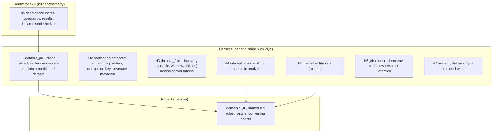

# Making data reuse endemic: harness-side changes requested from the Ziya implementation

Origin: netscan project, 2026-11-02 review of two weeks of ClickHouse-backed investigations
(conversations "Loss census — daily" and forks, "Gate Metric Target Plan", "for anand/james",
"whats up with ks300", "LEB testers 01:15-01:30PDT", "brewster backup beam partial loss").
Audience: Ziya harness maintainers. Companion documents:
- `kuiper_telemetry_connector_guidance.md` (same directory): requests to the connector-skill authors.
- `.ziya/netscan/lc/` (project): what stays local.

## 1. The failure mode, measured

The harness instructions already say "rows belong in a dataset, compute with `analyze`, never snapshot-copy".
In practice the model produced 16 standalone pandas scripts in one day, because the ad-hoc path
(`q(sql, nocache=True)` -> CSV -> pandas) is shorter than the sanctioned path. Evidence from this project:

| Symptom | Measurement |
|---|---|
| Query cache written but never read | 12/16 scripts pass `nocache=True`; the connector still writes the result. 231 files / 6.2 GB written today into the *nightly run's* cache dir; ~110 GB of dead JSON across `lc/runs/*/cache` and `runs/*/cache`. |
| Same raw pull repeated across conversations | Key-ID 4-s bins for 10/29 pulled by jobs `4s P90 tunnel loss 10/29` (722 s, 5.9 GB RSS), `keyid 4s bins 10/30` (690 s), then `anand 7 PT days` (1314 s, 6.5 GB) covering the same days again, then a 3-hour extension. `SDN_full_path_xform` pulled 4 times over overlapping windows (60 + 30 + 6 + 0.4 MB CSVs). |
| Nothing lets a new conversation discover an existing pull | `dataset_list(all_conversations=True)` returns name/rows/columns, not *coverage* (table, time range, entity set). Prior results were found by `chat_search` on file names. |
| Same join re-implemented with divergent rules | bin -> contact-leg interval join written 5 times (`searchsorted(legs.s, w*1000) … w < e`) with 3 different leg-selection rules. An accuracy hazard, not just duplication. |
| Config recovered by parsing source text | 6 scripts obtain a CT roster via `open("anand_loss7d.py").read().split("LEB = [")`. |
| Retry loop copy-pasted | `for i in range(3): try q(...) except: sleep` in 10 scripts plus a variant in `keyid._q`. |
| Interpreter environment leak | 15 scripts begin with `sys.path[:] = [p for p in sys.path if ".toolbox/tools/ziya" not in p]` because the job runner leaks Ziya's py3.13 venv into the subprocess; several jobs in the history exited 1 on first try for this reason. |
| Memory-bound pandas | 5-6.5 GB RSS for group-bys over ~10 M rows that DuckDB does in <1 s. Every script re-reads a 76 MB parquet + 21 MB CSV and runs `pd.to_numeric` on every column to answer a question about 18 CTs x 12 h. |

Root cause: an **affordance gap**. The instruction exists; the primitive does not. Each item below closes one gap so
that the sanctioned path is also the shortest path.

## 2. What belongs where



Of the seven improvements proposed for netscan, **five are harness-shaped** (H1-H6), **one is connector-shaped**
(dead cache writes, result format, settle horizon), and **one is unavoidably local** (domain SQL and leg-selection
rules). The local `lc/data.py` I would otherwise write is ~200 lines re-implementing H1-H4 for one project; that is
the signal it belongs upstream.

## 3. Requested harness changes

### H1. `dataset_pull`: one primitive for "loop over slices, retry, concat"

```
dataset_pull(connector="clickhouse", sql_template=..., t0, t1, step="15min",
             params={cts: "@brewster_noncanary"}, partition_by="utc_day", key=["tiid","w"],
             settle=None, name=..., retries=3)
```

- Slices `[t0,t1)` by `step`, substitutes `{T0}`/`{T1}`/params, runs each slice through the connector with one
  retry/backoff policy, appends to a partitioned dataset (H2).
- **Settledness**: a slice whose end is older than `settle` is immutable and may be cached; a younger slice is always
  re-queried. This is the correct replacement for blanket `nocache=True` and never freezes partial data. `settle`
  defaults to the connector's declared horizon; an undeclared connector is treated as never-settled (today's
  behaviour), so this ships safely before connectors catch up.
- Runs as a managed job when the slice count is large; returns the dataset id at once so the conversation can
  `job_wait`. Records each slice as an evidence-ledger observation (query text, row hash) automatically.
- Per-slice progress goes to the job journal (the `log(...)` every script reinvents).

### H2. Partitioned, keyed datasets

`dataset_register` today treats a dataset as one file. Needed:
- `dataset_append(id, rows_or_path, partition=...)` with **dedupe on key**, so re-pulling an overlapping window is a
  no-op rather than a double count.
- Parquet partitioned by the declared column (UTC day is the right default for telemetry).
- `dataset_describe` reports **coverage**: time min/max per partition, distinct entities, producing SQL template and
  params, settle horizon used, which partitions are still "young".
- `dataset_missing(id, t0, t1, entities)` -> the (partition, entity) pairs not present. "Pull 7 days" becomes "pull the
  3 hours and 1 CT that are new".

### H3. Discovery across conversations

`dataset_find(table=..., window=[t0,t1], entities=[...])` over the project catalog, ranked by coverage overlap. With
H2 metadata this is a filter. The "Working with data" prompt section should then say: *before any pull, call
`dataset_find`*.

### H4. `interval_join` and `asof_join` macros in `analyze`

The `intervals_*` macros are interval-vs-interval. Telemetry needs point-vs-interval: "which contact leg (sat, spot,
rx_modem) was active for this CT at this 4-s bin".

```
interval_join(points, intervals, 'entity', 'ts', 'start', 'end', priority := 'col')
```
Left-join each point to the containing interval (`start <= ts < end`) per entity; when several contain it, pick by
`priority` and report `n_matches` so ambiguity is visible. `asof_join` for "latest state at or before ts" (software
version, config epoch). These replace five `searchsorted` implementations and put the rule in the SQL where a
reviewer sees it.

### H5. Named entity sets

Rosters are reused for weeks and live in `.py` literals, CSVs and chat history. `entity_set_save(name, ids,
kind="tiid", note=...)`, `entity_set_get(name)`, versioned, listed by `dataset_list`; `dataset_pull` params and
`dataset_find` accept `@name`.

### H6. Job runner and cache hygiene

- **Environment**: launch jobs with a clean interpreter environment (no Ziya venv / `PYTHONPATH` inheritance) by
  default; opt-in to inherit.
- **Cache ownership**: distinguish *run* caches (owned by a nightly profile, kept) from *ad-hoc* caches (owned by a
  conversation, purgeable). Set a per-conversation cache env var for spawned processes; own retention (size cap, age,
  `ziya cache prune`).
- **Visibility**: a `cache_status` tool (or `job_status` field) showing cache size per owner, so 110 GB of dead JSON
  is noticed before `df` is.

### H7. Advisory lint on scripts the model writes

Every anti-pattern above was written while the instruction forbidding it was in the prompt. A string check at
`file_write`/`job_start` for `.py` content, surfaced as a one-line hint, not a block:
- `nocache=True` inside a time-slice loop -> "use dataset_pull with settle=".
- `open(*.py).read().split(` -> "config parsed from source; use entity_set".
- `for i in range(3): try: q(` -> "dataset_pull has the retry".
- `pd.read_parquet(f)` then `.isin(` -> "filter in analyze, not after load".
- `.groupby(...).apply(lambda` -> "analyze does this in SQL".
- `sys.path[:] = [p for p in sys.path if` -> flags H6 until fixed.

### H8. A versioned data-sink protocol that connector skills can target without depending on Ziya

Connector skills (kuiper-telemetry is one; it ships in the Kuiper AI capabilities package and is used from other
harnesses) cannot import Ziya. For H1-H3 to reach them, the harness must publish a minimal protocol rather than an
API:

- **Discovery**: set `ZIYA_DATA_SINK=<version>:<module or endpoint>` in the environment of every process Ziya spawns
  (shell tool, jobs, Task Card lanes). A skill that finds it unset falls back to its own local sink; nothing breaks.
- **Interface** (version 1, deliberately small): `append(partition, arrow_table_or_parquet_path, key=[...])` with
  dedupe on key; `coverage() -> {partition: {t_min, t_max, entities, n}}`; `missing(t0, t1, entities) -> [(partition,
  entity)]`; optional `observe(query_text, result_hash)` for the evidence ledger. Everything else (naming, discovery,
  `dataset_find`) is harness-internal.
- **Capabilities the other way**: `dataset_pull` (H1) should probe the connector for `--capabilities` and delegate
  slicing/settledness to it when advertised, otherwise slice itself. That keeps one source of truth for settle
  horizons (the connector knows its data) while letting a connector that has not caught up still work.
- **Stability**: version the protocol, publish it as a one-page spec plus a stub module other harnesses can vendor, so
  "works with Ziya" never means "requires Ziya".

## 4. What stays local (netscan)

- Key-ID `MAIN` SQL and panel-112 rules; a `grain=` parameter on `keyid.pull()` instead of `str.replace` on SQL.
- The three leg-selection rules, named, as `interval_join` priority arguments.
- Rosters as entity sets; conversion of the 16 scripts.
- Settle horizon per table (needs data owners' answer on backfill).

## 5. Acceptance criteria

1. A new conversation asking for "Brewster UL loss for 10/29" finds the existing 4-s bins via `dataset_find` and pulls
   zero new slices for settled days.
2. Re-running a crashed pull re-queries only the unsettled tail.
3. No cache file is written for `nocache` queries; cache size per owner is visible.
4. `job_start` of a plain `python3 script.py` needs no `sys.path` scrub.
5. The bin -> leg join exists once, as an `analyze` macro, and each caller names its priority rule.
6. The kuiper-telemetry skill's verification suite passes identically with `ZIYA_DATA_SINK` unset and with the Ziya
   sink present; under Ziya the pulled slices additionally appear in `dataset_find` and the evidence ledger.
