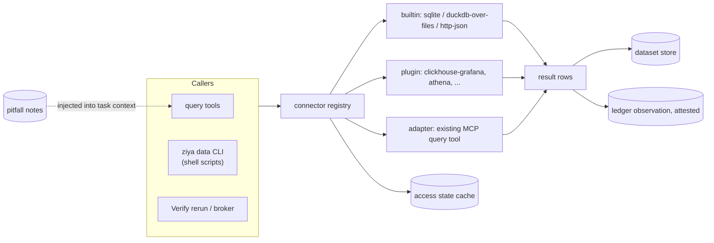

# Data-Source Connectors and Pitfall Notes (research harness, item 3 of 7)

Status: **accepted (decisions at end), not implemented** · Owner: maintainers · Depends on: `design/evidence-ledger.md`
(observations) · Related: `design/dataset-store.md`, `design/typed-findings.md`.
Built on by: query broker (item 5), Verify block `rerun` (item 6).

## Problem

In the reference investigation run, about 40 minutes went to finding out which
data sources worked before any analysis started, and what was learned lived
in hand-written files:

- **Access by trial.** The warehouse's restricted namespaces, a second
  store and a cross-account role were each tried by hand and denied.
  ClickHouse through the Grafana proxy worked only by copying the SSO cookie
  into a Grafana session.
- **A one-off client.** `.ziya/<run>/ch.py` re-implemented login refresh,
  retries, caching and result shaping. Every stage called it through the
  shell, so the harness saw only stdout.
- **Pitfalls in prose.** Duplicate funnel rows (dedupe with `argMax`), a
  `report_ts_ms` column that is zero on ~99.9% of rows, non-equi
  `LEFT JOIN ... ON` conditions ignored, aggregate-alias reuse rejected,
  `start_time_unix_ms` needing datetime literals, placeholder rows: all were
  written into the run's brief files by hand, and the brief was itself
  wrong once (it recommended `report_ts_ms`). A later investigation on the same
  tables would start from nothing.
- **No denied-source memory.** Nothing recorded that the cross-account role
  was denied, so phase 2 would have re-tried it without the brief.

## Goals

1. A data source is registered once per user or project: how to authenticate,
   how to list and describe tables, how to run a query.
2. Queries through a connector are recorded in the evidence ledger as
   **attested** observations automatically: the server holds the result bytes
   and hashes them.
3. Known pitfalls are structured notes attached to a source, table or column,
   added during work, reviewed like memory proposals, and shown automatically
   whenever a task uses that source.
4. Access state (works / denied / expired) is cached and shown, so nothing
   re-tries a denied source by accident.
5. Shell scripts get the same connector through a CLI, so analysis scripts no
   longer need their own client.

## Non-goals

- **A query language.** Each connector speaks its source's native query
  language (SQL dialect, PromQL, etc.).
- **Rate limiting and cross-lane deduplication.** That is the query broker
  (item 5). This spec defines the connector call the broker will wrap.
- **Shipping site-specific connectors in core.** Core ships the interface and
  generic connectors. A site's ClickHouse-via-Grafana connector belongs in a
  closed plugin.
- **Replacing MCP.** MCP tools stay as they are. An adapter lets an existing
  MCP query tool act as a connector (see *Connector kinds*).

## Overview



## Connector interface

A new ABC in `app/plugins/interfaces.py`, registered with
`register_data_source_provider()` in `app/plugins/__init__.py`, following the
existing provider pattern.

```python
class DataSourceProvider(ABC):
    source_id: str            # "clickhouse-warehouse-prod"
    kind: str                 # "clickhouse", "sqlite", "http-json", "mcp-adapter", ...
    dialect: str              # "clickhouse-sql", "sqlite", ...
    volatile: bool            # live data (results may change on rerun)

    async def check_access(self) -> AccessState: ...
    async def list_tables(self, pattern: str | None = None) -> list[TableInfo]: ...
    async def describe(self, table: str) -> TableSchema: ...
    async def query(self, text: str, params: dict, limits: QueryLimits) -> QueryResult: ...
    def source_pitfalls(self) -> list[PitfallNote]: ...   # shipped with the connector, may be []
```

| Type | Fields |
|---|---|
| `AccessState` | `status` (`ok`, `denied`, `expired`, `unreachable`, `unknown`), `detail`, `checked_at`, `remedy` (e.g. "re-run the SSO login") |
| `TableInfo` | `name`, `row_estimate?`, `freshness?` (max timestamp seen), `description?` |
| `TableSchema` | `columns[]` (`name`, `type`, `description?`), `time_column?`, `partition_keys[]` |
| `QueryLimits` | `max_rows` (default 200k), `max_bytes` (default 256 MB), `timeout_s` (default 300) |
| `QueryResult` | `columns`, `rows` (iterator), `row_count`, `truncated`, `source_query_id?`, `as_of` |

Credentials are the provider's business. A plugin connector uses whatever its
environment provides (SSO cookie, cloud profile); core connectors take a
reference to an environment variable or keychain item, never an inline
secret in config.

## Connector kinds

| Kind | Ships in | Notes |
|---|---|---|
| `sqlite` | core | Read-only open (`mode=ro`). |
| `duckdb-files` | core code, `duckdb` from the optional `data` extra | SQL over project CSV / Parquet / JSONL under readable prefixes. Also how evidence files are re-queried. Without `duckdb` installed the kind is registered but reports `unavailable: install ziya[data]`. |
| `http-json` | core | GET/POST to a configured base URL returning JSON rows; for simple internal APIs. |
| `mcp-adapter` | core | Wraps an existing MCP tool that takes a query and returns rows. Configured with the tool name, argument mapping and a result path. Results pass through the same attestation path. |
| `clickhouse-grafana`, `athena`, ... | plugins | Site-specific auth and transport. The reference run's `ch.py` becomes one of these. |

## Configuration

Project file `.ziya/datasources.yaml` (user-level `~/.ziya/datasources.yaml`
merged underneath; project wins by `source_id`):

```yaml
sources:
  - id: warehouse-ch
    kind: clickhouse-grafana          # provided by a plugin
    options:
      grafana_url: https://grafana.example.internal
      datasource_uid: ae25ae06-6b08-4047-865c-328a2a4d67a1
    volatile: true
    allow_tables: ["*"]
    deny_tables: ["*-local"]
  - id: evidence
    kind: duckdb-files
    options: {roots: [".ziya/audit/evidence"]}
```

- A source referenced but not defined, or whose `kind` has no registered
  provider, shows as `unavailable` with the reason; it is not an error at
  startup.
- `allow_tables` / `deny_tables` are glob filters applied before any query
  reaches the provider (tables are extracted with a dialect-aware parser
  where one exists; otherwise the filter is advisory and the source is
  marked `table_filter: advisory`).

## Read-only by default

Connectors are for analysis. Every connector declares `read_only: true`
unless its config sets `allow_writes: true`, which requires a signed scope
grant like other escalations. For SQL sources the core rejects statements
that are not `SELECT` / `WITH … SELECT` / `DESCRIBE` / `SHOW` / `EXPLAIN`
before dispatch, using the dialect parser; the provider must also enforce
read-only at its own layer (e.g. a read-only DB role). The core check is a
guard, not the security boundary.

## Results

- **Small results** (≤ 2,000 rows and ≤ 256 KB) are returned inline to the
  caller.
- **Larger results** are registered in the dataset store and the caller gets
  a `describe` plus the `ds_…` id, never the rows. This keeps a 200k-row
  result out of the model's context, which `ch.py` printing to stdout did not.
- **Every result** produces a ledger observation: `source: sql`, the query
  text, connector id, `as_of`, `volatile`, row/column counts, and the SHA-256
  of the canonical result (rows serialised as JSONL in column order). The
  server computed the hash from bytes it received, so it is `attested: true`.
- **Caching** is the query broker's job (`design/query-broker.md`): one
  user-level cache keyed by source fingerprint. Connectors never cache.

## Tools (builtin category `data`)

| Tool | Purpose |
|---|---|
| `data_sources` | List sources with access state, kind, volatile flag and pitfall count. `refresh: true` re-runs `check_access`. |
| `data_describe` | Tables (with optional pattern) or one table's schema, **plus its pitfall notes**. |
| `data_query` | Run a query on a source. Returns inline rows or a dataset id, the `obs_id`, and any pitfall notes matching tables or columns in the query. |
| `data_note` | Propose a pitfall note (see below). |

`data_query` on a source whose cached state is `denied` refuses without
calling the provider, and says when access was last checked and how to
re-check. This is what stops a lane from re-trying the cross-account role.

## Pitfall notes

A note is a small, structured fact about a source that changes how queries
must be written or read.

| Field | Meaning |
|---|---|
| `id` | `pf_` + 12 hex |
| `source_id` | required |
| `target` | `source`, `table:<name>`, `column:<table>.<column>`, or `pattern:<glob>` (e.g. `table:*-local`) |
| `kind` | `dedupe`, `unit`, `semantics`, `null_or_zero`, `dialect`, `access`, `coverage`, `freshness`, `artifact` |
| `text` | One or two sentences, imperative where possible: "Rows are duplicated per key; dedupe with `argMax(metric_aggregate_value, last_updated)` grouped by (metric_context_key, metric_name)." |
| `evidence` | Optional ledger claim or observation id that demonstrates it (e.g. the query showing `report_ts_ms` is 0 on 99.9% of rows) |
| `status` | `proposed`, `accepted`, `retired` |
| `created_by`, `created_at`, `retired_reason?` | |

**Lifecycle.**

- `data_note` creates a `proposed` note. Proposals use the existing proposal
  store and review UI (`app/storage/proposals.py`), so pitfall proposals sit
  beside memory proposals and are approved or dismissed the same way.
- A note with an `evidence` reference to an attested observation can be
  auto-accepted when the project sets `pitfalls.auto_accept_with_evidence:
  true`. Default: off.
- Notes are retired, never deleted, with a reason. The brief's wrong advice
  about `report_ts_ms` is exactly the case: the note gets retired and replaced, and
  both stay visible in history.
- Connector-shipped notes (`source_pitfalls()`) appear as `accepted`,
  attributed to the connector, and cannot be edited, only overridden by a
  project note that retires them.

**Scope: user-level, annotated by origin.** A pitfall is a fact about a data
source, not about a project, and the same warehouse is queried from many
projects. Notes therefore live at user level and follow the user:

- **Storage.** `~/.ziya/datasources/pitfalls.jsonl` (`get_ziya_home()`;
  append-only; status changes are new lines; latest wins). Writable only
  through the server, like the ledger. Proposals go through the existing
  proposal store, which is already user-level (`~/.ziya/memory`).
- **Origin on every note.** `origin: {project_id, project_root,
  conversation_id?, run_id?, block_id?}`, recorded by the server from the
  calling context (never supplied by the model). This is what lets notes,
  and later the data, skills and references built on them, be filtered or
  extracted per project without one project's material leaking into
  another's export: `ziya data notes --origin <project>` and
  `data_describe(..., origin="this_project")`.
- **Attached to the source's identity, not its name.** Two projects may both
  call a source `prod`. Each source has a `fingerprint`: SHA-256 of `kind`
  plus its identifying options (declared by the provider, e.g. `grafana_url`
  + `datasource_uid`; never credentials). Notes attach to the fingerprint
  and record the `source_id` they were written under as a label. A note
  written in project A applies in project B only if B's source has the same
  fingerprint.
- **Default visibility.** Accepted notes for a matching fingerprint are shown
  in every project. Each shown note carries its origin project name, so a
  task can see that a note came from elsewhere. A project can opt out of
  foreign notes with `pitfalls.include_other_projects: false`.
- **Retiring a note** is user-level too, and records which project retired
  it.

**Access state** moves to the same place and key:
`~/.ziya/datasources/access.json`, per fingerprint (and per table or
namespace within it). Access depends on the user's credentials, not on the
project, so a namespace denied in one project is denied in all of them.

**Where notes are shown.**

1. **`data_describe` and `data_query` results**, filtered to the tables and
   columns involved. Query-time matching uses table names extracted by the
   dialect parser; if parsing fails, all table-level notes for the source are
   shown.
2. **Task Card prompts.** A Task whose scope or instructions name a source
   (`scope.data_sources: ["warehouse-ch"]`, or a State block's
   `data_sources`) gets a *Data source notes* section listing accepted notes
   for that source, capped at 1,500 tokens, most-specific first (column, then
   table, then source). Over the cap, the section lists the remaining notes'
   targets so the task can call `data_describe`.
3. **Chat.** Notes appear in the result of the query tool calls; nothing is
   injected into ordinary chat turns.

This replaces the "known pitfalls" and "verified live tables" sections of a
hand-written brief. The brief keeps the mission and rubric.

## Access state

- `check_access` runs on first use per process, on `refresh`, and when a
  query fails with an auth-class error. Results are stored per source
  fingerprint in `~/.ziya/datasources/access.json` with `checked_at` (see
  *Pitfall notes → Scope*).
- `denied` and `expired` are distinguished: `expired` (e.g. an expired
  SSO cookie or cloud token) includes a `remedy`, and a later query re-checks
  automatically; `denied` (authorization) is sticky until `refresh`.
- Table-level denial is recorded too: when a query fails with a
  not-authorized error naming a table or namespace, that target is marked
  `denied` and `data_query` refuses later queries that touch it. The
  reference run's case (restricted namespaces denied for the analyst role,
  the canary namespace allowed) is per-namespace, not per-source.

## Shell CLI

So scripts stop carrying their own clients:

```bash
ziya data query warehouse-ch --file sql/rca1/t_path.sql --param T0="2026-03-01 09:00:00" \
     --out evidence/rca1/path24_h00.csv          # also prints obs_id on stderr
ziya data sources
ziya data describe warehouse-ch route_table
```

and a stdlib-only Python helper (`from ziya_data import query`) that posts to
the running server, using the `ZIYA_LEDGER_URL` / `ZIYA_LEDGER_SCOPE`
environment the ledger spec already injects into shell children. A query
from a script is therefore attributed to the calling Task block, and its
observation is attested, which `ch.py` output never was.

`--out` writes only under paths the caller's write policy allows; the server
performs the write and records the file's hash on the observation.

## Migration of the reference run's helpers

| Today | After |
|---|---|
| `.ziya/<run>/ch.py` (login, retry, cache) | `clickhouse-grafana` plugin connector |
| brief "Data access" table | `data_sources` + `data_describe` output |
| brief "Known pitfalls" and follow-up constraints about ClickHouse | ~12 pitfall notes on `warehouse-ch` (seeded by an importer) |
| "Denied (do not waste time)" list | `access.json` per-namespace `denied` |
| `sql/verify/run_any.py` hour slicing | still a script in v1; becomes broker time-slicing (item 5) |

Shell-policy lessons in the follow-up brief (`nohup`, `pkill`, `open(…,'w')`) are not
data-source pitfalls; they belong to the job runner (item 4).

## Security

- Connector configs hold no secrets; providers obtain credentials from the
  environment, a keychain reference or an enterprise auth provider.
- Read-only guard in core plus read-only enforcement required at the provider.
- Query text and results are untrusted data. Results are returned inside the
  normal tool-result envelope; text columns from external sources are marked
  `trust: low` exactly like web content.
- Pitfall notes are model-proposable but enter prompts only once accepted,
  because they are injected into future task prompts and would otherwise be a
  prompt-injection path from a malicious result row into later runs.
- Size caps on inline results, dataset ingest (dataset store's 500k-row cap)
  and observation inline payloads (ledger's 64 KB).
- `allow_tables` / `deny_tables` give projects a way to keep a broad
  credential pointed at only the tables an investigation needs.

## Implementation plan

| Step | Change | Files |
|---|---|---|
| 1 | `DataSourceProvider` ABC and value types; `register_data_source_provider` | `app/plugins/interfaces.py`, `app/plugins/__init__.py` |
| 2 | Registry, config loading/merging, access-state cache | new `app/datasources/registry.py`, `app/datasources/access.py` |
| 3 | Read-only guard and table extraction (`sqlglot` from the `data` extra if installed, else conservative regex + `table_filter: advisory`) | new `app/datasources/sql_guard.py`; `pyproject.toml`: `data = ["duckdb", "sqlglot"]` under `[tool.poetry.extras]`, added to `all` |
| 4 | Result handling: inline vs dataset, canonical hashing, cache | new `app/datasources/results.py`; uses `app/storage/datasets` and the ledger store |
| 5 | Core connectors: `sqlite`, `duckdb-files`, `http-json`, `mcp-adapter` | new `app/datasources/builtin/*.py` |
| 6 | User-level pitfall store with origin annotation, source fingerprints, proposal integration, matching, `--origin` filter | new `app/datasources/pitfalls.py`, `app/datasources/fingerprint.py`; `app/storage/proposals.py` |
| 7 | Tools `data_sources` / `data_describe` / `data_query` / `data_note` | new `app/mcp/tools/data_tools.py`, `app/mcp/builtin_tools.py` |
| 8 | Task prompt section and `scope.data_sources` | `app/models/task_card.py`, `app/agents/task_executor.py` |
| 9 | CLI `ziya data …` and stdlib helper | `app/cli.py`, new `app/utils/ziya_data_client.py` |
| 10 | Write-policy deny for `~/.ziya/datasources/` (server-only; matters if a grant ever widens writes into `~/.ziya`) | `app/config/write_policy.py` |
| 11 | Brief importer: pitfalls + denied namespaces from the run's briefs (acceptance) | `scripts/datasources_import_brief.py` |
| 12 | Docs | `Docs/FeatureInventory.md`, `CHANGELOG.md` [Unreleased] |

A site's `clickhouse-grafana` connector is built in its enterprise plugin
package, not in this repository.

## Tests

Seam-first:

- **Query → ledger seam (end to end).** Through `data_query` on a `sqlite`
  source: the tool result carries an `obs_id`; `ledger_query` on it returns
  `attested: true` and a hash equal to the hash of the returned rows
  re-serialised canonically. Fails on unpatched code (no observation).
- **Large-result seam.** A query returning 10k rows yields a `ds_…` id and a
  describe, no rows inline; `dataset_describe` on that id shows 10k rows.
  Positive control: a 10-row result is returned inline.
- **Pitfall injection seam.** An accepted note on `table:funnel` appears in
  the prompt sent to the model for a Task with `scope.data_sources:
  [src]` (assert on the scripted provider's received messages), and does not
  appear for a Task without it. A `proposed` note on the same table never
  appears (injection-safety negative), while the accepted one does in the
  same test.
- **Query-time matching.** `data_query` touching `funnel` returns the
  `funnel` note and the `funnel.ts` column note, and not a note on `other`.
- **Denied stays denied.** A provider whose `check_access` returns `denied`:
  `data_query` refuses without calling `query` (assert the provider's call
  count is 0); after `refresh` with access restored, it calls through.
  Per-table: a not-authorized error naming table `ns-a` marks it, and a later
  query on `ns-b` still runs.
- **Read-only guard.** `DELETE`, `INSERT … SELECT`, multi-statement `SELECT 1;
  DROP TABLE x` are refused before dispatch; `WITH … SELECT` passes.
- **CLI seam.** A shell command run through the shell server calls `ziya data
  query … --out x.csv`; the observation's provenance names the calling block
  and its `result_ref` hash matches `x.csv`. `--out` outside the write policy
  is refused.
- **Cache.** Same query twice returns the same `obs_id`; `nocache` creates a
  second observation; a volatile source expires at its shorter TTL.
- **mcp-adapter.** A fake MCP tool returning rows is queryable as a source,
  and its results are attested.
- **Cross-project notes.** Two projects define a source `prod`. Same
  fingerprint: an accepted note written from project A appears in project
  B's `data_describe`, labelled with A as its origin. Different fingerprint
  (different `datasource_uid`): it does not appear. `include_other_projects:
  false` in B hides it; `--origin A` lists only A's notes. The origin is
  taken from the server context: a `data_note` call that passes its own
  `origin` argument has it ignored.
- **Optional extras absent.** With `duckdb` not importable, `data_sources`
  lists `duckdb-files` as `unavailable: install ziya[data]` and startup
  succeeds. With `sqlglot` absent, a table filter is reported as advisory and
  the read-only guard still refuses `DELETE` (regex path).
- **Importer acceptance.** Importing a run's briefs produces notes for
  funnel dedupe, `report_ts_ms` (retired-and-replaced: the brief's advice
  retired, the corrected note accepted), non-equi join, alias reuse and
  placeholder rows, and `denied` state for the restricted namespaces.

## Decisions (2026-10-02)

1. **Unreviewed notes are never injected**, including within the run that
   proposed them. A proposed note is still returned in the result of the
   tool call that created it, so the task that found the pitfall can act on
   it; later tasks see it only after it is accepted.
2. **`sqlglot` and `duckdb` are optional**, both in a new `data` extra
   (`pip install ziya[data]`). Core works without them: `duckdb-files`
   reports unavailable, and the SQL guard falls back to the conservative
   regex with advisory table filtering.
3. **Pitfall notes (and access state) are user-level**, attached to a
   source fingerprint, with every note annotated by origin project,
   conversation and run so they can be filtered and extracted per project
   later.

No open questions remain for this item.
