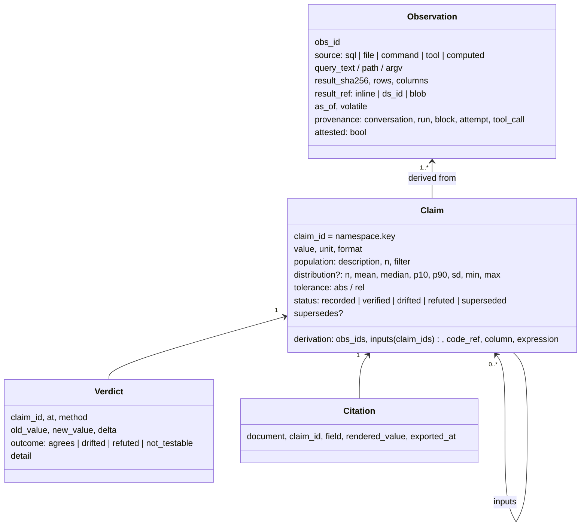
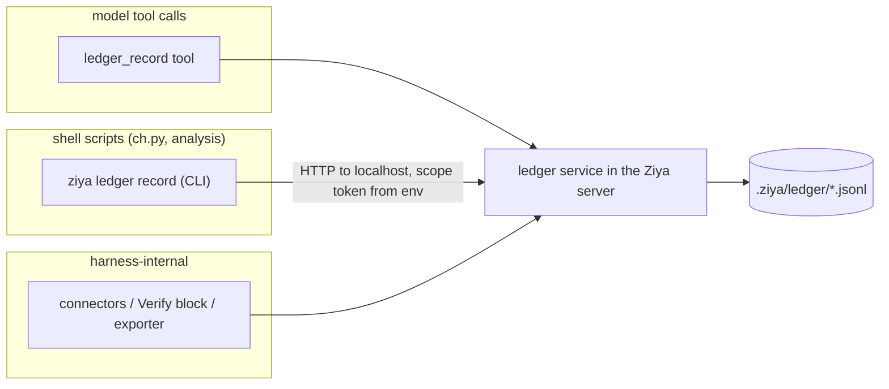

# Evidence Ledger (research harness, item 1 of 7)

Status: **accepted; steps 1–9 built (2026-10-05); docs (10) in CHANGELOG / DocumentAuthoring** · Owner: maintainers · Related: `design/dataset-store.md`,
`design/task-cards.md`, later specs for typed findings (item 2), data-source
connectors (item 3), job runner (item 4), Verify block (item 6).

## Problem

In a multi-stage analysis the numbers are the product, but the harness keeps
no record of where a number came from. In the reference investigation run:

- **Traceability by convention only.** "Every number carries its SQL" was an
  instruction in a brief. It held because the stages were careful, not
  because anything enforced it.
- **Verification by hand.** The skeptic stage re-summed evidence CSVs to check
  headline figures. Nothing linked a figure in the report to the CSV or query
  that produced it.
- **Stale numbers flow forward.** One finding's impact changed from a funnel
  estimate to a direct per-unit measurement. Both versions existed in
  different files, and only manual editing kept the PDF consistent.
- **Unit and column mistakes.** #5's per-incident length was first computed
  from `dur` (the path length) instead of `L` (the episode length). Nothing
  recorded which column a statistic was derived from.
- **The numbers lived in shell scripts.** Most values were produced by
  `python3 ch.py …` and analysis scripts run through the shell MCP server,
  which the harness sees only as stdout.

## Goals

1. Every reported number can be traced to the observation (query, file or
   command) and the derivation that produced it.
2. Documents cite numbers by id. Export substitutes the current value and can
   refuse to publish a number that has no source, has drifted or was refuted.
3. Any claim can be re-verified later, by re-running its observation or
   re-hashing its input.
4. Works for numbers produced inside shell scripts, not only through builtin
   tools.
5. Cheap to adopt: one call per claim, no change to existing tools.

## Non-goals

- **Proving authenticity.** The ledger makes a number traceable and
  re-checkable; it does not prove the query was meaningful. Authenticity comes
  from re-verification (Verify block, item 6).
- **Holding the data.** Tabular results belong in the dataset store. The
  ledger stores hashes, small inline results and references.
- **A schema for findings.** That is item 2. The ledger stores individual
  values plus an optional generic distribution summary.
- **Automatic re-execution at export time.** Export checks status only. Reruns
  happen when explicitly requested (see Security).

## Concepts



- **Observation.** One act of looking at data: a SQL query and its result, a
  file at a hash, a command and its output. Immutable.
- **Claim.** A named value derived from one or more observations or other
  claims. The `derivation` records which column and expression were used, so a
  `dur`-vs-`L` slip is visible in the record. A new value is a new claim
  version that `supersedes` the old one; claims are never edited in place.
- **Verdict.** The result of re-checking a claim. Appended, never rewritten.
  A claim's status is its latest verdict.
- **Citation.** A record written at export time of which claim versions a
  document used.

Claim ids are `namespace.key`, e.g. `audit-2026-03.s1.error_rate_retried`.
The namespace is declared once (in a document's front matter or a card's
State block) so lanes in one investigation share it and a later investigation
does not collide. A citation can address fields: `….per_unit.distribution.median`.

## Storage

Project-level, under `.ziya/ledger/`:

```
.ziya/ledger/                # the attestation key is NOT here; it lives in ~/.ziya (see Security)
  observations.jsonl       # append-only, one Observation per line
  claims.jsonl             # append-only, one Claim version per line
  verdicts.jsonl           # append-only
  citations.jsonl          # append-only, written by the exporter
  blobs/<sha256>           # results too large to inline and not tabular (cap 50 MB each)
  index.sqlite             # derived index (latest version, status); rebuildable from the jsonl
```

- **Project, not user, scope.** Unlike the dataset store, nothing here is
  fetched by a frontend renderer without a project header: the exporter and
  task executor both know the project root. Claims belong with the project's
  documents and evidence.
- **Append-only JSONL.** Each record is written with a single `O_APPEND`
  write under an advisory `flock`, so parallel lanes can record concurrently.
  The SQLite index is a cache and is rebuilt if missing or older than the
  JSONL files.
- **Result storage.** Small results (≤ 64 KB) are stored inline. Tabular
  results are registered with the dataset store and referenced by `ds_…`
  id. Anything else goes to a content-addressed blob. Every observation stores
  the SHA-256 of the canonical result bytes regardless.
- **Retention.** Observations and blobs referenced by a citation or a
  non-superseded claim are kept. Others become collectable after 90 days
  (`ziya ledger gc`, never automatic).

## Write paths

There are three, so the ledger works wherever numbers are produced:



1. **Tool.** `ledger_record` for values the model computes itself or reads
   from a tool result.
2. **CLI from shell.** `ziya ledger record …` (and a stdlib-only
   `ziya_ledger` helper for Python scripts) posts to the running server. The
   shell server injects `ZIYA_LEDGER_URL` and a short-lived
   `ZIYA_LEDGER_SCOPE` token into each child environment through
   `_clean_child_env`. The token encodes conversation, run, block and attempt,
   so shell-recorded claims carry the same provenance as tool-recorded ones.
   Today the shell server passes no run or conversation identity to children;
   this is the new seam.
3. **Harness.** Connectors (item 3) record an observation for every query
   they run, automatically. The Verify block (item 6) writes verdicts. The
   exporter writes citations.

All writes go through the server. File writes into `.ziya/ledger/` by
`file_write` or the shell are refused by the write policy (new deny entry),
so a record cannot be fabricated by writing JSONL directly.

### Example: recording from an analysis script

```bash
# observation: the query and its result file; the server hashes the file itself
obs=$(ziya ledger observe --sql-file sql/verify/s1_errors.sql \
        --connector clickhouse-grafana --result evidence/verify/s1_errors_A.csv)

# claim derived from it, with the column and expression that produced it
ziya ledger claim audit-2026-03.s1.error_rate_retried 0.1872 \
   --unit ratio --from "$obs" \
   --population "retried requests, 2026-03-01T09Z–03-02T09Z, n=120000" \
   --derivation "sum(errors)/sum(requests) where retried=1" --tolerance rel=0.02
```

## Tools (builtin category `evidence`)

Three tools, kept compact because the tool list is paid on every turn:

| Tool | Purpose |
|---|---|
| `ledger_record` | Record an observation (`source`, `query_text`/`path`/`argv`, `result_path` or `dataset_id` or `inline`) and/or a claim (`key`, `value`, `unit`, `population`, `derivation`, `distribution?`, `tolerance?`). Returns ids. |
| `ledger_query` | Look up claims by id, namespace or prefix: current value, status, derivation and latest verdict. |
| `ledger_verify` | Re-check claims (by id or namespace) and append verdicts. Method `rehash` (file and inline observations) or `rerun` (re-execute the observation's source). |

`ledger_verify` with `rerun` runs SQL through the connector (item 3) and
commands through the job runner (item 4), both under existing policy. Until
those exist, only `rehash` and `computed` (re-evaluate a claim from its input
claims) are available.

## Citations in documents

```markdown
---
ziya-doc: 1
evidence:
  namespace: audit-2026-03
  policy: strict        # strict | warn (default) | off
---
The error rate on retried requests was {{claim:s1.error_rate_retried|fmt=.2%}}.
The median affected host loses {{claim:s1.per_unit.distribution.median|fmt=,.0f}} s/day.
```

- **Syntax.** `{{claim:KEY|fmt=…|unit}}`. A relative key is resolved against
  the document's namespace. The colon is deliberate: task templating's
  `_PLACEHOLDER_RE` accepts only identifier characters and dots, so
  `{{claim:…}}` never matches it and passes through card instructions
  untouched, while a dotted form like `{{claim.x}}` would collide. A
  regression test pins this.
- **Resolution.** A new pass, `resolve_claim_citations`, runs in front of
  `preprocess_document_body` in the document export path. It substitutes
  formatted values, writes `citations.jsonl`, and appends an **Evidence**
  appendix: claim id, value, population, observation source and hash, as-of
  time and status.
- **Policy.**

  | Status | `strict` | `warn` |
  |---|---|---|
  | unknown id | export fails (400, list of ids) | renders `⟦missing: id⟧` |
  | `drifted` / `refuted` | fails | renders value with ⚠ and lists it in the appendix |
  | `recorded` (never verified) | allowed, flagged "unverified" in the appendix | same |
  | `superseded` | fails unless pinned with `@v<n>` | uses the latest version and notes it |

- **Uncited-number lint.** In `warn` and `strict` modes the exporter counts
  numeric literals in prose and tables that are not citations, and reports
  them in the export response (never blocking). This is a heuristic to catch
  hand-typed numbers.
- **Chat.** The same syntax renders in chat messages as a value chip with a
  hover card (status, population, source). Phase 2; export comes first.

## Task Card integration

- Task executor context supplies conversation, run, block and attempt to
  `ledger_record` and to the shell scope token, so claims recorded inside a
  card are attributable without the model passing ids.
- A finished task's artifact gains a data part
  `{"ledger_claims": [ids…]}`, listing the claims recorded during that block.
  The run inspector shows them with their status.
- A State block may declare `evidence_namespace`, inherited by every task in
  scope.
- Typed findings (item 2) will reference claim ids instead of raw numbers, and
  the Verify block (item 6) will be a consumer of `ledger_verify`. This spec
  only fixes the data model they will build on.

## Volatile sources

Live tables changed by up to 0.07% overnight during the scan. An observation
records `as_of` and, from its connector, `volatile: true`. On `rerun` a
volatile observation is expected to hash differently; the verdict then
compares the re-derived claim value within the claim's tolerance
(default `rel=0.01`) instead of failing on the hash.

## Security

- **Attestation.** Records written through the server are HMAC-signed with a
  per-user key in `~/.ziya/ledger.key` (created `0o600`). The existing
  tool-result secret is per-session, so it cannot sign records that must
  outlive the session. A record is `attested: true` when the server computed
  the result hash itself from bytes it read: a file path it hashed, a
  connector result it received, a dataset it owns. Model-supplied inline
  values are recorded `attested: false`. The appendix shows the distinction.
- **No writes around the server.** `.ziya/ledger/` is added to the write
  policy deny list for `file_write` and shell redirection.
- **Scope token.** Short-lived, HMAC-bound to conversation/run/block, valid
  only against the localhost ledger endpoint. A leaked token can append
  records attributed to that block, nothing else.
- **No silent re-execution.** Export never reruns anything. `rerun` goes
  through the connector or job runner with the caller's current policy; a
  claim recorded under a wider grant is re-checked under today's grant or is
  `not_testable`.
- **Bounded ingest.** Inline ≤ 64 KB, blobs ≤ 50 MB, 1 M claims per
  project before `ziya ledger gc` is suggested.

## Implementation plan

| Step | Change | Files |
|---|---|---|
| 1 | Ledger store: models, append, index, rebuild | new `app/storage/evidence_ledger.py`, `app/models/evidence.py` |
| 2 | Server API (`/api/ledger/*`) and attestation key | new `app/api/ledger.py`, `app/server.py` (router) |
| 3 | Tools `ledger_record` / `ledger_query` / `ledger_verify` (rehash, computed) | new `app/mcp/tools/ledger_tools.py`, `app/mcp/builtin_tools.py` |
| 4 | Shell seam: inject `ZIYA_LEDGER_URL` / `ZIYA_LEDGER_SCOPE` | `app/mcp_servers/shell_server.py` (`_clean_child_env`), tool executor passes scope |
| 5 | CLI `ziya ledger observe/claim/query/verify/gc` + stdlib helper | `app/cli.py`, new `app/utils/ziya_ledger_client.py` |
| 6 | Write-policy deny for `.ziya/ledger/` | `app/config/write_policy.py` |
| 7 | Export: `resolve_claim_citations`, appendix, policy | `app/utils/document_preprocess.py`, `app/services/pdf_exporter.py`, `app/routes/export_routes.py` |
| 8 | Task executor provenance + artifact `ledger_claims` part | `app/agents/block_executor.py`, `app/agents/task_executor.py` |
| 9 | Import acceptance on synthetic evidence | `tests/test_analyze_ledger_acceptance.py` |
| 10 | Docs | `Docs/FeatureInventory.md`, new section in the document-authoring skill, `CHANGELOG.md` [Unreleased] |

Steps 1–3 and 7 are independently useful (model-recorded claims cited in
documents). Step 4–5 is what makes it work for shell-produced numbers, which
was most of the scan.

## Tests

Seam-first, per the project's test rules:

- **Shell seam (end to end).** A shell command run through the shell server
  sees `ZIYA_LEDGER_SCOPE`; `ziya ledger claim` from that command produces a
  claim whose provenance names the calling block. Fails on unpatched code
  because the variable is absent.
- **Export seam (end to end).** A document citing a claim exports to a PDF
  whose text (read back with `pdf_read_pages`) contains the formatted value and
  an Evidence appendix row. Paired negative: with `policy: strict`, a refuted
  claim makes the export return 400 naming the id; a positive control in the
  same test shows the path ran (verified claim exports).
- **Templating non-collision.** `task_templating.render` leaves
  `{{claim:a.b}}` byte-identical, and `{{claim.x}}` is reported as an unknown
  head (documents why the colon matters).
- **Write-policy.** `file_write` to `.ziya/ledger/claims.jsonl` is refused;
  a server write in the same test succeeds.
- **Concurrency.** 10 processes × 200 appends produce 2,000 parseable lines
  and an index that agrees after rebuild.
- **Supersession.** Recording `s2.impact` twice yields v1 superseded by v2;
  export without a pin uses v2 and notes it; `@v1` pin under `strict` fails
  only if v1 is refuted.
- **Volatile rerun.** A `computed` claim over a changed input passes within
  tolerance and drifts outside it.
- **Import acceptance.** Importing synthetic evidence reproduces the
  per-unit reconciliation table from ledger claims alone.

## Decisions (2026-10-02)

1. **Default policy** for documents with an `evidence:` block is `warn`.
   `strict` is opt-in per document. Documents without the block behave as
   today.
2. **Attestation of shell-produced values.** `attested: true` on an
   observation means the server hashed the bytes itself. A claim is attested
   only when it is re-derivable (`computed`) or has passed a `rerun` verdict.
3. **Cross-project citation** is not supported in v1.
4. **Chat value chips** come after typed findings (item 2), so the hover card
   can show finding context.

## Decisions while building (2026-10-04)

5. **Location.** The ledger service lives in `app/utils/evidence/`
   (`store`, `verify`, `refs`, `service`) rather than `app/storage/` and
   `app/models/`, as `analyze` does in `app/utils/analytics/`. The tools in
   `app/mcp/tools/ledger_tools.py` and, later, the `/api/ledger` routes are
   thin wrappers over `service`.
6. **Index.** In memory and incremental: the cache keeps the byte offset it
   has parsed and verifies only appended lines. The SQLite index is deferred
   until a project needs it. Re-reading the whole file under the claim lock
   made 10 parallel writers quadratic (over 60 s for 2,000 records; 6 s now).
7. **A claim must cite a source**: at least one observation
   (`derivation.obs_ids`) or input claim (`derivation.inputs`), and each must
   exist. One `ledger_record` call can record an observation and the claim
   that cites it.
8. **Computed claims.** `inputs` is a list (each input bound to an
   expression name by its id's last segment; two equal names are refused) or
   `{name: claim}`. Inputs are stored pinned (`id@vN`); `computed` evaluates
   with each input's *current* version and notes any that moved on. The
   expression evaluator allows only arithmetic, `abs/min/max/round/sqrt/log/
   log10/exp`, and exponents up to 64. Default tolerance is `rel=1e-9`;
   claims over volatile sources should set one (e.g. `rel=0.01`).
9. **rehash.** A changed volatile source gives `not_testable`, not
   `drifted`. A claim derived only from input claims is `drifted` when an
   input is drifted, refuted or has a newer version.
10. **rerun** is refused, writing no verdict, until the connector and job
    runner exist (M3/M4).
11. **The HTTP API (step 2)** lands with the shell seam and CLI (steps 4–5),
    its only callers, so the scope token is designed once.
12. **Blobs deferred.** A file observation stores the resolved path, size and
    hash, not a copy: `rehash` exists to detect that the file changed.
    Content-addressed blobs come with `rerun`.
13. **Signature failures.** A line whose HMAC does not verify (hand-edited, or
    written without the key) is skipped on read and counted in `stats()`.
14. **Scope token** (`app/utils/evidence/scope.py`): `base64url(payload).hmac`
    under the ledger key, payload = project root, conversation / run / block
    / source from the server's context, and an expiry (4 h: a shell analysis
    may run long, and a token expiring mid-run would fail its last step).
    The HTTP routes (`app/api/ledger.py`, `/api/ledger/record|query|verify`)
    accept nothing without a valid token (401) and take project root and
    provenance from it, never from the body.
15. **Shell seam.** `MCPManager.call_tool` attaches `_ledger_scope = {url,
    token}` to every shell-server call (the same choke point as
    `_task_scope`, so the text-fence path is covered too); the shell server
    pops it into a request-scoped ContextVar and `_clean_child_env` adds
    `ZIYA_LEDGER_URL` / `ZIYA_LEDGER_SCOPE` to every child it spawns.
    Run and block ids come from the usage-attribution contextvar the task
    executor already sets, so step 8's provenance needs no new plumbing.
16. **Client.** `app/utils/ziya_ledger_client.py` is stdlib-only (urllib)
    so scripts can import or copy it; `ziya ledger observe|claim|query|
    verify` wraps it. `ziya ledger verify` exits 1 when any claim drifted or
    was refuted, so a script can stop on it.
17. **Task provenance (step 8).** Run and block ids come from the
    usage-attribution contextvar the task executor already sets; there is no
    attempt counter in the executor, so the enclosing Repeat/Until iteration
    (owner block and index) is recorded instead (`service.task_context`).
    `evidence_namespace` is an ordinary State variable (`state_variables:
    {evidence_namespace: …}`), not a new State field: the block executor
    reads it from the run's variables (launch overrides win) and sets it
    around each task dispatch, and the ledger tools and the shell token use
    it as the default namespace.
18. **Ledger root inside tasks.** A task with a scope `cwd` runs its tools
    in that subdirectory, which would have put its claims in a second,
    orphaned `<cwd>/.ziya/ledger/`. The task executor sets a `ledger_root`
    contextvar to the card's project root; tools and the shell token use it,
    while file paths still resolve against the task's workspace.
19. **Artifact part.** After a task, the claim versions it recorded (matched
    on provenance run and block, and recorded since the task started, so a
    loop's later pass lists only its own) are appended as one `data` part
    `{"ledger_claims": [id@vN, …]}`, labelled "Evidence ledger claims". The
    artifact viewer renders data parts as JSON; per-claim status there is a
    later refinement.
20. **Import acceptance (step 9).** `tests/test_analyze_ledger_acceptance.py`
    defines the figure SQL once, shared by the analytics replay and the
    ledger import. The import records each raw CSV as
    a `file` observation, each figure's `analyze` result as a `sql`
    observation (`dataset_id`, `query_text`), and the figure as a claim:
    value = fleet total (the distribution's `total`), `distribution` =
    n/mean/median/p10/p90/min/max/sd, `derivation` = raw observations + result
    observation, the SQL as `expression` and the metric as `column`. Keys
    `s1.outage` and `s2.errors` under `audit-synthetic`. The rebuild reads the
    table from `ledger.find(namespace)` alone and re-hashes every claim.
    Re-importing appends superseding versions. The first version of this
    acceptance ran against a real investigation's evidence kept outside the
    repository; the synthetic set replaced it.
