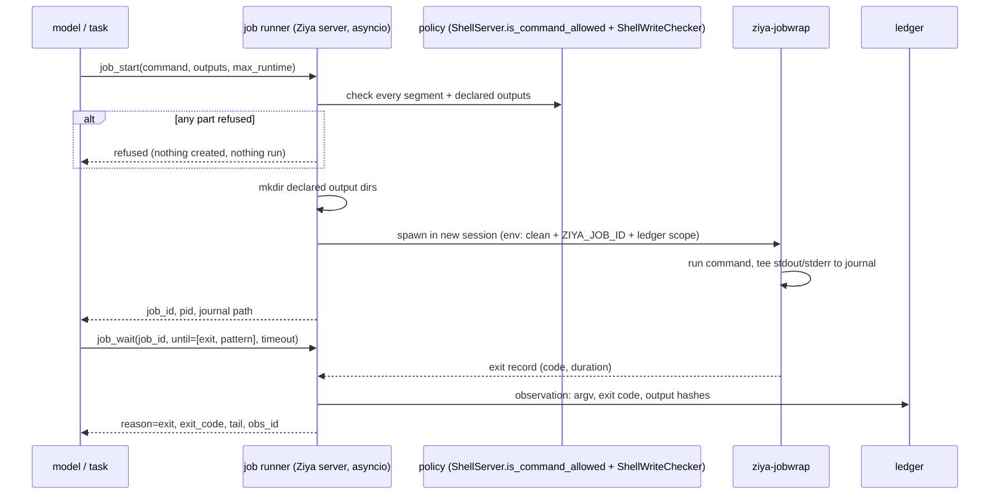

# Managed Job Runner (research harness, item 4 of 7)

Status: **implemented 2026-10-08** (all 11 steps; one deviation: the exit observation is recorded `inline`, so the store marks it `attested: false` — widening the store's attestation rule to runner-hashed multi-output results is a separate evidence-ledger decision) · Owner: maintainers · Depends on: `design/evidence-ledger.md`
(observations, shell scope env) · Related: `design/shadow-wait.md` (wait
conditions), `design/data-source-connectors.md` (`ziya data` CLI).
Built on by: query broker time-slicing (item 5), Verify `rerun` of commands
(item 6), time-budgeted cards (item 7).

## Problem

The shell tool runs one command, synchronously, within a timeout (default
30 s, ceiling 300 s). Anything longer had to be backgrounded by hand. In the
2026-10-02 network scan, starting one 24-slice query job took five attempts:

| Attempt | What happened | Cause |
|---|---|---|
| `nohup python3 run_any.py … &` | blocked | `nohup` is not on the allowlist |
| `python3 -c "subprocess.Popen(...); open(log,'w')"` | blocked | write checker: the script contains `subprocess.Popen`, so its write-path extraction is incomplete and the blanket block applies |
| `bash -c '… > /tmp/x.log 2>&1 &'` | ran, but the output was lost | the `mkdir -p` for the output directory was part of the earlier *blocked* command, so it never ran; the job failed at its final write after all 24 slices |
| `pkill -f run_any.py` | blocked | `pkill` is not on the allowlist; replaced with `ps | grep | awk | xargs kill` |
| polling | `sleep 75; cat log` | no way to wait for "exited" or "matched a line" |

None of these is a policy bug. The allowlist and write checker are right to
refuse unmanaged background processes and opaque write scripts. What is
missing is a **supported** way to run a long command: start it, see it, wait
on it, stop it, and know what it produced.

Two facts in the current code constrain the design:

- **The shell server cannot host jobs.** It is a single-threaded JSON-RPC
  loop (`_popen_group` docstring: "while a command runs, no other request is
  serviced"). A job must not live inside it.
- **Process-group kill already exists.** `_popen_group` starts every child
  with `start_new_session=True` and kills the whole group on timeout, because
  a surviving grandchild wedged the server. Jobs need the same discipline,
  for the same reason.

## Goals

1. Start a command that outlives the tool call, the turn and the 300 s
   ceiling, under exactly the same command and write policy as the shell tool.
2. Wait on it by condition (exit, line pattern, N lines, quiet, timeout),
   returning a bounded tail, as `shadow_wait` does for shadow sessions.
3. Stop it, including every process it spawned.
4. Create declared output locations before the job starts, and refuse the
   whole job before anything runs if any part is disallowed.
5. Record a finished job in the evidence ledger: command, exit code, duration
   and hashes of its declared outputs.
6. Tie jobs to their owner (conversation, or Task Card run and block), so a
   cancelled run does not leave processes behind.

## Non-goals

- **A sandbox.** Jobs run as the user under process-level guards, like shell
  commands. Declared outputs are created and hashed, not enforced: the runner
  cannot stop a job writing elsewhere, any more than the shell tool can stop
  a script it allowed. Enforcement stays where it is today, in the command
  checks before launch.
- **Widening the allowlist.** `nohup`, `setsid`, `disown`, `pkill`, `&` and
  friends stay blocked inside job commands. The runner does the
  backgrounding and killing itself.
- **Remote execution.** Shadow sessions cover remote hosts.
- **Scheduling.** Schedule blocks cover recurrence. A job is one process
  tree.

## Overview



## Where jobs live

Jobs are managed by a `JobManager` in the Ziya server process (asyncio), not
in the shell MCP server.

Each job is started through a tiny wrapper, `ziya-jobwrap` (a console script
in `pyproject.toml`, stdlib only), which:

1. runs the command with `sh -c` in its own session (process group);
2. writes stdout and stderr, line by line, to a journal in the same record
   format as shadow sessions (`seq`, `ts`, `stream`, `text`), so the
   `shadow_wait` condition matcher can be reused unchanged;
3. on exit, writes an `exit` record (code or signal, wall time, peak RSS when
   available) and a `status.json`, then exits.

The wrapper is what makes jobs survive a server restart. The server holds no
pipes to the job; it reads the journal. After a restart, `JobManager` scans
its job directories:

| Found | Status |
|---|---|
| `status.json` with an exit | `exited` (code known) |
| no `status.json`, wrapper pid alive and its start time matches | `running` (re-attached) |
| no `status.json`, wrapper pid gone | `lost` (exit code unknown) |

Pid reuse is guarded by recording the wrapper's process start time at launch
and comparing it on re-attach.

## Storage

Project-level, `.ziya/jobs/<job_id>/`:

```
job.json        # owner, command, cwd, declared outputs, limits, policy decision, wrapper pid + start time
journal.jsonl   # output records (rotated at 50 MB: journal.1.jsonl, ...; total cap 200 MB per job)
status.json     # written by the wrapper on exit
```

Job ids are `job_` + 12 hex. The directory is writable only by the server and
the wrapper; it is added to the write-policy deny list for `file_write` and
shell redirection, so a job's record cannot be edited after the fact.

## Tools (builtin category `jobs`)

| Tool | Arguments | Returns |
|---|---|---|
| `job_start` | `command`, `cwd?`, `outputs?` (paths or dirs the job will write), `max_runtime_s?` (default 6 h), `label?`, `keep_awake?`, `wait_s?` (default 0, max 600) | `job_id`, `pid`, or a refusal naming the segment and reason; with `wait_s`, also the `job_wait` fields |
| `job_wait` | `job_id`, `until` (`exit`, `pattern`, `lines`, `quiet`, `change`; default `exit`), `pattern?`, `lines?`, `quiet_ms?`, `from_seq?`, `timeout_s` (default 240, max 3,600), `tail_lines` (default 20), `max_chars` | `reason`, `exit_code?`, `matched?`, `tail`, `next_seq`, `still_running`, `obs_id?` |
| `job_status` | `job_id?` (omit for all jobs owned by this conversation or run) | status, runtime, last line, output bytes, CPU time |
| `job_read` | `job_id`, `from_seq?`, `search?`, `max_chars` | journal records (bounded) |
| `job_kill` | `job_id`, `signal?` (`TERM`, then `KILL` after 10 s) | final status |

`job_wait` uses the same condition engine and return shape as
`shadow_wait`, so a model that knows one knows the other. A timeout is a
checkpoint, not a failure: it returns the tail so far.

The shell tool's result for a command that hits its timeout adds a hint:
*"timed out at 30 s; for long commands use `job_start`."*

## Policy

`job_start` applies the shell tool's checks to the whole command **before
anything is created or run**:

1. **Allowlist and injection checks.** The command is checked by the same
   code as the shell tool (`ShellServer.is_command_allowed`, segment by
   segment). Background operators (`&` at segment end, `nohup`, `setsid`,
   `disown`, `daemon`) are refused with a message pointing at `job_start`
   itself. The YOLO and task-grant paths apply exactly as for the shell tool.
2. **Write checks.** `ShellWriteChecker.check` runs on the command, as today.
3. **Declared outputs.** Each path in `outputs` must be writable under the
   effective write policy (including task-scope grants). A disallowed output
   refuses the job.
4. **All or nothing.** A refusal at any step means no directory is created
   and no process starts. This is the fix for the lost `mkdir`: today a
   compound command that is partly refused leaves its allowed parts not run,
   and a later command assumes they did.

After the checks pass, the runner creates the parent directories of the
declared outputs. The job's stdout and stderr go to the journal, so a job
needs no redirection to keep its log, and the inline-write false positive
(`open(log, 'w')` next to `subprocess`) does not arise.

The policy decision (allowed segments, grants used, write policy hash) is
stored in `job.json`, so a job can be audited later against what was allowed
when it started.

## Environment

The child environment is `_clean_child_env()` (credential-stripping, as for
shell commands) plus:

- `ZIYA_JOB_ID`;
- `ZIYA_LEDGER_URL` and `ZIYA_LEDGER_SCOPE` (from the ledger spec), so
  `ziya ledger …` and `ziya data …` calls inside the job are attributed to
  the owning block;
- `PWD` set to the job's cwd.

## Limits

| Limit | Default | Override |
|---|---|---|
| Running jobs per conversation or run | 8 | project config |
| Running jobs per user (all projects) | 32 | user config |
| `max_runtime_s` | 6 h | up to 24 h without a grant; longer needs a task-scope grant (`scope.job_max_runtime_s`), signed like other escalations |
| Journal size | 200 MB per job | none; output beyond it is counted, not stored |
| `job_wait` timeout | 3,600 s per call | none (call again) |

At `max_runtime_s` the runner sends `TERM` to the process group, then `KILL`
after 10 s, and records `reason: max_runtime`.

## Ownership and cleanup

Each job records its owner: conversation id, or run id + block id + attempt
for jobs started inside a Task Card.

| Event | Effect on owned jobs |
|---|---|
| Task block finishes | jobs it started are killed, unless started with `detach: "run"` (then they live until the run ends) |
| Run cancelled or finished | all its jobs killed |
| Run held (infra fault) | jobs keep running; on resume, `job_status` shows them and the resumed task can wait on them |
| Conversation deleted | its jobs killed |
| Ziya server stops | jobs keep running (the wrapper is independent); re-attached at restart |
| `ziya jobs gc` | removes job directories older than 30 days that no ledger citation references |

Killing always targets the process group (`os.killpg`), never a pid alone,
for the same reason `_popen_group` does.

## Ledger integration

When a job exits, the runner records one observation:

- `source: command`, `argv`, `cwd`, exit code or signal, duration;
- SHA-256 and size of each declared output that exists;
- `attested: true`: the runner read the exit status and output bytes itself.

`job_wait` returns its `obs_id`. A missing declared output is recorded too
(`outputs_missing`), so "the job ran but wrote nothing" is visible, which is
the scan's lost-output case. Verify `rerun` (item 6) re-runs a command
observation by starting a new job from the stored command under the
*current* policy.

## Keep-awake

`keep_awake: true` holds an OS inhibitor for the job's lifetime: on macOS,
`caffeinate -i -w <wrapper pid>`; on Linux, `systemd-inhibit --what=idle` if
available. If neither exists the job still starts and `job_start` says so.
This covers one job. Keeping the machine awake for a whole card is item 7.

## UI (phase 2)

A Jobs panel in the conversation sidebar (status, runtime, last line, Kill),
and the existing green-check notification when a job owned by an idle
conversation exits. The model is not woken: the result is there when the
user or the next turn calls `job_status`.

## What this replaces in the scan

| Scan workaround | With the runner |
|---|---|
| `bash -c '… > /tmp/x.log 2>&1 &'` | `job_start(command="python3 sql/verify/run_any.py …", outputs=["evidence/summary/"])` |
| `mkdir -p` in a separate (blocked) command | declared output created after all checks pass |
| `sleep 75; cat /tmp/x.log` | `job_wait(until=["exit","pattern"], pattern="FAILED|ERR")` |
| `ps aux \| grep \| awk \| xargs kill` | `job_kill(job_id)` |
| `/tmp` logs lost on reboot | `.ziya/jobs/<id>/journal.jsonl` |
| no record that a job ran | ledger observation with exit code and output hashes |

## Security

- **Same gate as the shell tool**, run first, all or nothing. The runner adds
  no commands to what is allowed.
- **No unmanaged background processes.** Background operators remain refused
  inside commands; the only way to background is the runner, which tracks
  and can kill everything it starts.
- **Bounded resources:** per-owner and per-user job caps, runtime caps, and
  journal caps.
- **Journals are untrusted data.** `job_wait` and `job_read` return output
  inside the normal tool-result envelope, like shell output.
- **Records are server-only.** `.ziya/jobs/` is write-denied to tools, and
  the wrapper writes only inside its own job directory.
- **Credential stripping** is inherited from `_clean_child_env`.

## Implementation plan

| Step | Change | Files |
|---|---|---|
| 1 | `ziya-jobwrap`: run in new session, journal records, exit status | new `app/jobs/wrap.py`; `pyproject.toml` script entry |
| 2 | `JobManager`: launch, limits, re-attach on startup, kill by group, runtime cap | new `app/jobs/manager.py`; `app/server.py` (startup hook) |
| 3 | Policy pre-check: reuse `ShellServer.is_command_allowed` and `ShellWriteChecker` in-process; background-operator refusal; declared-output check | new `app/jobs/policy.py`; small refactor so the checks are importable without the MCP server loop |
| 4 | Wait engine: lift `shadow_wait`'s condition matcher into a shared module | new `app/utils/journal_wait.py`; shadow tools switch to it |
| 5 | Tools, including `job_start(wait_s)` | new `app/mcp/tools/job_tools.py`; `app/mcp/builtin_tools.py` |
| 6 | Ownership: run/block/attempt from task context; kill on block end, run end and cancel; held-run behaviour | `app/agents/task_executor.py`, `app/agents/block_executor.py` |
| 7 | Ledger observation on exit | `app/jobs/manager.py` (after ledger step 3) |
| 8 | Write-policy deny for `.ziya/jobs/`; shell timeout hint | `app/config/write_policy.py`, `app/mcp_servers/shell_server.py` |
| 9 | Keep-awake inhibitor | `app/jobs/inhibit.py` |
| 10 | CLI `ziya jobs list/tail/kill/gc` | `app/cli.py` |
| 11 | Docs | `Docs/FeatureInventory.md`, task-card skill, `CHANGELOG.md` [Unreleased] |

## Tests

Seam-first:

- **Long job end to end.** `job_start("python3 -c 'import time; print(1); time.sleep(40); print(2)'")`
  then `job_wait(until=["exit"], timeout_s=120)` returns `exit_code: 0` and a
  tail containing `1` and `2`. The same command through the shell tool times
  out (positive control that the 30 s ceiling is real).
- **Inline wait.** `job_start(..., wait_s=30)` on a 2 s job returns
  `reason: exit` and the exit code in one call; on a 60 s job it returns
  `still_running: true` after about 30 s, and a following `job_wait` sees the
  exit.
- **All or nothing.** `job_start` with `outputs=["evidence/x/"]` and a
  command containing a refused segment: refusal, `evidence/x/` does not
  exist, and no process was started (job directory absent). Fails against
  the scan's sequence, where the allowed `mkdir` part was lost while the job
  later assumed it.
- **Declared output created.** Allowed job with `outputs=["evidence/new/"]`:
  the directory exists before the command's first line runs (the command
  checks for it and prints).
- **Background operators refused.** `sleep 100 &`, `nohup sleep 1`,
  `setsid sleep 1` are refused by `job_start` with a pointer to the runner.
- **Group kill.** A job that spawns a grandchild (`sh -c 'sleep 300 & sleep 300'`):
  `job_kill` leaves no process from that group alive (checked with
  `os.killpg(pgid, 0)` raising). Paired: the same tree is still alive before
  the kill.
- **Restart re-attach.** Start a job, drop and recreate `JobManager`, and
  `job_status` reports `running` with the same pid; after the job exits,
  `exited` with its code. Kill the wrapper with `SIGKILL` mid-run: status
  `lost`.
- **Pid reuse.** A `job.json` whose pid exists but whose recorded start time
  differs is reported `lost`, not `running`.
- **Task ownership.** A Task block starts a job and finishes: the job is
  killed. With `detach: "run"`: it survives the block and is killed at run
  end. Run cancel kills it.
- **Ledger.** On exit, `ledger_query(obs_id)` shows the argv, exit code,
  `attested: true` and the SHA-256 of a declared output file; a declared
  output never written is listed in `outputs_missing`.
- **Shared wait engine.** The existing `shadow_wait` tests pass unchanged
  after the matcher moves to `journal_wait.py`.
- **Limits.** The ninth concurrent job in one conversation is refused; a job
  past `max_runtime_s` is ended with `reason: max_runtime`.

## Decisions (2026-10-02)

1. **Default `max_runtime_s` is 6 h**, up to 24 h without a grant.
2. **Jobs a Task starts are killed when that Task finishes**, unless started
   with `detach: "run"`.
3. **`job_start` accepts `wait_s`** (default 0, max 600). When set, it waits
   on `exit` for up to that long and returns the `job_wait` result shape
   alongside the `job_id`, so a short job needs one call. If the job is still
   running, `still_running: true` and the caller continues with `job_wait`.

No open questions remain for this item.
