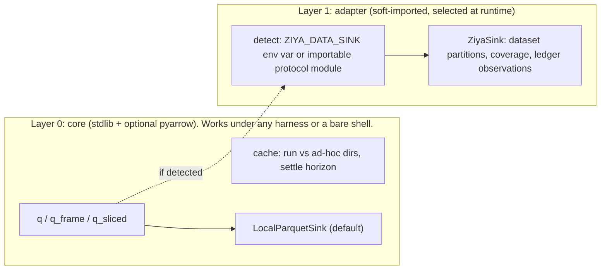

# Guidance for kuiper-telemetry skill authors: `scripts/graf_q.py` and the ClickHouse connector

Origin: netscan project review, 2026-11-02 (see `data-reuse-endemic.md` for the harness-side requests and the
measurements). Ownership (confirmed 2026-11-02): the skill ships in the Kuiper AI capabilities package, not core
Ziya, and is used from other harnesses. Design constraint that follows: the connector must stay fully functional with
no Ziya present, while taking full advantage of Ziya's data handling when it is. Section 3 specifies how.

## 1. What was observed

- `q(sql, nocache=True)` is the dominant call pattern in investigation scripts (12 of 16 scripts in one day; every
  recent conversation searched). The reason is sound: data lands up to ~30 min late, so a cached result for a recent
  window would freeze a partial answer.
- `q()` calls `cache_put()` **unconditionally**, so every bypassed query still serialises its result to JSON. One day
  of ad-hoc work wrote 231 files / 6.2 GB; ~110 GB of never-read JSON exists across run caches. A 90 MB result costs
  ~0.5 s to load and more to dump.
- Results come back as `list[dict]` built from the Grafana frame, discarding the typed schema the frame carries. Every
  consumer then runs `pd.to_numeric` over every column (and occasionally guesses wrong on NULL-bearing columns).
- Scripts slice time windows and retry themselves (`for i in range(3): try q(...) except: sleep`) because the
  connector's retry covers transport errors but the callers do not trust it for proxy row-limit / timeout errors;
  10 copies of that loop exist.
- The cache directory is selected by `ATLAS_METRICS_CACHE`, which the project shims point at the current nightly
  run's cache; ad-hoc results therefore pollute the run cache that nightly reproducibility depends on.

## 2. Requests, in order of payoff

### S1. Do not write the cache when the caller bypassed it (one line)

```python
if not nocache:
    cache_put(cp, rows)
```
Rationale: a `nocache` caller has declared the result non-reusable; persisting it costs disk and time and is never
read. This removes the single largest waste found. (If the intent was "always refresh the cache", make that a
separate `refresh=True` flag; the current callers do not want it.)

### S2. Settledness: a horizon the connector knows and the harness can ask for

Add module constants and expose them:

```python
SETTLE_S = {"clickhouse": 3 * 3600, "atlas": 3 * 3600}   # data older than this is immutable
def settle_seconds(source="clickhouse"): ...
```

and an optional `q(sql, until=<window end>)`: when `until` is older than the horizon the connector may serve from
cache even if the caller did not ask, and must not when it is younger. The harness's `dataset_pull` will consume
`settle_seconds()`; callers today can use `until` directly in place of blanket `nocache=True`. The actual numbers
need the data owners' confirmation (ClickHouse via Grafana ~30 min; CT-side `CT-prod` may trail further); until
confirmed, keep an undeclared source as never-settled.

### S3. Preserve types; offer columnar output

The Grafana frame schema has field types. Return them:
- `q(..., typed=True)` -> `(rows, schema)` or
- `q_frame(...)` -> `pyarrow.Table` / `pandas.DataFrame` with correct dtypes, and `--parquet out.parquet` on the CLI.
This removes the per-script `to_numeric` pass and makes large results cheap to store and to query with DuckDB.
JSON cache files can stay for small results; above a size threshold write parquet.

### S4. Built-in slicing

```python
def q_sliced(template, t0, t1, step_min=15, params=None, until_settled=True, log=None): ...
```
Substitutes `{T0}`/`{T1}` (ISO, UTC) and `params`, runs each slice with the connector's retry policy, applies S2 per
slice, yields frames. This replaces the 10 hand-written loops and the `SLICE_MIN` monkey-patching in `lc/keyid.py`.
Keep the existing `_FATAL` list so syntax errors are not retried.

### S5. Cache placement and hygiene

- Separate `ATLAS_METRICS_CACHE` (run-owned, reproducible) from an ad-hoc cache (`ATLAS_METRICS_ADHOC_CACHE`,
  default `/tmp/atlas-metrics-adhoc-$USER`), used when the caller is not inside a declared run. The project shims
  currently cannot express this distinction.
- `graf_q.py --cache-status` printing size and file count per cache dir; `--prune --older-than 7d`.
- Document in SKILL.md that cache files are keyed by SQL text only: a query whose text does not change but whose
  data does (recent windows) is the known hazard, and S2 is the remedy.

### S6. Document the retry contract

SKILL.md should state which errors `q()` retries (transport, 5xx, proxy timeouts) and which it raises immediately
(`_FATAL`), so callers stop wrapping it. If proxy row-limit errors are not in the retried set, add them or say so.

## 3. Portability: generic core, optional harness adapter

The skill is consumed by several harnesses. Nothing in S1-S6 may import Ziya at module level or require it at
runtime. The structure that satisfies both goals:



Rules:

- **Soft detection, never a hard dependency.** The adapter is chosen by a documented env var (proposed
  `ZIYA_DATA_SINK=<protocol version>:<endpoint or module>`) or by a successful `importlib.util.find_spec` of the
  harness-provided protocol module. Absence of both selects `LocalParquetSink`, which writes partitioned parquet under
  the ad-hoc cache dir with a sidecar `coverage.json`. Behaviour and numbers are identical in both modes; only where
  the rows land and how they are catalogued differs.
- **One small sink protocol, implemented twice.** `q_sliced` (S4) hands each finished slice to a sink:
  `sink.append(partition, table, key=[...])`, `sink.coverage()`, `sink.missing(t0, t1, entities)`. The local sink
  gives every harness dedupe-on-key and skip-what-is-covered; the Ziya sink gives the same plus cross-conversation
  discovery and evidence-ledger observations. The protocol is defined by the harness (companion doc, H8) and
  versioned; the skill pins the versions it supports.
- **Capability advertisement.** `graf_q.py --capabilities` prints JSON: `{"settle_s": {...}, "typed": true,
  "sliced": true, "sink_protocol": ["1"]}`. A harness reads this to decide whether its own pull primitive may
  delegate slicing to the skill or must slice itself. Harnesses that do not read it lose nothing.
- **Settle horizon lives in the skill, not the harness.** The connector knows its data sources; the harness only
  asks `settle_seconds(source)`. Other harnesses can call the same function.
- **No harness-specific CLI.** Everything above is reachable from `python3 scripts/graf_q.py ...` with flags, so a
  harness that can only run shell commands gets S1-S5 in full.

A conformance check for the skill repo: run the verification suite (section 5) once with `ZIYA_DATA_SINK` unset and
once with a stub sink module on the path; results must match row-for-row.

## 4. Compatibility

S1 and S6 change no interface. S2-S5 are additive (new parameters, new functions, new env var). Existing callers that
pass `nocache=True` keep working and simply stop writing dead files.

## 5. Verification the skill can run itself

1. `q("SELECT 1", nocache=True)` leaves the cache directory unchanged.
2. `q_sliced(tpl, t0, t1)` over a window straddling the settle horizon writes cache files only for the settled
   slices.
3. `q_frame` returns `Int64`/`Float64`/timestamp dtypes matching the Grafana schema for `s3_pop_per_ct_metrics`
   and `CT-prod` samples, with no `object` columns for numeric fields.
