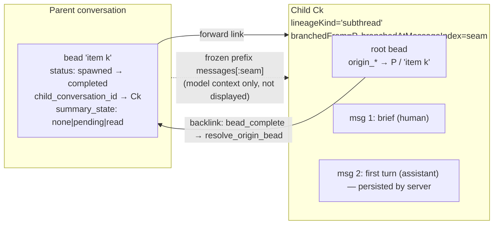

# Model-Spawned Subthreads

Status: **design** (direction accepted 2026-09-24, unbuilt). Builds on
`design/bead-branching.md` (bead links between conversations) and
`design/conversation-handoff.md` (turn prelude, scoped retrieval).

## Goal

When the model sees that a conversation holds N separable pieces of work
("there are seven things here"), it can break them out. Each piece becomes a
**child conversation**:

- linked back to the parent and nested under it in the sidebar;
- tracked by the parent through beads;
- run for **one turn**, then waiting for input like any other conversation.

## Principle: a subthread is a conversation, not a task

Everything is inspectable, and every piece of background work can be entered
as a conversation. So a subthread is not a task run, a delegate or a worker.
It is an ordinary conversation whose first turn was started by the server
instead of by a user pressing Enter. There is no unattended mode. After that
first turn the child waits. If the model thinks the item is finished it says
so and sends the parent a signal (below), but the child stays open for the
user.

The task-card runtime, E4/E6 in `design/unified-task-faces.md` and
TaskBinding are **not** part of this design.

## Decisions

| # | Question | Decision |
|---|---|---|
| 1 | What runs a child's first turn | The normal server turn function (Turn authorship, `conversation-single-writer.md`), called with no overrides. The same path every conversation uses. |
| 2 | Child's starting context | The **full parent transcript**, frozen at the spawn point, is sent to the model. It is **not** shown in the child's message list, which starts with the brief. The child UI shows a backlink ("from *Parent*, where you raised *X*"). Reducing cost comes later. |
| 3 | Approval | The model's judgement: it may show a review step (human in the loop) or spawn directly. The prompt coaching says **usually show the review step**, and spawn directly only when the user has already asked for the breakout in plain terms. |
| 4 | When a child finishes | The parent's bead closes. The child's summary becomes **pending**. The parent is told on its **next natural turn** and reads the summary on demand. Nothing is pushed into the parent's transcript. |
| 5 | Parent bead status | New status `spawned`. Internal only, hidden from user-facing counts. |

Default nesting depth is **1**: a child cannot spawn children of its own.

## Shape



## Spawn flow

```mermaid
sequenceDiagram
  participant M as Model (parent turn)
  participant T as subthread_spawn / subthread_propose
  participant U as User
  participant S as spawn endpoint
  participant R as chat_turn_relay
  participant C as Child conversation
  alt review step (default)
    M->>T: subthread_propose(items)
    T-->>U: tile: checkboxes, editable briefs, model per item
    U->>S: Spawn (selected items)
  else direct (user already asked)
    M->>T: subthread_spawn(items)
    T->>S: spawn
  end
  S->>C: child record + brief message; parent 'spawned' beads; child root beads
  S->>R: start_turn(child, stream_chunks(server-built body))
  R->>C: server writes human + assistant messages (Turn authorship)
  Note over C: waits for input; user can open it at any time and attach live
```

Per item, in one write step:

- **Child record:**
  - `lineageKind="subthread"`, `branchedFrom=parent`,
    `branchedAtMessageIndex=seam`, `branchedFromLabel=title`;
  - `subthread: {parentId, throughMessageIndex: seam, parentBeadId}`;
  - `messages=[brief]`. The brief is a normal human message, so the child
    reads like any conversation.
  - **No `lineageRootId`.** A child keeps its own bead tree. A shared tree
    allows only one active bead across N concurrent children
    (`bead_create` parks the current active one), and each child's
    sub-beads would bury the parent's list.
  - Folder, `contextIds`, `skillIds`, `additionalFiles` and
    `modelPreference` are copied from the parent. A per-item model overrides
    `modelPreference`.
- **Child root bead:** `active`, with `origin_*` pointing at the parent's
  item bead.
- **Parent bead:** `spawned`, with `child_conversation_id`. If the item
  already has a parked bead, it is reused (parked → spawned). Otherwise a new
  one is created **without** parking the parent's active bead.

`seam` follows `bead_create`: persisted message count + 1, so the parent's
in-flight assistant turn (the one proposing the split) is included in the
frozen prefix.

## Prerequisite: server-authored turns

A subthread needs nothing special to run, as long as the server writes every
turn itself and a conversation runs happily with no browser attached. That is
not true today. The browser authors and saves assistant messages, and the
relay cancels a turn that nobody is watching. The fix is general and lives in
`design/conversation-single-writer.md`, section **Turn authorship**. Spawning
calls the same server turn function the turn endpoint uses, with no
overrides, so the child gets its conversation's defaults.

## Parent context in the child (decision 2)

- **What:** `parent.messages[:throughMessageIndex]`, frozen at spawn. Later
  parent turns never leak in. Turns muted in the parent at spawn time are
  excluded, matching what the parent itself sends.
- **Where:** inserted ahead of the child's own messages when `stream_chunks`
  assembles the child's prompt, next to where the handoff prelude is
  applied, with a short note: "The following is the parent conversation *P*
  up to where this subthread was split off. It is background; your task is
  the brief that follows."
- **Display:** none. The backlink bar links to the parent at the seam.
- **Cost:** the prefix is identical across all N siblings, so with the same
  model and provider they can share the prompt cache, provided the prefix is
  byte-identical, comes first, and each brief falls after the cache marker.
  **To verify:** N children started at the same instant may all miss the
  cache before the first one has written it. If so, start child 1 and release
  the rest once its stream begins.

## Approval (decision 3)

Two tools, and the model picks:

- `subthread_propose(items)`: stages a tile in the parent with a checkbox,
  editable brief and optional model per item. **Spawn** on the tile calls
  the spawn endpoint.
- `subthread_spawn(items)`: spawns directly.

Coaching, in the tool descriptions and the system prompt: "Default to
`subthread_propose`. Use `subthread_spawn` only when the user has explicitly
asked you to break the work out in this turn or an earlier one, and the
items are the ones they meant." A "yes" in chat to an earlier proposal counts
only if it refers to a specific list the model showed.

Children inherit the parent's permissions, so nothing escalates. The guards
are:

- a per-call cap on item count (default 16);
- the depth guard (a record with a `subthread` field cannot spawn).

## Completion and the pending summary (decision 4)

1. **The child reports.** When the model in a child considers the item done,
   it calls `subthread_report(summary)`, which:
   - stores `subthread.summary` and `summaryAt` on the child record;
   - completes the child's root bead, which runs `resolve_origin_bead` and
     completes the parent's bead.

   The child then still waits for input. A later report overwrites the
   summary and sets `summary_state` back to `pending`. If the root bead is
   completed without a report, the summary falls back to the last assistant
   message.
2. **Parent state:** `summary_state = pending`.
3. **Notice.** On the parent's next turn, whoever triggers it, the turn part
   of the handoff prelude (`split_handoff_prelude`, appended to the final user
   message, outside the cached prefix) gains one line per pending child:
   `Subthread "<title>" finished; summary available — subthread_read("<id8>")`.
   It repeats each turn until read.
4. **Read.** `subthread_read(id)` returns the summary, a link to the child
   and the child's open beads, and sets `summary_state = read`.

The summary enters the parent's context only when the model asks for it.

**Required fix:** `_resolve_origin_walk` resolves only `active`/`parked`
beads. It must also accept `spawned`, or completing a child silently leaves
the parent's bead open.

## `spawned` status (decision 5)

- **Hidden from the user:** `count_open_beads` counts only `parked`, so the
  sidebar indicator already excludes it. The bead chip filters it too.
- **Visible to the model:** `bead_status` lists these in a
  `SPAWNED (running elsewhere)` section with child id and summary state, so
  the model does not pick up a thread another conversation owns.
- **Lifecycle:** `spawned` → `completed` through the origin walk. If the
  child is deleted, the parent's bead reverts to `parked` and its
  `child_conversation_id` is cleared (hook in the chat delete path).

## Frontend

- **Tile** for `subthread_propose`.
- **Backlink bar** on the child (the lineage-bar pattern from
  bead-branching): "from *Parent*, where you raised *title*".
- **Sidebar arrival.** Children appear nested under the parent without a
  reload. Trace how fork and handoff children reach the sidebar today and
  reuse that path; the spawn response and the relay both carry the new ids.
- **Ready marker.** When a child's first turn finishes it gets the same
  green check (unread) marker as any conversation whose turn finished while
  you were elsewhere. That marker is how the user finds the 13 children
  that are waiting.

## Build order

1. **Beads:** status `spawned`, `child_conversation_id`, `summary_state`;
   origin walk accepts `spawned`; `bead_status` section.
2. **Prerequisite:** Turn authorship in `design/conversation-single-writer.md`
   (id-merge, TurnAssembler, turn endpoint, no viewerless cancel).
3. **Spawn endpoint:** child records, briefs, beads, `start_turn` per child.
4. **Parent-context injection** in the child's prompt assembly; measure
   sibling cache behaviour.
5. **Tools:** `subthread_propose` (and tile), `subthread_spawn`, coaching.
6. **`subthread_report` / `subthread_read`** and the turn-part notice.
7. **Frontend:** backlink bar, sidebar arrival, ready marker.

## Tests (at the connection points)

- Spawn creates a child whose root bead's `origin_*` names the parent's bead.
  Completing the child's root bead through the real `bead_complete` tool moves
  the parent's bead `spawned` → `completed`. Fails before the origin-walk fix.
- A spawned child that is never opened ends with its first assistant turn on
  its record (depends on Turn authorship).
- The child's assembled prompt contains parent message `seam-1` and not
  `seam`, even after the parent grows, and excludes messages muted at spawn.
  The child's stored `messages` contain only the brief and its own turns.
- `subthread_propose` creates no child; the tile's Spawn does.
- After `subthread_report`, the parent's next turn part contains the notice;
  after `subthread_read`, it does not; the parent's `messages` never contain
  the summary.
- `count_open_beads` ignores `spawned`; `bead_status` lists it.

## Open

- **Concurrent edits.** N children editing the same repository at once can
  conflict; there is no worktree isolation. Options: a per-item read-only
  flag, advisory file claims between siblings, or relying on the diff/apply
  layer to catch drift. Decide before step 5.
- **Notice repetition.** Repeats until read; consider a cap or a user-side
  dismiss.
- **Nesting.** Depth > 1 needs the backlink bar to show the full chain.
