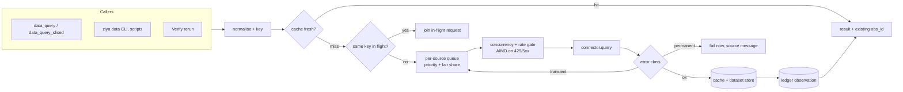

# Query Broker (research harness, item 5 of 7)

Status: **accepted (decisions at end), not implemented** · Owner: maintainers · Depends on:
`design/data-source-connectors.md` (connector `query`, fingerprints),
`design/evidence-ledger.md` (observations), `design/job-runner.md` (job
handles, ownership, `job_wait`). Built on by: Verify `rerun` (item 6),
time-budgeted cards (item 7).

## Problem

The connector spec defines how one query reaches one source. It does not
define what happens when many callers query the same source at once, which
is the normal case for a research card. In the reference investigation run:

- **Ten lanes, one session, no coordination.** Every lane called the same
  Grafana-proxied ClickHouse through its own `ch.py` process. Nothing limited
  concurrency per source; avoiding rate limits relied on lanes happening not
  to overlap.
- **Deduplication by luck.** `ch.py` cached results by a hash of the SQL text
  on disk. Two lanes issuing the same query at the same moment both ran it;
  a query differing only in whitespace was a miss.
- **No freshness model.** The cache had no expiry. The tables were still
  updating overnight (up to 0.07% drift), so a cached result and a fresh one
  could disagree with nothing recording which was used.
- **Retrying the unretryable.** `ch.py` retried every HTTP error four times
  with backoff (5 + 10 + 15 + 20 s). A ClickHouse `ILLEGAL_AGGREGATION` error
  arrives as HTTP 400, so a typo cost 50 s and four calls, and the server's
  error body was discarded: the message was "HTTP Error 400: Bad Request"
  until I re-sent the query by hand to read the body.
- **Time-slicing by script, with silent gaps.** `sql/verify/run_any.py`
  substituted `{T0}`/`{T1}` per hour and concatenated the rows. A slice that
  failed three times printed `FAILED` and was skipped, and the CSV was
  written anyway: a 24-hour result could be a 23-hour result with nothing in
  the file saying so. It also did not create its output directory, which
  lost one full run.

## Goals

1. All queries to a source, from every caller (tools, CLI, scripts, Verify),
   pass through one broker that enforces per-source concurrency and rate
   limits and backs off when the source pushes back.
2. Identical in-flight queries run once; identical recent queries are served
   from a shared cache whose freshness is explicit and recorded.
3. Errors are classified. Permanent errors (syntax, unknown column, access
   denied) fail at once with the source's own message; only transient ones
   are retried.
4. Long windows are split into slices by the broker, run under the same
   limits, and combined with explicit completeness: a result with a missing
   slice is never presented as complete.
5. Callers at different priorities share a source fairly; one lane's
   24-slice sweep does not starve another lane's single lookup.
6. Every query, slice and cache hit is accounted to its owner, so a run can
   report and later budget what it queried.

## Non-goals

- **Query planning or rewriting.** The broker never changes query text
  beyond substituting declared slice parameters.
- **A distributed cache.** One user, one machine.
- **Cost estimation in advance.** The broker reports what providers return
  (rows, bytes, provider-reported bytes scanned); it does not predict.

## Overview

The broker lives in the Ziya server process (asyncio), next to the job
manager. It wraps `DataSourceProvider.query`; nothing else calls a provider
directly.

## Keys and normalisation

A request key is `(source fingerprint, normalised query, params, limits)`.

- With `sqlglot` installed (`ziya[data]`): the query is parsed and
  re-rendered in its dialect, which removes comments and whitespace
  differences and canonicalises identifier quoting. Literal values are kept.
- Without it: comments and runs of whitespace are removed outside quoted
  strings. Equivalent queries written differently are misses; correctness is
  unaffected.
- Params are serialised in sorted-key canonical JSON. A slice's
  `{T0}`/`{T1}` are params, not text, so slices of different windows never
  collide.

## Admission control

**Per-source limits**, from the connector's declaration, overridable in
`datasources.yaml`:

| Limit | Default | Notes |
|---|---|---|
| `max_concurrency` | 4 | Queries in flight to the source. |
| `rate_per_min` | 120 | Token bucket on query starts. |
| `max_queue` | 500 | Beyond this, requests are refused with `busy`. |

**Adaptive back-off.** On a `throttled` or `unavailable` result (HTTP
429/503, provider-specific codes), effective concurrency is halved (minimum
1) and the request requeued after the provider's `Retry-After` or an
exponential delay with jitter. Each success raises effective concurrency by
one per 30 s, up to `max_concurrency` (additive increase, multiplicative
decrease). The current effective value is visible in `data_sources`.

**Priority and fairness.** Each request carries a class and an owner:

| Class | Used by | Weight |
|---|---|---|
| `interactive` | chat-turn tool calls | 4 |
| `task` | Task Card blocks | 2 |
| `bulk` | sliced queries, Verify reruns | 1 |

Within a source, the queue is weighted fair across classes, and round-robin
across owners (run id + block id, or conversation id) within a class. A
24-slice sweep from one lane therefore interleaves with other lanes' single
queries instead of occupying the source for its whole duration.

## In-flight deduplication

If a request's key matches one already dispatched, the new caller waits on
the same future ("single flight"). Both receive the same result and the same
`obs_id`; the observation's provenance lists every requester. If the first
caller is cancelled, the request continues while any joiner remains.

## Cache

- **Scope: user-level, keyed by source fingerprint**, the same as pitfall
  notes and access state, because results depend on the user's credentials,
  not the project. Stored under `~/.ziya/datasources/cache/`, with result
  rows in the dataset store and a small index in SQLite. Each entry records
  the origin (project, conversation, run, block) of the request that filled
  it.
- **Cross-project use.** A cache entry filled from project A is served to
  project B only when the source fingerprints match. A project can opt out
  of foreign cache entries with `cache.include_other_projects: false`.
- **Freshness.** Each entry has `as_of` and a TTL: 24 h by default, 30 min
  for `volatile` sources, overridable per source and per call
  (`max_age_s`). A hit returns `cache: {hit: true, age_s, as_of}`. In the
  project that filled the entry it returns the original `obs_id`. In any
  other project it records a new observation in that project's ledger with
  the same result hash and `cache_of: {project_id, obs_id}`, attested
  because the server holds the bytes; ledger observations are project-level
  and cannot be cited across projects (ledger decision 3).
  `nocache: true` forces a fresh query and a new observation.
- **Window-aware TTL.** For a sliced query whose slice ends more than 24 h in
  the past, the slice is treated as settled and cached for 7 days even on a
  volatile source; slices covering the last 24 h use the volatile TTL. This
  matches how the scan's tables behaved: old hours stable, recent hours still
  filling.
- **Size.** 5 GB per user by default, least recently used evicted first.
  Entries referenced by a ledger citation are never evicted; their rows stay
  in the dataset store.

## Error classification

Providers map each failure to a class. The broker acts on the class, never on
a raw status code:

| Class | Examples | Broker action |
|---|---|---|
| `permanent` | syntax error, unknown table or column, illegal aggregation, type error, query too large | Fail immediately, no retry. Return the source's message verbatim (bounded to 4 KB). |
| `denied` | not authorised for table/namespace | Fail immediately; update access state (connector spec). |
| `expired` | expired token or cookie | One credential refresh through the provider, then one retry; otherwise fail with the provider's `remedy`. |
| `throttled` | HTTP 429, provider rate-limit codes | Requeue with back-off; reduce effective concurrency. |
| `transient` | timeout, connection reset, HTTP 5xx | Retry up to 3 times with exponential backoff and jitter. |
| `unknown` | anything unmapped | Treated as `transient` for one retry, then failed with the raw message. |

A provider that cannot classify its errors gets the `unknown` row, which is
still better than today: one retry, not four, and the message is kept.

## Sliced queries

A new tool `data_query_sliced` (and `ziya data query --slice`):

| Argument | Meaning |
|---|---|
| `source`, `query` or `query_file` | Query text with slice placeholders `{T0}` and `{T1}`. |
| `start`, `end` | The full window (ISO-8601, UTC). |
| `step` | Slice length (`1h`, `6h`, `15m`, ...). |
| `params` | Other params (the scan's `{GWK}`/`{GWN}` maps). |
| `combine` | `concat` (default: rows of all slices, with a `slice_start` column) or `none` (per-slice datasets only). |
| `require` | `all` (default), or a minimum fraction such as `0.95`. |
| `out` | Optional CSV path, written by the server under write policy, parent directory created. |

**Placeholder formatting** is done by the connector's dialect, so a slice
boundary is a correct literal for that source (for ClickHouse,
`toDateTime64('2026-10-01 09:00:00', 3, 'UTC')`), rather than text pasted
into a template. The parameter type is declared (`datetime` or `epoch_ms`).

**Execution.** A sliced query is a **job** of kind `query` in the job
manager: `data_query_sliced` returns a `job_id` (or, with `wait_s`, waits
like `job_start`), and `job_wait`, `job_status` and `job_kill` work on it
with the same ownership and cleanup rules as command jobs. Slices are
requests of class `bulk`, so they share the source fairly with everything
else.

**Completeness.** The job keeps a manifest: per slice, its window, status
(`ok`, `cached`, `failed`, `skipped`), row count, `obs_id` and error. On
completion:

- **All slices ok:** the combined result is a dataset, and one combined
  observation is recorded that lists the slice observations; it is
  `complete: true`.
- **Some failed, `require` not met:** the job ends `failed`, no combined
  CSV is written, and the result names the missing windows and their errors.
- **Some failed, `require` met:** the combined result is written with
  `complete: false` and `missing_windows` in the observation, the dataset
  metadata and a sidecar `<out>.manifest.json`. A ledger claim derived from
  a `complete: false` observation is flagged in the Evidence appendix.
- **A permanent error in the first slice** stops the job at once: the same
  query text would fail in every slice.

**Resuming.** Re-running the same sliced query (same key) reuses every slice
still fresh in the cache and runs only the missing or expired ones. A job
that died at slice 17 of 24 costs 8 slices to finish, not 24.

## Accounting

Every request is attributed to its owner: queries started, cache hits,
in-flight joins, rows and bytes returned, provider-reported bytes scanned
when available, and time queued. `data_stats(owner?)` returns these per
source, and a run's totals are written to its run record at the end. Item 7
(time-budgeted cards) uses these counters for query budgets; this spec only
collects them.

## Tools

| Tool | Change |
|---|---|
| `data_query` | Gains `priority?` (defaults by caller), `max_age_s?`, `nocache?`; result gains `cache`, `queued_ms`, `error_class` on failure. |
| `data_query_sliced` | New (above). |
| `data_sources` | Shows effective concurrency, queue depth, rate and cache hit rate per source. |
| `data_stats` | New: accounting by owner and source. |

The `ziya data` CLI and the Python helper go through the same broker, so
scripts get limits, single flight, the cache and error classes without any
change to the scripts beyond using the helper.

## What this replaces in the scan

| Scan | With the broker |
|---|---|
| `ch.py` disk cache keyed by raw SQL hash, no expiry | Normalised key, fingerprint scope, TTL, `as_of` on every hit |
| Ten lanes sharing a Grafana session, uncoordinated | Per-source concurrency, AIMD back-off, fair share across lanes |
| HTTP 400 retried 4 times, message lost | `permanent`, failed at once with the ClickHouse message |
| `run_any.py` 24 x 1 h, `FAILED` slices skipped, CSV written anyway | `data_query_sliced` with a manifest; incomplete results refused or flagged |
| `run_any.py` not creating its output directory | `out` written by the server, directory created |
| Re-running a sweep re-ran every hour | Settled slices served from cache; only missing ones run |

## Security

- The broker adds no access: every request still goes through the connector,
  its read-only guard and its table filters.
- Cache entries are user-level and keyed by fingerprint, so a cached result
  is only ever served for the same source under the same user.
- Source error messages are untrusted data, bounded and returned inside the
  tool-result envelope.
- `out` writes go through the write policy, as in the connector spec.
- Queue caps and the per-user job limits from the job runner bound how much
  work one caller can enqueue.

## Implementation plan

| Step | Change | Files |
|---|---|---|
| 1 | Request model, keying and normalisation | new `app/datasources/broker/keys.py` |
| 2 | Per-source queue: weighted fair, owner round-robin, token bucket, AIMD | new `app/datasources/broker/scheduler.py` |
| 3 | Single flight and cache (user-level, fingerprint scoped, TTL, window-aware) | new `app/datasources/broker/cache.py` |
| 4 | Error classes in the provider interface; broker actions | `app/plugins/interfaces.py` (`QueryError.error_class`), `app/datasources/broker/core.py` |
| 5 | Route `data_query`, CLI and helper through the broker | `app/mcp/tools/data_tools.py`, `app/utils/ziya_data_client.py` |
| 6 | Sliced queries as jobs of kind `query`; manifest; resume | `app/datasources/broker/sliced.py`, `app/jobs/manager.py` |
| 7 | Dialect placeholder formatting | `DataSourceProvider.format_param()`; built-in connectors |
| 8 | Accounting and `data_stats`; run-record totals | `app/datasources/broker/accounting.py`, `app/agents/block_executor.py` |
| 9 | Docs | `Docs/FeatureInventory.md`, `CHANGELOG.md` [Unreleased] |

## Tests

Seam-first, using a fake provider with scripted latency, errors and call
counting:

- **Single flight (end to end).** Two `data_query` calls with the same query
  issued together: the provider is called once, both results carry the same
  `obs_id`, and the observation lists both requesters. A query differing only
  in whitespace and a comment also joins (with `sqlglot`) or misses (without
  it); a query with a different literal never joins.
- **Concurrency cap.** Ten simultaneous distinct queries on a source with
  `max_concurrency: 2`: the provider never sees more than two in flight.
- **AIMD.** A provider returning 429 on the third query halves effective
  concurrency, and it recovers after successes.
- **Fairness.** A 24-slice `bulk` job and a single `task` query submitted
  after it: the task query starts before the job's fifth slice.
- **Permanent error.** A provider returning a syntax error: exactly one
  provider call, and the result contains the provider's message. Paired:
  a transient error is retried, and succeeds on the third call. Fails
  against `ch.py`'s behaviour, which made four calls and lost the message.
- **Expired credentials.** One refresh, one retry, then success; if refresh
  fails, the provider's remedy is returned.
- **Sliced completeness.** Slice 7 of 24 fails permanently after the first
  slice succeeded (a data-dependent error): with `require: all`, the job
  fails naming the slice-7 window and no CSV exists. With `require: 0.95`,
  the CSV exists, the observation has `complete: false` and
  `missing_windows` covering slice 7. Fails against `run_any.py`, which
  wrote the CSV either way with no marker.
- **First-slice permanent error** stops the job after one provider call.
- **Resume.** A sliced job killed after 17 slices, then re-run: the provider
  is called for exactly 7 slices.
- **Cache TTL.** A volatile source's entry expires after 30 min; a settled
  slice (window ended more than 24 h ago) on the same source is still served
  after 2 h.
- **Cross-project cache.** Same fingerprint: served, with origin recorded;
  different fingerprint: miss; `include_other_projects: false`: miss.
- **Placeholder formatting.** A ClickHouse-dialect fake receives
  `toDateTime64('…', 3, 'UTC')` for a `datetime` param and an integer for
  `epoch_ms`.

## Decisions (2026-10-02)

1. **Plugin connectors must declare their limits.** Registration fails
   without `max_concurrency` and `rate_per_min`. Built-in connectors use the
   core defaults (4 and 120).
2. **Sliced queries default to `require: all`.** Exploratory sweeps set a
   fraction (e.g. `0.95`) explicitly and get a `complete: false` result.
3. **Capacity reservation for cards** is item 7 (time-budgeted cards). The
   scheduler here exposes a per-owner minimum share for item 7 to set.

No open questions remain for this item.
