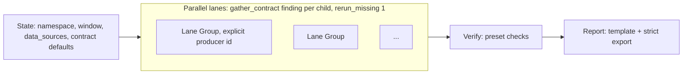

# Research Blocks: Verify and Report (research harness, item 6 of 7)

Status: **accepted (decisions at end), not implemented** · Owner: maintainers · Depends on: `design/evidence-ledger.md`
(claims, verdicts), `design/typed-findings.md` (finding schema, contracts),
`design/data-source-connectors.md` and `design/query-broker.md` (reruns),
`design/job-runner.md` (command reruns). Built on by: time-budgeted cards
(item 7).

## Problem

The 2026-10-02 network scan built the same pipeline twice (phase 1 and the
phase-2 card): lanes → synthesis → RCA → skeptic verification → report. The
last two stages carried most of the hand work:

- **Verification was prose.** Stage 5's instructions listed the checks:
  split-half, previous day, telemetry-gap artifact, duplicate rows, one
  entity skewing a total, independent witness. Which ran for which finding
  was the model's choice. It wrote its own SQL and re-summed evidence CSVs,
  and `verification.json` had no fixed shape. Phase 2 restated the same
  checks for its cross-lane validation.
- **Verdicts had no rules.** CONFIRMED / WEAKENED / REFUTED were judgments
  written in prose. #4 was weakened because the previous day ran at 0.30 pp
  against 3.71 pp, which is a mechanical observation. Nothing recorded it as
  one.
- **De-overlap was arithmetic in prose.** "#3 ⊂ #5, #4 removed from #5, net
  total" was computed by hand, at fleet level, not per unit.
- **The report was retyped.** Numbers were copied from stage files, the
  per-unit section was added by editing the document, and the PDF came from a
  second hand-written document. When one figure was corrected, keeping
  the documents consistent was manual.

## What becomes a block

| Piece | Form | Why |
|---|---|---|
| **Verify** | new block type `verify` | Most checks are mechanical. The harness should run them, not describe them to a model. |
| **Report** | new block type `report` | Its value is the export gate and the regeneration of mechanical sections. |
| **Lane** | not a block; a **card template** | A lane is a Group or Task with a `finding` contract and an explicit producer, which item 2 already provides. Calls cannot be parameterised, so reuse happens when the card is authored: `task_card_stage(template=…)` (see *Research template*). |

## Prerequisite: executable derivations

A mechanical check needs to recompute a claim from new data. The ledger
claim's `derivation` gains an optional `exec`:

```json
"derivation": {
  "text": "sum(errors)/sum(requests) where retried=1",
  "exec": {"engine": "duckdb",
           "sql": "SELECT sum(errors)/sum(requests) FROM r WHERE retried = 1",
           "inputs": {"r": "obs_7f3a…"},
           "output": "scalar"}
}
```

- **`output: distribution`.** The SQL returns one row per entity
  (`entity`, `value`); the harness computes `n, mean, median, p10, p90, sd,
  min, max`, so per-unit statistics are never hand-computed.
- **Checked at record time.** `ledger_record` with an `exec` runs it once
  against the named inputs and compares the result with the claimed value
  within tolerance. A match makes the claim re-derivable, which under the
  ledger's decision 2 makes it attested. A mismatch refuses the claim, with
  both values.
- **Requires `ziya[data]`** (duckdb). Without it, `exec` is stored but not
  run, and mechanical checks on that claim report `not_testable`.

## Verify block

```json
{
  "block_type": "verify",
  "name": "Skeptic pass",
  "verify_source": "{{sibling(\"lanes\").outputs_all.finding}}",
  "verify_checks": ["rerun", "window:split_half", "window:previous_day",
                    "leave_out:top_1pct", "reconcile", "overlap",
                    "witness", "artifact_screen"],
  "verify_policy": {"preset": "ziya:research/v1"},
  "verify_adjudicator": {"model_tier": "large"},
  "verify_budget": {"max_model_checks": 30}
}
```

The source must be typed (a `finding` contract or a gather contract); card
validation refuses an untyped source.

### Checks

| Check | Kind | What it does | Needs |
|---|---|---|---|
| `rerun` | mechanical | Re-executes each primary claim's observations through the broker (SQL) or job runner (commands) under the current policy, re-runs `exec`, compares. | connector or command observation, `exec` |
| `window:<shift>` | mechanical | Re-runs the observation with its slice parameters shifted: `split_half` (each half of the window), `previous_day`, `day_offset:-N`, then re-runs `exec`. | observation recorded by a sliced query (`{T0}`/`{T1}` params) |
| `leave_out:<rule>` | mechanical | Recomputes a distribution or total without `top_k`, `top_1pct`, or a named exclusion list (e.g. the phase-2 L9 stuck-device list). Reports the change. | per-entity table + `exec` with `output: distribution` |
| `reconcile` | mechanical | Re-evaluates the finding's contract checks (`reconciles`, `ordered`, `subset`) on current claim values. | finding contract |
| `overlap` | mechanical, across findings | Builds a per-entity matrix from the findings' per-entity tables (same `entity_kind`), and reports pairwise shared entities and seconds, plus a net total with each entity counted once. Uses the findings' `touches` to decide which pairs to subtract; reports pairs with high overlap that are not declared. | per-entity tables |
| `witness` | model | One Task per finding: find an independent source or population and test the claim. It must emit a `check` part. | data tools |
| `natural_control` | model | The same, for a control group (e.g. the single-KPOP region for #1). | |
| `artifact_screen` | model | A Task given the source's pitfall notes of kind `artifact`, `coverage` and `null_or_zero`, asked whether one of them explains the finding. | pitfall notes |
| `known_issue` | model | A Task given the investigation's known-issues source (tickets, prior reports, a `known_issues` dataset) asked whether the finding is an already-tracked issue. `agrees` means it matches; the check result carries the issue id and its status (`open`, `mitigated`, `closed`). | known-issues source |

Every check produces a `ziya:check-result/v1` part: `finding_id`, `check`,
`outcome` (`agrees`, `disagrees`, `not_testable`), the claims involved with
their old and new values, the delta, and a short detail. Every mechanical
comparison also appends a ledger verdict on each claim it touched.

**Execution.** For each finding, mechanical checks run concurrently as
`bulk`-class broker requests. Model checks run as Tasks under an internal
Parallel with a gather contract (`check`, `per: child`, `rerun_missing: 1`),
so a missing check result gets the correction turn and one rerun.
`verify_budget.max_model_checks` caps model checks; card validation reports
the worst case, and checks over the cap are recorded `not_testable` with
reason `budget`.

### Verdict rules

Verdicts come from a rule table applied to the check results, not from a
model. The `ziya:research/v1` preset:

| Verdict | Rule |
|---|---|
| `refuted` | `rerun` disagrees; or both `split_half` and `previous_day` disagree; or `artifact_screen` disagrees and `witness` does not agree |
| `known` | `known_issue` agrees and `rerun` agrees. Evaluated after `refuted` and before every row below. The finding records `known_issue: {id, status}` |
| `weakened` | exactly one window check disagrees; or `leave_out` changes the total or median by more than 30%; or `witness` disagrees |
| `confirmed` | `rerun` agrees, at least two of (`split_half`, `previous_day`, `witness`, `natural_control`) agree, none disagree, and mechanism confidence ≥ 3 |
| `reproduced_unexplained` | `rerun` and the window checks agree, but mechanism confidence < 3 |
| `mixed` | anything else |

**Adjudicator.** A model is called only for `mixed` findings. It must choose
from the verdicts that the results allow (it can never return `confirmed`
when any mechanical check disagrees) and write a rationale. A response
outside the allowed set is rejected and the finding stays `mixed`.

Projects can override thresholds and rules in `verify_policy`. Overrides are
recorded with the run, so a verdict can be traced to the rules that produced
it.

### Scores and ranking

`verify_policy.score` is an arithmetic formula over finding fields, e.g.
`log10(impact.fleet_total.mid) * scores.obscurity * scores.correlation *
scores.confidence / 5`. It is evaluated by a small parser (numbers,
`+ - * /`, `log10`, `min`, `max`, field paths), never by `eval`. Findings are
ranked by verdict group (confirmed, weakened, reproduced_unexplained, mixed,
refuted), then by score.

### Output

- **Findings.** `finding` parts with `verdict`, `cross_validation[]` and
  `scores` filled in, under the same schema as the input.
- **Overlap.** One `ziya:overlap/v1` part: pairwise shared seconds, the net
  total, and the per-entity matrix as a dataset reference.
- **Checks.** All check results, kept in the run record for the inspector.

## Report block

```json
{
  "block_type": "report",
  "name": "Morning report",
  "report_source": "{{sibling(\"verify\").outputs_all.finding}}",
  "report_document": ".ziya/documents/audit-2026-03.md",
  "report_template": "ziya:research-report/v1",
  "report_export": {"pdf": true, "policy": "strict", "max_uncited": 0},
  "report_style": "Plain technical prose for a principal engineer."
}
```

**Generated sections.** The harness writes these from the findings, claims
and overlap part, between markers such as
`<!-- ziya:generated:summary-table -->` … `<!-- /ziya:generated -->`:

- the summary table (verdict, affected entities, per-entity median, score);
- per-entity distribution and per-incident tables, and the reconciliation
  table;
- the overlap table and net total;
- the refuted appendix;
- charts: per-entity distributions and impact against obscurity, as
  Vega-Lite specs whose data is a `ziya://dataset/` reference, not inline
  values;
- the Evidence appendix (from the ledger export).

**Prose sections.** A Task writes the rest: signal, why hidden, mechanism,
next steps. It runs with `require_claims: true`, so every number is a
`{{claim:…}}`. The template lists the sections and their order.

**Export gate.** The block exports with the given policy. If export fails
(missing, drifted or refuted claims, or more uncited numbers than
`max_uncited`), the prose Task gets one correction turn listing the
problems. If export still fails, the block fails: the document is kept and
no PDF is produced.

**Regeneration.** Running the Report block again after a Verify rerun
rewrites the generated sections and resolves claims to their current
values. Prose is not rewritten; prose sections that mention a finding whose
verdict changed are listed in the block's decisions for review.

## Research template

`task_card_stage(template="ziya:research/v1", params={…})` expands into an
ordinary, editable card:



Params: mission, window, sources, lanes (`id`, `title`, `instructions`), an
optional synthesis or RCA stage, the verify preset and the report template.
The expansion is checked by `validate_card_tree` like any authored card.
Each phase of the reference run would have been one template call plus its lane
instructions.

## What this replaces in the scan

| Scan | With these blocks |
|---|---|
| Stage 5 instructions listing checks in prose | `verify_checks` list; mechanical checks run by the harness |
| Skeptic re-summing CSVs | `rerun` re-executes observations and `exec` |
| "Weakened: previous day 0.30 pp vs 3.71 pp" as judgment | `window:previous_day` disagrees → rule → `weakened` |
| Stuck-device maxima flagged but unchecked | `leave_out:top_1pct` on every distribution |
| Hand-computed de-overlap, net total | `overlap` per entity, net total with each entity counted once |
| Numbers retyped into two documents | Generated sections and `{{claim:}}` prose; one document, strict export |
| Phase 2 restating the pipeline | `template: ziya:research/v1` |

## Security

- Reruns go through the broker and job runner under the current policy. A
  claim recorded under a wider grant is re-checked under today's grant or
  marked `not_testable`.
- `exec` SQL runs in duckdb over registered datasets and observation results
  only (no file or network access: `enable_external_access=false`).
- The adjudicator's output is constrained to the allowed verdict set.
- The score formula is parsed, never evaluated as code.
- Generated chart specs reference datasets; the existing chart loader rules
  apply.

## Implementation plan

| Step | Change | Files |
|---|---|---|
| 1 | `derivation.exec`: duckdb runner (no external access), distribution stats, check at record time | `app/storage/evidence_ledger.py`, new `app/evidence/exec.py` |
| 2 | Block types `verify` and `report`; fields; validation | `app/models/task_card.py` (`block_type` Literal), `app/utils/task_card_validation.py` |
| 3 | Mechanical checks: rerun, window, leave_out, reconcile, overlap | new `app/research/checks/*.py` |
| 4 | Model checks as an internal gathered Parallel; `ziya:check-result/v1` | `app/research/verify.py`, `app/schemas/outputs/` |
| 5 | Rule table, presets, adjudicator, score parser | `app/research/verdicts.py`, `app/research/formula.py` |
| 6 | `_execute_verify` dispatch | `app/agents/block_executor.py` |
| 7 | Report: generated sections, chart specs, prose Task, export gate, regeneration | `app/research/report.py`, `app/agents/block_executor.py` (`_execute_report`), `app/services/pdf_exporter.py` |
| 8 | Template expansion in `task_card_stage` | `app/mcp/tools/task_card_stage.py`, new `app/research/templates/research_v1.json` |
| 9 | Docs and skill | task-card skill, document-authoring skill, `Docs/FeatureInventory.md`, `CHANGELOG.md` [Unreleased] |

## Tests

Seam-first, with a fake connector and the scripted provider:

- **Verify end to end.** A finding whose primary claim's rerun returns a
  value outside tolerance: verdict `refuted`, a ledger verdict appended to
  the claim, and the output finding carries the `rerun` check result.
  Positive control: the same finding with an agreeing rerun and agreeing
  window checks is `confirmed`.
- **Window shift reaches the source.** `window:previous_day` makes the fake
  connector receive `{T0}`/`{T1}` exactly 24 h earlier than the original
  observation's.
- **Leave-out.** A distribution where one entity carries 80% of the total:
  the check reports the change and the verdict is `weakened`.
- **Overlap.** Two findings sharing entities: the net total counts each
  entity once; an undeclared high-overlap pair is reported.
- **Adjudicator cannot override.** The scripted adjudicator returns
  `confirmed` for a finding with a disagreeing window check: rejected, the
  finding stays `mixed`.
- **Exec at record time.** A claim whose `exec` reproduces its value is
  attested; one that does not is refused with both values.
- **Report gate.** Strict export fails on a drifted claim; the prose Task
  gets its correction turn; export then passes. After a Verify rerun changes
  a value, re-running Report updates the generated tables while the prose
  sections are byte-identical.
- **Template.** `ziya:research/v1` with three lanes validates, and each lane
  has an explicit producer.
- **Reference-run acceptance (rehash mode, recorded observations).** #1 is
  confirmed; #4 is weakened by `window:previous_day`; slot 5 is refuted by
  `window:previous_day`; slot 7 is `known` (ISSUE-5584, `closed`, flagged as a
  possible regression because it reproduced in-window); `leave_out` flags the
  #4 and #6 maxima.
- **Known precedence.** A finding with agreeing `known_issue` and `rerun` is
  `known` even when a window check would make it `weakened`; with a
  disagreeing `rerun` it is `refuted`.

## Decisions (2026-10-02)

1. **Rule thresholds are provisional.** The 30% leave-out line and "two
   agreeing checks" for `confirmed` ship as the `ziya:research/v1` defaults,
   calibrated by the reference-run acceptance test above. Presets are versioned and
   immutable once released: changing a threshold means `ziya:research/v2`,
   and every run records the preset it used, so past verdicts stay
   reproducible.
2. **`known` is its own verdict**, produced by the `known_issue` check.
   Reports group known findings after `weakened` and before
   `reproduced_unexplained`. A `known` finding whose issue status is `closed`
   but which still reproduces is flagged as a possible regression in the
   report.
3. **Model-check budget defaults to 30** per Verify block
   (`verify_budget.max_model_checks`).

No open questions remain for this item.
