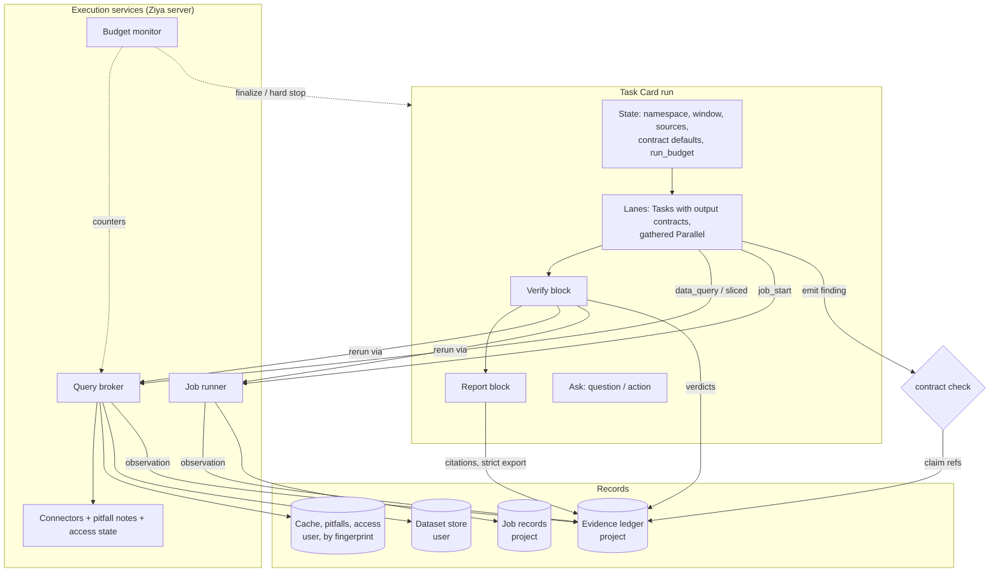

# Research Harness: Integration and Build Order

Status: **proposed** · Owner: maintainers

This document ties together the seven research-harness specs and the small
items: how the pieces fit, the concepts they share, the conflicts between
them and how they are resolved, and the order to build them. Where it
resolves a conflict, this document takes precedence over the individual
spec until that spec is amended.

## The specs

| # | Spec | Provides | Status |
|---|---|---|---|
| 1 | `design/evidence-ledger.md` | Observations, claims, verdicts, citations; `{{claim:…}}` in documents; strict export | accepted |
| 2 | `design/typed-findings.md` | Output contracts on Tasks; gather contracts on containers; explicit producers; `rerun_missing`; schemas | accepted |
| 3 | `design/data-source-connectors.md` | Connector plugin interface; built-in connectors; pitfall notes; access state | accepted |
| 4 | `design/job-runner.md` | Long-running commands: start, wait, kill; ownership; output hashes | accepted |
| 5 | `design/query-broker.md` | One call path per source: limits, single flight, cache, error classes, sliced queries | accepted |
| 6 | `design/research-blocks.md` | Executable derivations; Verify and Report blocks; `ziya:research/v1` template | accepted |
| 7 | `design/time-budgeted-cards.md` | Deadlines, finalize mode, partial results, launch checks, keep-awake, capacity reservation | accepted |
| — | `design/harness-small-items.md` | `show_document`; column dictionaries; log-scale fix and visible chart rewrites; human-action Ask | proposed |

## How the pieces fit



Every number in a report traces back through the same path: a connector or
job produces bytes, the broker or job runner records an attested
observation, a claim is derived from it (re-derivable through `exec`), a
finding cites the claim, Verify appends verdicts, and the Report resolves
the citation at export.

## User experience

**Principle: the harness is invisible.** The user deals with five things:
the chat, one launch sheet, the run tile, the morning summary and the
report. Everything else in this document is machinery behind them. No
feature may require the user to write config, work through a review queue,
interpret a validation error, or remember an install step.

### What the user touches

| Surface | Shows | Never shows by default |
|---|---|---|
| Chat | The plan in prose, with an expected finish time | Block trees, schemas, contract names |
| Launch sheet | One screen: approvals, credential fixes, keep-awake, deadline, what cannot be fixed | A separate dialog per check |
| Run tile | One progress row per lane, time to deadline, one "needs you" item at a time | Retry counts, queues, job ids (behind *Details*) |
| Morning summary | Finished or not, what was cut and why, what is waiting for the user, then findings | Token and query counts (behind *Details*) |
| Report | The document; each number has a hover card (source, population, as-of, status) | Claim ids inline (they live in the appendix) |

### Rules every spec follows

1. **Model-facing errors stay with the model.** Card validation errors
   (producers, schema paths, contract conflicts, rerun placement) are
   returned to the model by `task_card_stage`; the Run button appears only
   for a card that validates. Contract rejections and correction turns
   happen inside the run. The user sees an error only when no automatic
   fix exists, and it is phrased as what to do next.
2. **No user-authored config is required.** A source that worked is
   registered automatically: the first successful query through a
   recognised path (e.g. Grafana-proxied ClickHouse) writes a
   `datasources.yaml` entry and says so once in chat ("Saved `warehouse-ch` as
   a data source"). Schemas and Verify presets ship with the research
   template. Config files exist for overriding, not for starting.
3. **Nothing waits on a human queue.** Pitfall notes measured by the harness
   itself (profiling queries: null and zero rates, duplicate keys, coverage)
   are accepted at once, because they contain no model-written text.
   Model-written notes follow the memory probation model and promote or
   expire automatically. Neither needs a review.
4. **Every failure degrades to something usable.**
   - Export always produces the PDF. Problem numbers are marked inline and
     counted in a banner ("3 numbers unverified"). `strict` gates sharing
     and publishing only, never local generation.
   - A run that reaches its deadline ends with a report and a *Not
     completed* section, never with nothing.
   - A missing optional dependency (`ziya[data]`) becomes a one-time offer
     to install it the first time it is needed, as `ziya-install-extras`
     does for Chromium, not a stream of `not_testable` results.
5. **Ask once, at launch.** Every approval a card can foresee (escalation
   signatures, foreseeable out-of-policy writes, capacity reservation) is
   collected on the launch sheet. An unattended run never discovers in the
   morning that unsigned blocks were clamped.
6. **Fix, don't warn.** Launch checks apply the fix where one exists: an
   expiring credential is switched to an auto-refreshing one when the
   provider supports it (e.g. ada `credential_process`); keep-awake is
   turned on. Only what cannot be fixed is a warning, stated plainly
   ("Closing the lid will stop the run").
7. **Machinery is inspectable, not presented.** Ledger records, jobs,
   broker stats, checks and contract results are one click away in the run
   inspector and on a number's hover card. They never appear in the
   default view.

### Changes to the individual specs

This section takes precedence over the specs below until they are amended.

| Spec | Change |
|---|---|
| Evidence ledger | `strict` blocks share and publish actions only; local PDF export always succeeds with inline markers. Cited numbers get hover cards in the rendered report. |
| Research blocks | Report export failure after the correction turn produces the PDF with the unverified banner instead of failing the block. A missing `ziya[data]` triggers the install offer. |
| Connectors | Working sources register automatically. Measured notes are accepted immediately; model-written notes use memory probation. Replaces the review-UI step and `auto_accept_with_evidence`. |
| Typed findings | All validation errors go to the model at staging; none are shown to the user. |
| Job runner | Jobs appear only as a lane's progress; the Jobs panel lives behind *Details*. |
| Time budgets | The launch sheet consolidates approvals and applies credential fixes; the morning summary leads with run status and pending actions. |

## Shared concepts

### Provenance

One context flows through every record:

| Field | Set by | Carried into |
|---|---|---|
| `project_id`, `project_root` | server | every record |
| `conversation_id` | chat request or run | ledger, jobs, broker accounting, pitfall origin |
| `run_id`, `block_id`, `attempt` | task executor | same, plus artifacts and contract checks |
| `iteration_path` | block executor | artifact parts (typed findings) |

Shell children and jobs receive it through `ZIYA_LEDGER_URL` and
`ZIYA_LEDGER_SCOPE` (ledger spec). The CLIs (`ziya ledger`, `ziya data`,
`ziya jobs`) and the stdlib helpers read those variables, so a value
produced inside a script is attributed to the block that ran it. Provenance
is always taken from the server context, never from model-supplied
arguments.

### Identifiers

| Prefix | Object | Scope |
|---|---|---|
| `obs_` | ledger observation | project |
| `namespace.key[@vN]` | ledger claim | project |
| `ds_` | dataset | user |
| `job_` | job | project |
| `pf_` | pitfall note | user, with origin |
| source fingerprint | data source identity | user |
| `ziya:<name>/vN`, `project:<name>` | schema or preset | release / project |

### Where records live

| Record | Location | Scope | Written by |
|---|---|---|---|
| Ledger | `.ziya/ledger/` | project | server only |
| Jobs | `.ziya/jobs/<id>/` | project | server and `ziya-jobwrap` only |
| Schemas | `.ziya/schemas/` | project | anyone (pinned by hash at launch) |
| Data-source config | `.ziya/datasources.yaml`, `~/.ziya/datasources.yaml` | project over user | user |
| Pitfall notes, access state, broker cache | `~/.ziya/datasources/` | user, by fingerprint | server only |
| Datasets | `~/.ziya/datasets/` | user | server |
| Evidence sidecars | next to the evidence file | project | server (helpers, CLI) |

### Attestation

A record is `attested` when the server computed its hash from bytes it held
itself: a connector result, a job's output file, a dataset it owns. A claim
is attested when its `exec` derivation reproduced the value or a `rerun`
verdict agreed (ledger decision 2, research-blocks prerequisite). Literal
values typed by the model are never attested, and the Evidence appendix
says so.

## Conflicts and resolutions

1. **No deny mechanism exists in the write policy.** The ledger, job runner
   and connector specs each say their directories are "write-denied to
   tools". The write policy today is allow-only: `check_write` calls
   `is_write_allowed` against `safe_write_paths` and patterns, and `.ziya/`
   is a safe path. **Resolution:** add one `server_only_paths` list to the
   write policy, checked before any allow rule, by both `file_write` and the
   shell write checker. Entries: `.ziya/ledger/`, `.ziya/jobs/`,
   `~/.ziya/datasources/`. Server-side writers bypass it through an internal
   API, not by path. This is milestone 0, because three specs rely on it.

2. **Two caches.** The connector spec's *Results → Caching* paragraph defines
   a per-`source_id` cache; the broker spec defines the user-level cache by
   fingerprint. **Resolution:** the broker is the only cache, and connectors
   never cache. The connector spec is amended to say so.

3. **Cross-project cache hits return an `obs_id` from another project's
   ledger.** The broker cache is user-level, the ledger is project-level, and
   ledger decision 3 forbids cross-project citation. **Resolution:** a hit
   from another project records a new observation in the requesting
   project's ledger, with the same result hash and `cache_of: {project_id,
   obs_id}`. It is attested, because the server still holds the bytes. The
   broker spec is amended.

4. **Pitfall evidence across projects.** A user-level note may cite an
   observation in the project where it was written. **Resolution:** the
   evidence reference stores `project_id` with the `obs_id`; in other
   projects the note shows "evidence in project A" and the reference is not
   resolvable there.

5. **`ziya[data]` is effectively required for research.** `duckdb` powers
   `duckdb-files` and `exec`; `sqlglot` powers broker keys and the SQL
   guard. Without them, Verify's mechanical checks report `not_testable`.
   **Resolution:** card validation warns when a card contains a Verify block
   and `duckdb` is not importable, and the `ziya:research/v1` template
   refuses to expand without it, with an install hint.

6. **Keep-awake in two places.** Jobs (item 4) and budgeted runs (item 7)
   both hold OS inhibitors. **Resolution:** one inhibitor module; inside a
   budgeted run, per-job inhibitors are skipped because the run-level one
   covers them.

7. **Ask status assumes one open question per run.** Parallel branches can
   each open an action Ask (small item 4). **Resolution:** pending asks
   become a list on the run record; the status rule is in the small-items
   spec.

8. **Retries at three layers.** Contract correction turns (one per task),
   `rerun_missing` (one pass per container) and broker retries (transient
   errors only) are independent. **Resolution:** keep them independent; card
   validation reports the combined worst case (model calls per unit,
   queries per slice), and finalize mode suppresses `rerun_missing` (item 7).

## Build order

Each milestone is useful on its own and ends with an end-to-end test.

```
flowchart LR
  M0[M0 Foundations<br/>server_only_paths · log-scale fix · show_document]
  M1[M1 Ledger<br/>store · tools · export citations · shell seam]
  M2[M2 Contracts<br/>task · gather · producer · rerun_missing]
  M3[M3 Job runner<br/>+ shared shell checks + wait engine]
  M4[M4 Data plane<br/>connectors + broker together · pitfalls · sidecars]
  M5[M5 Research blocks<br/>exec · Verify · Report · template]
  M6[M6 Budgets<br/>finalize · launch checks · extend · reservation]
  MA[Action Ask]
  M0 --> M1 --> M2
  M0 --> M3
  M1 --> M3
  M1 --> M4
  M3 --> M4
  M2 --> M5
  M4 --> M5
  M5 --> M6
  M3 --> M6
  M0 --> MA --> M6
```

| Milestone | Contents | Done when |
|---|---|---|
| **M0 Foundations** | `server_only_paths` in the write policy; Fix 3.7/3.8 log-scale bug; visible chart rewrites; `show_document` | Tools cannot write `.ziya/ledger/`; the repro chart keeps its log axis; a report can be shown inline with no parroting interruption |
| **M1 Ledger** | Ledger steps 1–3 (store, API, tools) and 7 (export citations), then 4–6 (shell seam, CLI, policy) | A document citing claims exports with an Evidence appendix; a claim recorded from a shell script carries its block's provenance |
| **M2 Contracts** | Typed-findings steps 1–6, then 6a–6g (gather, producer, rerun), then 7 (claims) | A gathered Parallel with one silent child gets the correction turn, the rerun, then fails naming the child |
| **M3 Job runner** | Job-runner steps 1–8; the shell-check refactor and the shared wait engine | A 40-minute job started, waited on and killed with no shell workarounds, with a ledger observation on exit |
| **M4 Data plane** | Connectors and broker built together, so the broker is the only call path from the first release; pitfall notes; column sidecars | Two lanes issuing the same query cause one provider call; a sliced query with a failed slice is refused or flagged |
| **M5 Research blocks** | `exec`; Verify (mechanical, then model checks, then rules); Report; template | Reference-run acceptance (below) |
| **M6 Budgets** | Budget monitor, admission gate, soft and hard stop, partial results, extend, launch checks, reservation, morning summary | The four-lane finalize test in the budgets spec |
| **Action Ask** | Small item 4 | Can land any time after M0; its budget behaviour lands with M6 |

Column sidecars (small item 2) land with M4, because their automatic path is
`ziya data query --out`; the `write_table` helper can land with M1.

## Acceptance: replaying the network scan

One test, extended as milestones land, exercises the whole system on the
2026-10-02 evidence:

1. **M1.** `tests/test_analyze_ledger_acceptance.py` imports synthetic
   evidence as observations and claims; the per-unit reconciliation table is
   rebuilt from claims alone.
2. **M2.** The phase-2 card, re-expressed with a gathered lanes Parallel and
   explicit producers, validates; removing one lane's producer is a
   validation error naming the lane.
3. **M4.** `scripts/datasources_import_brief.py` produces the pitfall
   notes and per-namespace denied access state.
4. **M5.** Verify in rehash mode over the imported findings produces #1
   confirmed, #4 weakened (previous day), slot 5 refuted, slot 7 known
   (ISSUE-5584, flagged as a possible regression), and `leave_out` flags the
   #4 and #6 maxima. Report exports under `strict` with no uncited numbers.
5. **M6.** The same card with a deadline and a lane forced to stall finishes
   in finalize mode, with the stalled lane listed under Not completed.

Live re-execution against ClickHouse is not part of the automated test (it
needs credentials); it is a manual check before release.

## Documentation

- `Docs/FeatureInventory.md`: a *Research harness* section, added per
  milestone.
- Task-card skill: output and gather contracts, producers, `rerun_missing`,
  Verify and Report, budgets, action Ask.
- Document-authoring skill: `{{claim:…}}`, the `evidence:` front matter,
  strict export.
- `CHANGELOG.md`: one `[Unreleased]` entry per milestone as it lands.

## Out of scope

- A sandbox for jobs or scripts.
- Cross-project citation (ledger decision 3).
- A distributed cache or multi-user ledger.
- Domain statistics beyond per-entity distributions; those belong in skills.
