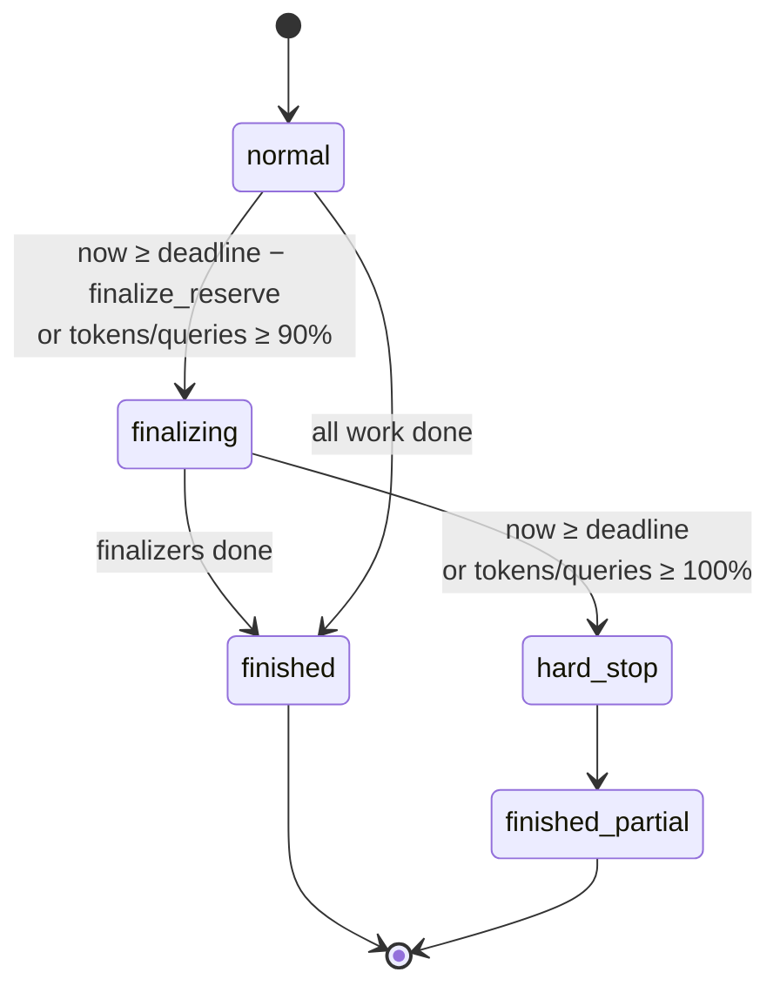

# Time-Budgeted Cards (research harness, item 7 of 7)

Status: **accepted (decisions at end), not implemented** · Owner: maintainers · Depends on: `design/job-runner.md`
(keep-awake, ownership), `design/query-broker.md` (accounting, per-owner
share), `design/data-source-connectors.md` (access state),
`design/typed-findings.md` (gather contracts), `design/research-blocks.md`
(Verify, Report).

## Problem

The 2026-10-02 scan was asked to "run for the next 6 hours while I sleep".
The card had no notion of time:

- **No deadline.** It ran until Stage 6 finished. Had a lane stalled, the
  report would have arrived whenever it arrived, or not at all. Nothing
  guaranteed a partial report by morning.
- **No graceful finish.** If time ran short, the only options were to let it
  run or cancel it. Cancelling discards the synthesis and report stages,
  which are exactly the stages that turn finished lanes into something
  readable.
- **Keep-awake by hand.** I told you to run `caffeinate -dimsu &`. If you
  had forgotten, the machine would have slept and the run stalled.
- **Credentials checked only by luck.** The analyst cloud token had already
  expired once that night (refreshed by hand at 02:18). Nothing checked at
  launch whether every source the card needed would still be valid at its
  deadline.
- **No reserved capacity.** The broker spec gives chat queries priority over
  card tasks. That is right during the day and wrong for an overnight run
  whose sources are shared with a morning of interactive work.

## Goals

1. A card can declare a deadline (or a wall-clock budget) and token and
   query budgets.
2. When a budget is about to run out, the card stops starting new work,
   lets running work wrap up, and still runs the stages marked as
   finalizers (synthesis, Verify, Report) on what has finished.
3. A run that finished early with gaps says exactly what was skipped and
   why, and can be extended and resumed to fill them.
4. An unattended run keeps the machine awake for its lifetime.
5. Launch checks that every declared data source will still be accessible
   at the deadline, and warns before the user walks away.
6. A card can reserve a minimum share of a source's capacity.

## Non-goals

- **Predicting run time.** The harness enforces budgets; it does not
  estimate how long a card will take. Card validation reports worst-case
  model-call counts (already computed for contracts and reruns), not times.
- **Sleep-proofing beyond an OS inhibitor.** A closed laptop lid, a power
  loss or a forced OS update still stop the run. Launch says so.
- **Changing cancel or hold.** Cancel and infra hold behave as today; budgets
  are a third, softer way to stop.

## Declaring budgets

On the card root (or any container, scoped to that subtree):

```json
"run_budget": {
  "deadline": "2026-10-02T06:30:00-07:00",
  "max_tokens": 40000000,
  "max_queries": 20000,
  "finalize_reserve_s": 2700,
  "unattended": true,
  "keep_awake": true,
  "reserve": [{"source": "warehouse-ch", "min_share": 0.5}]
}
```

| Field | Meaning |
|---|---|
| `deadline` or `max_wall_s` | Absolute time, or seconds from launch. One of them, not both. |
| `max_tokens` | Model tokens across the subtree (input + output + cache, as the usage tracker counts them). |
| `max_queries` | Broker queries started (cache hits and in-flight joins do not count). |
| `finalize_reserve_s` | Time held back for finalizers. Default: the sum of finalizer `budget.max_wall_s`, else 20% of the window. |
| `unattended` | Enables the launch checks below and the morning summary. |
| `keep_awake` | Hold an OS inhibitor for the run's lifetime. Defaults to `unattended`. |
| `reserve` | Minimum share of a source's broker capacity for this run (see *Capacity*). |

On any block:

| Field | Meaning |
|---|---|
| `budget.max_wall_s` | Wall-clock cap for the block. Exceeding it ends the block as `budget_exhausted` (soft stop first, see below). |
| `finalize: true` | The block runs even in finalize mode. Intended for synthesis, Verify and Report stages. |
| `priority` | `1`–`9` (default 5). In finalize mode, units not yet started are skipped lowest priority first. |

The research template (`ziya:research/v1`) marks its synthesis, Verify and
Report stages `finalize: true`.

## Run phases



**Normal.** Work runs as today.

**Finalizing.** Entered once, and latched (like `infra_gated_reason`), so it
cannot flip back as counters move:

- **No new non-finalize work is admitted.** At the same boundaries where
  `cancel_requested()` and `infra_gate_closed()` are checked today, a
  container does not start a child or iteration unless it is a finalizer or
  contains one. Skipped units are recorded with status `skipped` and reason
  `budget`.
- **Running tasks get a soft stop.** At the task's next tool boundary, the
  executor injects one user message: *"Budget reached. Stop gathering. Emit
  your required outputs now from what you have; mark anything unfinished."*
  The task keeps its correction turn if a required output is still missing.
- **Reruns are suppressed.** `rerun_missing` does not re-dispatch units in
  finalize mode; the shortfall is recorded with reason `budget`.
- **Finalizers run** on whatever finished. A gather contract evaluated in
  finalize mode does not fail its container for units skipped for budget;
  it records them, so synthesis and Verify receive the findings that exist
  plus an explicit list of what is missing.

**Hard stop.** At the deadline, or 100% of a token or query budget:

- Running tasks are cancelled with reason `budget` (their emitted parts so
  far are kept), jobs owned by the run are killed, sliced queries are
  stopped with their manifests marked incomplete.
- If a finalizer is running, it is allowed `hard_stop_grace_s` (default 600)
  to finish before it too is cancelled. A finalizer that never started does
  not start.
- The run ends `finished_partial`.

Block-level `budget.max_wall_s` applies the same soft-then-hard sequence to
that block alone (soft stop at 85% of its budget).

## Partial results

A run that ended in finalize mode or hard stop records a **budget
summary** on the run:

- the phase it reached and when;
- per budget: limit, used, and the moment it crossed 90% / 100%;
- skipped units (block id, label, roster key) and cancelled units, each with
  reason;
- which finalizers ran, and whether they completed.

The Report block's generated sections include a **Not completed** section
from this summary, so the morning report states what is missing rather than
quietly ranking fewer findings. Verify marks findings from cancelled units
`not_testable` with reason `budget`.

## Extend and resume

`task_card_extend(run_id, deadline | add_s, add_tokens?, add_queries?)` (and
an **Extend** button on the run tile) raises the budgets of a
`finished_partial` run and resumes it, reusing the existing resume
machinery:

- skipped and cancelled units are dispatched; finished units are replayed
  from their recorded artifacts;
- finalizers run again on the larger set of results. Report regeneration
  (item 6) rewrites the generated sections; prose is kept and listed for
  review where verdicts changed.

Extension is recorded on the run, so the budget summary shows every
extension and who made it.

## Unattended launch checks

With `unattended: true`, launching runs these checks before the run starts.
Failures are shown on the launch dialog; the user can launch anyway, and the
override is recorded.

| Check | How | Example result |
|---|---|---|
| Source access at deadline | `check_access` for every source named in scopes or State blocks; `AccessState` gains `valid_until` (token or cookie expiry, when the provider knows it) | "`warehouse-ch`: SSO cookie valid 8,750 h ✓ · the analyst role: AWS token expires 03:18, deadline 06:30 ✗ (remedy: re-running the credential helper refreshes for 1 h; use a role with auto-refresh)" |
| Denied sources | access state | "`warehouse-prod-restricted` denied; 2 tasks reference it" |
| Keep-awake | inhibitor acquired | "caffeinate holding (pid 81234) ✓" |
| Power | macOS `pmset -g batt`, Linux `/sys/class/power_supply` | "on battery, 41% ✗" |
| Escalation signatures | existing scope-approval check | "3 blocks need signed grants; unattended runs floor-clamp unsigned blocks" |
| Worst-case calls | contract and rerun bounds from validation | "up to 412 model calls" |

`AccessState.valid_until` is an addition to the connector interface: it is
optional, and providers that cannot know it return `null` (shown as
"expiry unknown").

**Mid-run expiry.** When a source moves to `expired` during the run and the
provider's refresh fails, tasks that query it get the access error (as
today). In addition, the run emits `source_expired` once, and the budget
summary records it, so a gap in the morning report can be traced to it.

## Keep-awake

The run holds one inhibitor from launch to end, independent of its jobs:
macOS `caffeinate -i -w <ziya server pid>`, released by killing it when the
run ends; Linux `systemd-inhibit --what=idle:sleep` with a holder process.
The job runner's per-job inhibitor (item 4) stays for jobs started outside
a budgeted run. `-i` prevents idle sleep only; display sleep is allowed.
Launch states that closing the lid will still sleep the machine on most
laptops.

## Capacity

`reserve: [{source, min_share}]` sets a per-owner minimum share in the
broker's weighted fair queue for the run's owner key. While the run has
requests queued on that source, it receives at least `min_share` of
dispatches, regardless of interactive traffic. The sum of reservations on a
source is capped at 0.8, so interactive work is never fully starved; a
reservation that would exceed the cap is refused at launch.

## Morning summary

When an `unattended` run ends, the harness writes a short summary to the
conversation (and the existing green-check notification): status, phase
reached, budgets used, findings by verdict, skipped units and the report
path. The summary is generated from the budget summary and run artifacts,
not written by a model.

## What this changes for the scan

| Scan | With budgets |
|---|---|
| "6 hours" was a hope | `deadline: 06:30`; finalize mode at 05:45; report guaranteed by 06:30 |
| Stalled lane would block the report | lane soft-stopped, then cancelled; synthesis and report run on the other lanes; report lists the lane as not completed |
| `caffeinate -dimsu &` by hand | `keep_awake: true` |
| analyst token expired mid-night | launch check flags the expiry before the user leaves |
| Chat could slow the overnight run | `reserve: warehouse-ch 0.5` |
| Partial run had no way forward | `task_card_extend` resumes only the skipped units |

## Security

- Budgets only stop work; they grant nothing.
- The soft-stop message is harness-authored text inserted at a tool
  boundary, in the same position as the contract correction turn.
- Launch overrides of failed checks are recorded with the run.
- `pmset`, `caffeinate` and `systemd-inhibit` are invoked by the server with
  fixed arguments, not through the shell tool.
- Extension of a run requires the same authority as launching it.

## Implementation plan

| Step | Change | Files |
|---|---|---|
| 1 | `RunBudget`, `budget`, `finalize`, `priority` fields; validation (one of deadline/max_wall_s, reserve cap) | `app/models/task_card.py`, `app/utils/task_card_validation.py` |
| 2 | Budget monitor: wall clock, token and query counters (usage tracker, broker accounting), latched phase | new `app/agents/run_budget.py`; `app/agents/block_executor.py` (`ExecutionContext`) |
| 3 | Admission gate at existing boundaries; `skipped: budget`; priority ordering | `app/agents/block_executor.py` |
| 4 | Soft stop at tool boundary; hard-stop cancel with reason; finalizer grace | `app/agents/task_executor.py`, `app/streaming_tool_executor.py` |
| 5 | Gather contracts and `rerun_missing` in finalize mode | `app/utils/output_contracts.py`, `app/agents/block_executor.py` |
| 6 | Budget summary on run record; `finished_partial` status | `app/models/task_card.py`, `app/storage/task_runs.py` |
| 7 | `task_card_extend` and Extend button | `app/mcp/tools/task_card_tools.py`, `app/api/task_cards.py`, frontend |
| 8 | Launch checks; `AccessState.valid_until` | `app/agents/launch_checks.py`, `app/plugins/interfaces.py` |
| 9 | Run-level inhibitor | `app/jobs/inhibit.py` (shared with item 4) |
| 10 | Broker per-owner minimum share | `app/datasources/broker/scheduler.py` |
| 11 | Report "Not completed" section; Verify `not_testable: budget` | `app/research/report.py`, `app/research/verify.py` |
| 12 | Morning summary | `app/agents/run_summary.py` |
| 13 | Docs | task-card skill, `Docs/FeatureInventory.md`, `CHANGELOG.md` [Unreleased] |

## Tests

Seam-first, with a fake clock and the scripted provider:

- **Finalize end to end.** A card with a Parallel of four lanes and a
  `finalize: true` Report, `max_wall_s: 100`, `finalize_reserve_s: 30`. Lanes
  1–2 finish at t=20; lanes 3–4 are still running at t=70. Assert: lanes 3–4
  get the soft-stop message at their next tool boundary; no new iteration is
  admitted after t=70; the Report runs and its document contains a Not
  completed section naming any lane that produced no finding; the run ends
  `finished` or `finished_partial` before t=100. Paired: the same card with
  no budget runs all lanes to completion. Fails on unpatched code, where
  the Report waits on lanes 3–4.
- **Hard stop.** A lane that ignores the soft stop is cancelled at the
  deadline with reason `budget`, its emitted parts are kept, and a job it
  owned is killed.
- **Latch.** Token use crosses 90% (finalize), then a cached replay lowers
  the rate: the run stays in finalize mode.
- **Gather in finalize mode.** A gathered Parallel with one child skipped
  for budget does not fail; the shortfall is recorded with reason `budget`.
  Outside finalize mode, the same gap fails it (positive control).
- **Rerun suppressed.** `rerun_missing: 1` does not re-dispatch in finalize
  mode.
- **Extend.** Extending a `finished_partial` run dispatches exactly the
  skipped and cancelled units and re-runs the finalizers.
- **Launch check.** A fake source with `valid_until` before the deadline is
  flagged; one with `valid_until: null` shows "expiry unknown"; a denied
  source referenced by a task is flagged.
- **Reservation.** With `min_share: 0.5` and a flood of interactive
  requests, the run receives at least half the dispatches on that source; a
  second reservation pushing the total past 0.8 is refused at launch.
- **Keep-awake.** The inhibitor process exists while the run is active and
  is gone after it ends (including after a hard stop).

## Decisions (2026-10-02)

1. **Finalize trigger** is 90% of any token or query budget.
2. **Default `finalize_reserve_s`** is the sum of the finalizers'
   `budget.max_wall_s` when declared, otherwise 20% of the window capped at
   45 min (2,700 s).
3. **`unattended: true` requires `deadline` or `max_wall_s`.** Card
   validation refuses an unattended card without one.

No open questions remain for this item.
