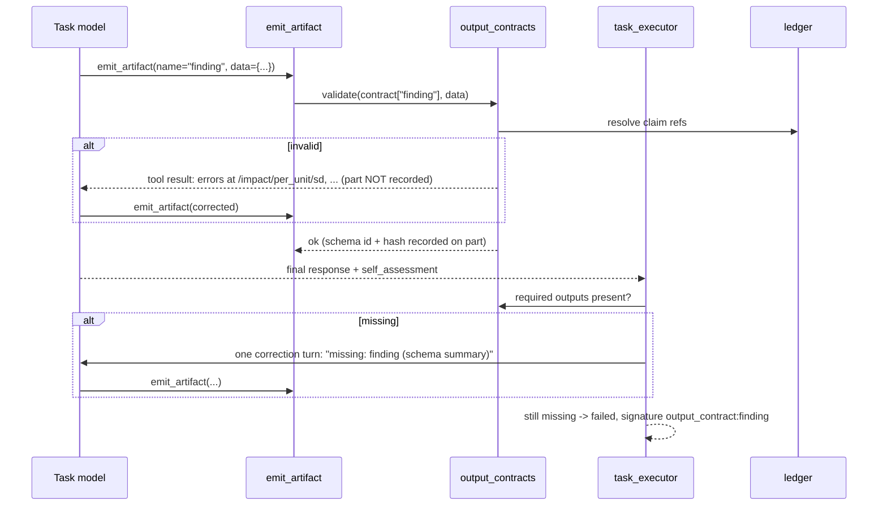

# Typed Findings and Output Contracts (research harness, item 2 of 7)

Status: **all steps built 2026-10-06, plus `validate_output` / `store_output` and the output store for plain chat (notes 40-47)** (see *Implementation notes*) · Owner: maintainers · Depends on: `design/evidence-ledger.md`
(claim ids) · Related: `design/task-card-roster-assertion.md`,
`design/task-cards.md`. Later specs build on this: Verify block (item 6),
Report block (item 6).

## Problem

Task Card stages exchange results as free-text summaries plus loose
`emit_artifact` data parts. Nothing states what shape a stage's output must
have, and nothing checks it. In the reference investigation run:

- **A reporting rule had to be added in five places.** The per-unit rule ("never
  a fleet total without per-unit mean, median, p10–p90, SD, per-incident size and
  a reconciliation") meant editing the brief, the Run-givens State block, every
  lane's instructions, the synthesis contract and the report task by hand.
  Nothing checked that any lane's JSON actually carried the fields.
- **Synthesis read an unchecked contract.** Stage 3 consumed six `laneX.json`
  files and wrote `candidates.json`. Field names and units were whatever each
  lane chose. The RCA stages then read `candidates.json` by slot number.
- **Coverage is status-shaped.** The roster assertion already records this gap
  in `app/models/task_card.py`: *"An iteration that reports success while
  producing no output still counts as covered; only an output contract (a
  separate primitive) could catch that."* This spec is that primitive.
- **Field meaning was ambiguous.** #5's per-incident statistic was first taken
  from `dur` (path length) instead of `L` (episode length). A schema with
  described fields, and numbers held as ledger claims with a recorded
  derivation, makes that kind of slip visible.

## Goals

1. A Task block can declare the outputs it must produce, by name and schema.
2. Outputs are checked when emitted, so the model can fix them in the same turn
   at no extra cost.
3. A task that finishes without its required outputs gets one bounded
   correction turn, then fails with a precise reason.
4. A rule like the per-unit rule is one schema change that reaches every block
   using that schema.
5. References between blocks (`{{sibling("x").outputs.finding.impact…}}`) are
   checked against the declared schema when the card is validated, not
   discovered empty at run time.
6. Numbers in findings are ledger claim ids, so the ledger's guarantees carry
   through.

## Non-goals

- A general rules engine. Cross-field checks are a fixed, small set of kinds
  (see *Checks*), not arbitrary expressions.
- Changing untyped tasks. A block with no contract behaves exactly as today.
- ~~A cross-run findings database.~~ Revised 2026-10-06 (notes 44-47): a
  validated output IS kept, as a line in `.ziya/outputs/<family>.jsonl`,
  because the user asked for interactive conversations to store and
  analyze structured results; there is still no index or service, only a
  file `analyze` reads. Numbers still live in the ledger.

## Overview



## Declaring a contract

A new optional field on Task blocks:

```json
{
  "block_type": "task",
  "name": "L1 retry-queue flush on reload",
  "instructions": "...",
  "output_contract": [
    {"name": "finding", "schema": "project:audit-finding", "required": true},
    {"name": "per_unit", "schema": "ziya:per-entity-table/v1", "required": true},
    {"name": "notes", "schema": "ziya:text", "required": false}
  ]
}
```

| Field | Meaning |
|---|---|
| `name` | The `emit_artifact` name the part must use. |
| `schema` | A registry reference (`ziya:<name>/v<n>` built in, `project:<name>` from `.ziya/schemas/`) or an inline JSON Schema object (capped at 16 KB). |
| `required` | Missing at task end triggers the correction turn, then failure. |
| `max_count` | Default 1. Above 1 allows repeated emits (e.g. one finding per sub-mechanism); each is validated. |
| `require_claims` | Every `number` field must be a claim reference, not a literal. Default `true` when an `evidence_namespace` is in scope, else `false`. |

A State block can set `output_contract_defaults` (same shape), merged into
every Task in its scope that declares no contract of the same name. This is
how a rule reaches every lane without editing each one. An explicit
`"output_contract": []` on a Task opts out.

## Schema registry

| Prefix | Location | Notes |
|---|---|---|
| `ziya:` | `app/schemas/outputs/<name>_v<n>.json` | Shipped, versioned, immutable once released. |
| `project:` | `.ziya/schemas/<name>.json` | Project-authored. Usually extends a `ziya:` schema with `allOf`. |
| inline | in the card | For one-off shapes. |

- **Refs are registry-only.** `$ref` may name another registry schema
  (`ziya:` or `project:`). Remote and file-path `$ref`s are refused, so
  validation never fetches anything.
- **Pinned at launch.** When a run starts, every schema the card references is
  resolved and snapshotted into the run record with its SHA-256, the same way
  the permission audit snapshot is taken. Editing `.ziya/schemas/` mid-run
  does not change what a running card is checked against. Each recorded part
  carries `schema_id` and `schema_sha256`.
- **Validator.** `jsonschema` (Draft 2020-12). It is installed today only as a
  transitive dependency; this change declares it in `pyproject.toml`.

Example: the per-unit rule as a project schema, one file, reaching every lane:

```json
{
  "$id": "project:audit-finding",
  "allOf": [{"$ref": "ziya:finding/v1"}],
  "properties": {
    "impact": {"required": ["population", "per_unit", "per_incident",
                            "incidents_per_unit_day", "fleet_total", "reconciliation"]}
  }
}
```

## Built-in schemas (v1)

**`ziya:number/v1`** — how a number is written. One of:

- `{"claim": "ns.key"}` or `{"claim": "ns.key", "field": "distribution.median"}`
  — a ledger claim reference. Validation resolves it (see *Claims*).
- `{"value": 0.1872, "unit": "ratio", "source": "free text"}` — a literal,
  allowed only when `require_claims` is false. Recorded as unverified.

**`ziya:distribution/v1`** — `n`, `mean`, `median`, `p10`, `p90`, `min`, `max`,
`sd` (each a number), plus `unit` and `population` (description, `n_total`,
`definition`). Built-in check: `p10 ≤ median ≤ p90`, `min ≤ p10`, `p90 ≤ max`,
`sd ≥ 0`, `n ≤ n_total`.

**`ziya:per-entity-table/v1`** — a per-entity table by reference, never inline:
`entity_kind` (e.g. `host`), `dataset` (a `ds_…` id) or `file` (project path),
`key_column`, `value_column`, `unit`, and a `columns` dictionary (name →
description). The dictionary is required: the `dur`/`L` slip was a missing
column definition.

**`ziya:finding/v1`** — a research finding.

| Field | Type | Notes |
|---|---|---|
| `id`, `title` | string | `id` stable across stages (e.g. `F-RETRY-FLUSH`). |
| `verdict` | enum | `candidate`, `confirmed`, `weakened`, `known`, `refuted`, `reproduced_unexplained`. When `known`, `known_issue: {id, status}` is required (`status`: `open`, `mitigated`, `closed`). |
| `signal`, `why_hidden` | string | Prose. |
| `mechanism` | object | `summary`, `confidence` (1–5), `code_refs[]` (`path`, `lines`, `commit`). |
| `impact` | object | `population` (description, `n_total`, `n_affected`, `definition`), `per_unit` (distribution), `per_incident` (distribution + `incident_definition`), `incidents_per_unit_day` (distribution), `fleet_total` (number with low/mid/high), `reconciliation` (`per_unit_sum`, `fleet_mid`, `tolerance`). All optional in v1; projects make them required. |
| `evidence[]` | array | `{claim, role}` where role is `primary`, `witness`, `control`. |
| `cross_validation[]` | array | `{method, outcome, claim?, detail}`. `method`: `split_half`, `previous_day`, `third_day`, `natural_control`, `independent_witness`, `outlier_leave_out`, `code_reading`. `outcome`: `agrees`, `disagrees`, `not_testable`. |
| `scores` | object | `obscurity`, `correlation`, `confidence` (1–5), `score` (number). |
| `falsifiers[]`, `next_steps[]` | string | |
| `owner` | string | |
| `touches[]` | array | Other finding ids this one overlaps; used by de-overlap. |

## Validation points

1. **At emit time.** `build_part` / `emit_part` in `app/utils/task_artifacts.py`
   look up the active task's contract by part name. An invalid part is **not
   recorded**. The tool result lists up to 20 errors as JSON pointers with the
   schema's description for each field, e.g.
   `/impact/per_unit/sd: required (standard deviation of per-unit seconds/day)`.
   A part whose name is not in a declared contract is recorded as today
   (contracts constrain, they do not forbid extra outputs).
2. **At task end.** After the stream ends and before the artifact is built in
   `execute_task_block`, required contract names with no recorded part are
   collected. If any are missing and the task did not fail otherwise, the
   executor appends the model's response and a user message naming the
   missing outputs (with a compact schema summary, ≤ 1,500 tokens) to
   `messages`, and calls `stream_with_tools` once more with the same scope.
   If they are still missing, the artifact is `failed=True` with signature
   `output_contract:<name>` and a decision line listing what was missing.
   The block's `on_failure` then governs, unchanged.
3. **At card validation.** `validate_card_tree` gains two checks (see
   *Static checks*).

Exactly one correction turn: the measured failure modes (silent final turn,
truncated summary) are one-off, and a second turn on the same omission is a
model that will not comply.

The prompt also changes: a task with a contract gets a short *Required
outputs* section listing each name and its schema summary, generated from the
schema rather than hand-written, so the instruction and the check cannot
disagree.

## Claims

When a `number` is a claim reference, validation resolves it through the
ledger (`ledger_query`) and:

- rejects an unknown id;
- rejects a claim whose status is `refuted`;
- accepts `recorded`, `verified`, `drifted` and `superseded`, and copies the
  resolved value, status and version onto the part (`resolved_claims`), so
  the artifact shows what the number was when the finding was emitted.

Distributions may cite one claim with a `distribution` (the ledger already
stores `n, mean, median, p10, p90, sd, min, max`) instead of eight separate
claims.

## Checks

Cross-field rules JSON Schema cannot express, as a fixed set of kinds under
the extension keyword `x-ziya-checks`:

| Kind | Example | Meaning |
|---|---|---|
| `ordered` | `["p10", "median", "p90"]` | Non-decreasing. |
| `range` | `{"path": "/scores/obscurity", "min": 1, "max": 5}` | Bounds (also expressible in schema; kept for claim-valued fields). |
| `reconciles` | `{"a": "/impact/reconciliation/per_unit_sum", "b": "/impact/reconciliation/fleet_mid", "tol_rel": "/impact/reconciliation/tolerance"}` | `abs(a − b) / b ≤ tol`. Fails with both values. |
| `subset` | `{"part": "/impact/population/n_affected", "of": "/impact/population/n_total"}` | `part ≤ of`. |

Checks evaluate resolved values (claims resolved first). No expression
language, no user code.

## Static checks at card validation

`validate_card_tree` (`app/utils/task_card_validation.py`) gains:

1. **Schema resolution.** Every `schema` reference resolves and compiles.
   Error otherwise, with the path to the block.
2. **Reference typing.** A precise reference
   `{{sibling("x").outputs.NAME.path}}` or `outputs_all.NAME`, where block `x`
   declares a contract for `NAME`, must name a path that exists in that
   schema. A `for_each` source must resolve to an array-typed path. The
   existing `_diagnose_precise_miss` explains misses at run time; this moves
   the common case to launch time. References to blocks with no contract are
   unchecked, as today.

## Roster coverage becomes output-shaped

For a `for_each` with `repeat_require_complete: true` whose body declares a
required contract, an iteration counts as covered only if every required
part was recorded and validated. Today an iteration that reports success
with no output counts as covered. With no contract in the body, behaviour is
unchanged.

## Container contracts (Parallel, Repeat, Until, Group)

A Task contract says "this task must produce X". A research card also needs
"every lane must produce a finding" and "every roster member must produce a
row", which is a statement about a container's children or iterations, not
about one task. Containers get their own contract, `gather_contract`.

```json
{
  "block_type": "parallel",
  "name": "Phase-2 research lanes",
  "gather_contract": [
    {"name": "finding", "schema": "project:audit-finding",
     "per": "child", "min": 1, "max": 6}
  ],
  "body": [ ...10 lane tasks or sub-groups... ]
}
```

| Field | Meaning |
|---|---|
| `name`, `schema` | As for Task contracts. |
| `per` | `child` (Parallel, Group: each direct body block), `iteration` (Repeat, Until: each executed iteration), or `total` (the container as a whole). |
| `min`, `max` | Valid parts required per unit (`per`). Default `min: 1`, `max: null`. |
| `producer` | Block id(s) inside the body that must emit it. Required when a unit contains more than one Task; see *Choosing the producer*. |
| `rerun_missing` | `0` (default) or `1`. With `1`, units that come up short are re-dispatched once before the container fails. Parallel and Repeat only; see *Re-running short units*. |

### Attribution

Each part is credited to a unit of the container by where it was emitted:

- **`per: child`.** At launch, the executor builds an ancestor map from the
  card tree (block id → chain of ancestor ids). A part belongs to the direct
  child whose subtree contains the part's `block_id`.
- **`per: iteration`.** Today a part is stamped with the innermost
  iteration only (`iteration`, `iteration_owner` in `task_artifacts.py`), so a
  Repeat wrapping another Repeat cannot tell which of its own iterations a
  part came from. Stamping changes to `iteration_path`, a list of
  `[owner_block_id, index]` pairs from outermost to innermost. The existing
  `iteration` / `iteration_owner` fields are kept (innermost) for
  compatibility. A part belongs to the container's iteration whose
  `[container_id, i]` appears in its path.
- For `for_each`, the unit is reported by `item_key`, so a shortfall names
  roster members, not indices.

### Push-down: checking at emit, not after the fact

A container check that only runs after the container finishes would find a
missing finding once all ten lanes are done, with no cheap way to fix it. So
a gather contract is pushed down to the tasks that will produce it:

- **Producer tasks** get the contract as a **required** Task contract, with
  the same emit-time validation and one correction turn. Which tasks are
  producers is decided at card validation, never guessed at run time (see
  *Choosing the producer*).
- **Every other descendant Task** gets it as an **optional** contract: if it
  emits a part with that name, the part is validated at emit time; if it does
  not, nothing is required of it.
- **Push-down stops at a Call block.** Permissions and definitions do not
  cross a Call (see `design/task-cards.md`), so a Call child is checked only
  at the container level, from the callee's returned outputs. Card
  validation warns about this, because that child gets no correction turn.
- **Conflict rule.** A descendant Task that declares its own contract with
  the same name must use the same schema, or a `project:` schema whose
  `allOf` includes it. Anything else is a validation error, since a part
  cannot satisfy two unrelated schemas.

### Choosing the producer

A unit is one direct child (`per: child`) or the loop body (`per: iteration`;
every iteration runs the same body, so it is decided once). Tasks behind a
Call block are not counted, since push-down does not cross a Call.

| Tasks in the unit | Rule |
|---|---|
| exactly one | That Task is the producer. No `producer` needed. |
| none, but a Call | No producer; checked at container end only. Validation **warning** (no correction turn). |
| more than one | `producer` must name at least one block inside this unit. Otherwise validation **error** naming the unit and its Tasks. |

- **Ids must be explicit.** `producer` refers to block ids, and the task-card
  skill tells authors to omit ids (they are minted at create time). A
  producer therefore needs an explicit `id`, exactly like a `sibling("…")`
  target. The validation error says so: *"child 'L1 retry-queue' contains 3 Tasks
  (Pull data, Analyse, Write finding); set `producer` to the id of the task
  that emits `finding`, and give that task an explicit `id`."*
- **Other `producer` errors.** An id not in the container's body; an id
  naming a block other than a Task or Call; two producers in one unit when
  `max` is 1 (each producer is required to emit, so the unit would always
  exceed `max`).
- **A Call can be named** as producer when its callee is known to emit the
  part. It still gets no push-down, and the Call warning applies.
- **Tasks that are not producers** keep the optional contract described
  above.

This replaces the earlier "last Task in the body" default. That rule was a
guess, and a wrong guess is invisible: a lane whose finding comes from its
second-to-last task would get a correction turn on the wrong task, then fail
with nothing pointing at the cause.

### Check at container end

After the body finishes, the container counts valid parts per unit, using the
`schema_sha256` recorded on each part (parts validated against a different
schema do not count). Units below `min` or above `max` are a shortfall:

- the container's artifact is `failed=True`, signature
  `gather_contract:<name>`, with a decision line naming the units (child
  names, iteration indices or roster keys), up to 50;
- a `contract_shortfall` event is emitted, with the same shape as today's
  `roster_shortfall`, so the run map can mark the units;
- the enclosing container's `on_failure` applies, unchanged.

Rules by mode:

| Container | Units checked |
|---|---|
| Parallel, Group | Every direct child, including failed ones. A failed child with no part is reported as both failed and missing. |
| Repeat `count` / `until`, Until | Every iteration that ran. |
| Repeat `for_each` | Every iteration that ran. With `repeat_require_complete`, also every roster member, and coverage requires a passed iteration **and** the part. Without it, clipped members are reported as a decision, as today. |
| `per: total` | The container as a whole; useful for "at least one finding came out of this sweep". |

This replaces the narrower "roster coverage becomes output-shaped" rule
above: that rule is the special case `per: iteration` on a `for_each` with
`require_complete`, and is implemented through the gather contract.

### Re-running short units

With `rerun_missing: 1`, the container-end check does not fail right away.
It re-dispatches the short units once, re-counts, and fails only if they are
still short.

**Where it is allowed.**

| Container | Allowed | Why |
|---|---|---|
| Parallel | yes | Children are independent. |
| Repeat (`count`, `for_each`, parallel or sequential) | yes | An iteration re-runs with the same index, item and `{{previous}}` it had the first time. |
| Group | no (validation error) | Later stages have already consumed the short stage's output; re-running it would leave them stale. |
| Until | no (validation error) | Whether an iteration exists depends on the evaluator's verdict on the previous one, so inserting a rerun changes what the loop means. |
| `per: total` | no (validation error) | There is no unit to re-dispatch. Wrap the container in an Until to retry it as a whole. |

**Which units.** Units below `min`: no valid part, too few valid parts, or a
failed child or iteration. Not re-run:

- units above `max` (more output cannot fix too much);
- units recorded `cancelled` (the environment stopped them; the run is
  stopping, or a held run will resume them anyway).

**How it re-dispatches.**

- **Parallel.** The short children run again through the same concurrency
  gate (`_gated`), concurrently with each other.
- **Repeat.** Each short iteration runs again through the existing per-index
  path (`_run_one` / `_run_one_gated`) with its original `index`, `item`,
  `item_key` and `previous`. For a sequential loop, `previous` is the
  recorded artifact of iteration `index − 1`, which is unchanged.
- **The rerun is told why.** The re-dispatched unit's tasks get a short
  auto-context note: *"Re-run of `<unit>`: the previous attempt produced no
  valid `finding` (missing / failed: `<signature>` / rejected: `<first
  error>`)."* Without it, a deterministic omission would just repeat.
- Push-down applies as before: rerun producers get their own emit-time
  checks and their own single correction turn.

**Which parts count.** The rerun's parts **replace** the first attempt's
parts for that unit in the container's gathered outputs, so a unit that
produced one of two required findings the first time is not double-counted.
The first attempt stays in the run record.

**Records and events.**

- `IterationSummary` gains `attempt` (default 1). A rerun appends a second
  summary for the same index with `attempt: 2`. Readers take the highest
  attempt per index; a missing `attempt` means 1. Parallel children get the
  same field on their stage evidence.
- Iteration artifacts are written per attempt, so attempt 1 is not
  overwritten.
- Resume reads the highest attempt per index:
  `resume_iteration_artifacts` and the parallel replay set must not treat a
  failed attempt 1 as the iteration's result when attempt 2 passed.
- Events: `unit_rerun` (container id, unit labels or roster keys, reason per
  unit) before re-dispatch. A `contract_shortfall` after the rerun carries
  `rerun_attempted: true`.
- `repeat_require_complete` coverage is evaluated after the rerun.

**Cost.** Exactly one rerun pass. The worst case is the short units'
cost once more, and each re-dispatched producer can still take its
correction turn, so up to four model calls per unit. Card validation reports
the bound, e.g. *"rerun_missing on 'Phase-2 lanes' can re-dispatch up to 10
children."*

**Sequential loops that read `{{previous}}`.** Iteration `i+1` already ran
on attempt 1 of iteration `i`. Re-running `i` does not re-run `i+1`.
Validation **warns** when `rerun_missing` is set on a sequential Repeat whose
body references `{{previous}}` / `{{previous.…}}`.

### Typed downstream references

A gather contract types the container's gathered output. Card validation
then checks `{{sibling("lanes").outputs_all.finding…}}` against the schema
as an array of that schema, and accepts it as a `for_each` source only when
the referenced path is array-typed. Before this, references to a container's
outputs were unchecked because only Tasks had contracts.

### State-block defaults

`output_contract_defaults` (Task contracts) gains a sibling,
`gather_contract_defaults`, applied to containers in scope that declare no
gather contract with the same name, matched by container type (`parallel`,
`repeat`, `until`, `group` or `any`). Merge is by name, the same as for Task
defaults.

## What this means for the reference run's card

| Before | After |
|---|---|
| Per-unit rule in the brief, State context and 10 sets of instructions | One `project:audit-finding` schema; `output_contract_defaults` on the Run-givens State block |
| `laneX.json` written with `file_write`, any shape | `emit_artifact(name="finding", …)`, checked at emit |
| Synthesis reads six files by path | `{{sibling("lanes").outputs_all.finding}}`, a typed array, path-checked at launch |
| A lane that never emitted a finding was noticed only when synthesis read its file | `gather_contract` on the lanes Parallel (`per: child, min: 1`): each lane names its `producer`; that task gets a correction turn, `rerun_missing: 1` re-dispatches a lane still short, and a remaining gap fails the Parallel naming the lane |
| Phase-2 RCA `for_each` over slots counted an iteration with no output as done | `per: iteration` gather contract; shortfall names the roster keys |
| "Every number carries its SQL" | `require_claims: true`; numbers are claim ids |
| A lane that forgot `per_unit.sd` passes | Rejected at emit with the field named |

## Security

- Schemas are data. Registry-only `$ref`; no remote fetch; no `format`
  checkers that execute code; inline schemas capped at 16 KB.
- Schema files under `.ziya/schemas/` are writable by the model (as `.ziya/`
  already is). Pinning at launch with a recorded hash means a run's checks
  cannot be weakened mid-run, and the hash in the run record shows which
  version applied. A run launched after a schema edit uses the edited
  version; the run inspector shows a changed hash.
- Claim resolution reads the ledger only; it never records or reruns.
- The correction turn runs under the task's existing scope and tool
  allowlist.

## Implementation plan

| Step | Change | Files |
|---|---|---|
| 1 | `OutputContract` model; `output_contract` on Block; `output_contract_defaults` on State | `app/models/task_card.py` |
| 2 | Registry, compile, validate, checks, schema summary, launch snapshot | new `app/utils/output_contracts.py`; new `app/schemas/outputs/*.json`; `pyproject.toml` (jsonschema) |
| 3 | Emit-time validation and part metadata | `app/utils/task_artifacts.py`, `app/mcp/tools/emit_artifact.py` |
| 4 | Required-outputs prompt section; end-of-task check; correction turn | `app/agents/task_executor.py` |
| 5 | Contract defaults inheritance; output-shaped roster coverage | `app/agents/block_executor.py` |
| 6 | Static checks | `app/utils/task_card_validation.py` |
| 6a | `GatherContract` model; `gather_contract` on Block; `gather_contract_defaults` on State | `app/models/task_card.py` |
| 6b | `iteration_path` stamping (outer to inner), keeping `iteration` / `iteration_owner` | `app/utils/task_artifacts.py`, `app/context.py` (iteration context becomes a stack) |
| 6c | Launch-time ancestor map; push-down resolution (producer vs optional, Call boundary, conflict rule) | `app/utils/output_contracts.py`, `app/agents/block_executor.py` |
| 6d | Container-end check in `_execute_parallel`, `_execute_sequence` (Group), `_execute_repeat`, `_execute_until`; `contract_shortfall` event; roster coverage via gather contract | `app/agents/block_executor.py` |
| 6e | Static checks: gather schema resolution, typed `outputs_all` references, Call-child warning, conflict errors, producer rules (explicit when > 1 Task), `rerun_missing` placement errors, `{{previous}}` warning, rerun cost bound | `app/utils/task_card_validation.py` |
| 6f | `attempt` on `IterationSummary` and stage evidence; per-attempt iteration artifacts; highest-attempt reads in resume and parallel replay | `app/models/task_card.py`, `app/storage/` (iteration artifact paths), `app/agents/block_executor.py` |
| 6g | Rerun pass: select short units, re-dispatch via `_gated` / `_run_one_gated`, rerun note, part replacement, `unit_rerun` event | `app/agents/block_executor.py` |
| 7 | Claim resolution (after ledger step 3) | `app/utils/output_contracts.py` |
| 8 | Run inspector: render `ziya:finding/*` parts as finding cards | frontend, phase 2 |
| 9 | Docs and skill | `task_cards` skill, `Docs/FeatureInventory.md`, `CHANGELOG.md` [Unreleased] |

Steps 1–6 work without the ledger (`require_claims: false`). Step 7 switches
on when the ledger lands.

## Tests

Seam-first:

- **Emit seam.** Through the real `emit_artifact` tool inside an active task
  collection with a contract: an invalid `finding` returns a tool result
  naming `/impact/per_unit/sd`, and the collector holds no `finding` part;
  the corrected emit is recorded with `schema_sha256`. Fails on unpatched
  code, where the invalid part is recorded.
- **Correction-turn seam.** Using the scripted-provider harness pattern from
  `tests/test_stream_loop_recovery_seam.py`: script call 1 to finish without
  emitting; assert call 2 is sent with a user message naming `finding`, and
  that an emit in call 2 yields a passing artifact. Second scenario: no emit
  in call 2 → `failed=True`, signature `output_contract:finding`, exactly two
  model calls (bounded).
- **Untyped tasks unchanged.** Positive control: a task with no contract and
  no emits still passes, with one model call.
- **Roster.** A `for_each` with `require_complete` where one iteration
  reports success but emits nothing: the loop fails naming that key. Paired
  run without a contract: the loop passes (today's behaviour).
- **Static check.** A card whose synthesis task references
  `outputs.finding.impact.per_unitt` fails validation naming the path; the
  correct path passes.
- **Pinning.** Edit `.ziya/schemas/x.json` after launch; the running card
  still validates against the launch hash.
- **Defaults.** `output_contract_defaults` on a State block applies to tasks
  in scope, not to tasks outside it, and `"output_contract": []` opts out.
- **Parallel gather seam (end to end).** A Parallel of three Task children
  with `gather_contract: finding, per: child`. Scripted provider: child 2
  never emits. Assert child 2's task gets the correction turn (pushed-down
  required contract), and, when it still does not emit, the Parallel
  artifact is failed with signature `gather_contract:finding` naming child 2
  while children 1 and 3's parts are present. Positive control in the same
  test file: all three emit, the Parallel passes. Fails on unpatched code,
  where the Parallel passes with two findings.
- **Producer must be explicit.** A gathered Parallel whose child is a Group
  of tasks A then B, with no `producer`: card validation errors naming the
  child and both tasks. With `producer: ["b"]`: valid; at run time B gets the
  required contract, A emitting an invalid `finding` is rejected at emit
  (optional contract), and A emitting nothing is fine. Single-Task children
  need no `producer` (positive control).
- **Producer errors.** An id outside the body, an id on a State block, and
  two producers in one unit with `max: 1` are each a validation error.
- **Nested iteration attribution.** Repeat(count=2) wrapping Repeat(count=3)
  with `per: iteration` on the outer loop: a part emitted in outer iteration
  1, inner iteration 2 is credited to outer iteration 1. Fails on unpatched
  code, where only the inner owner is stamped and the outer loop sees no
  parts.
- **for_each keys.** A `for_each` with a gather contract where member `b`
  passes without emitting: the shortfall names `b`, not `#1`.
- **Call boundary.** A Call child of a gathered Parallel gets no pushed-down
  contract and card validation returns a warning; its returned outputs
  still count at the container check.
- **Conflict.** A descendant Task declaring `finding` with an unrelated
  schema fails card validation; one whose `project:` schema `allOf`-includes
  the gather schema passes.
- **Typed container reference.** `{{sibling("lanes").outputs_all.finding.impact.per_unitt}}`
  fails validation; `…per_unit` passes; a `for_each` source on a non-array path
  fails.
- **Rerun seam, Parallel (end to end).** Three children, `rerun_missing: 1`.
  Scripted provider: child 2 emits nothing on attempt 1 (including its
  correction turn) and a valid finding on attempt 2. Assert: a `unit_rerun`
  event names child 2 only; child 2's attempt-2 prompt carries the rerun
  note; children 1 and 3 are dispatched exactly once; the Parallel passes
  with exactly three findings. Paired: the same script with
  `rerun_missing: 0` fails naming child 2. Fails on unpatched code, where no
  rerun happens.
- **Rerun still short.** Child 2 emits nothing on both attempts: the Parallel
  fails, `contract_shortfall` has `rerun_attempted: true`, and child 2 was
  dispatched exactly twice (bounded).
- **Rerun, for_each Repeat.** Member `b` short on attempt 1: re-run with the
  same `item` and `item_key`; the iteration log has `attempt: 1` (failed) and
  `attempt: 2` (passed) for `b`; `repeat_require_complete` passes. A resume
  of that run treats `b` as passed (highest attempt wins).
- **Part replacement.** `min: 2`, attempt 1 emits one valid finding, attempt
  2 emits two: the container holds two for that unit, not three.
- **Not re-run.** Units above `max`, and `cancelled` units, are not
  re-dispatched.
- **Rerun placement.** `rerun_missing: 1` on a Group, an Until, or a
  `per: total` contract is a validation error; on a sequential Repeat whose
  body uses `{{previous}}` it is a warning.
- **Claims (after ledger).** A finding citing a refuted claim is rejected at
  emit; a verified one records `resolved_claims` with the value.

## Decisions (2026-10-02)

1. **Correction turns:** exactly one per task, not configurable in v1.
2. **Defaults merge** by part name, for both `output_contract_defaults` and
   `gather_contract_defaults`.
3. **`require_claims`** defaults to on whenever an evidence namespace is in
   scope.
4. **Container contracts are in v1** (`gather_contract`, see *Container
   contracts*), not deferred.

5. **Producer is explicit** whenever a unit contains more than one Task;
   validation refuses to guess (*Choosing the producer*).
6. **`rerun_missing: 1`** is available on Parallel and Repeat gather
   contracts: one rerun pass of short units only (*Re-running short units*).

No open questions remain for this item.

## Implementation notes (2026-10-05)

Decided while building steps 2, 3 and 7. Each is the default the spec left
open, recorded here so later steps follow it.

7. **Shipped schemas live in `app/utils/output_schemas/`**, not
   `app/schemas/outputs/`: they sit next to the module that loads them, and
   `app/utils/` is in the agent's writable set. File name `<name>_v<n>.json`.
   Released files are immutable; a change is a new version.
8. **`ziya:<name>` without a version** means the highest shipped version.
   The version actually used is the pinned id (`ziya:text/v1`), so a later
   v2 never changes a running card.
9. **Pinned ids.** Inline schemas get `inline:<first 16 hex of sha256>`.
   `SchemaSet.to_snapshot()` returns `{schemas: {id: {sha256, schema}},
   aliases: {written ref: id}}`; this is what the run record stores.
10. **Claim references are recognised by shape**, not by schema position:
    any object with a non-empty string `claim`. That also resolves
    `evidence[].claim` and `cross_validation[].claim`, which is wanted
    (citing a refuted claim as evidence is rejected). A **literal** is an
    object of exactly `value` (number) plus optional `unit`/`source`;
    `require_claims` rejects those, and otherwise their pointers are recorded
    on the part as `unverified_numbers`.
11. **A distribution cites one claim** as `{"claim": id, "field":
    "distribution"}`. Checks (`ordered` etc.) run on the resolved value, so
    a claim whose recorded distribution has `p10 > median` is caught.
12. **Plain JSON numbers stay legal** for parameters that are not
    measurements (`reconciliation.tolerance`, `scores.*`). Measurements in
    the shipped schemas are `ziya:number/v1`.
13. **`ziya:distribution/v1` requires** `n, mean, median, p10, p90, sd,
    unit`; `min`, `max` and `population` are optional. `fleet_total`
    requires `mid` and checks `low ≤ mid ≤ high`.
14. **Check operands** are JSON pointers relative to the object that
    declares `x-ziya-checks`; a bare name is a key. A check whose operands
    are absent is skipped (fields are optional in v1). `ordered` skips
    absent members and compares the rest pairwise.
15. **Error reporting.** A `oneOf`/`anyOf` failure on an object is reported
    as the errors of the branch whose keys overlap the value most, so a
    statistics distribution missing `sd` reports `/…/sd: required`, not
    "claim is required". Descriptions follow `allOf`/`$ref`, so a project
    schema that only adds `required` still prints the shipped description.
16. **Emit-time validation is in `emit_part`**, which already owns the
    collector; `emit_artifact` needed no change. `start_artifact_collection`
    takes `contracts` (name → `ActiveContract`) and `claim_lookup`. A part
    counts toward its contract only when it carries the contract's pinned
    `schema_sha256` (stamped with `contract`, `schema_id`, `resolved_claims`).
17. **Text parts** validate their `text`; **file parts** validate
    `{file_uri, media_type}`; data parts validate `data`.

What exists: `app/utils/output_contracts.py` (registry, `SchemaSet`,
validation, checks, claims via `ledger_claim_lookup`, `bind_contracts`,
`check_part`, `missing_required`, `required_outputs_section`,
`correction_message`, `card_schema_refs`, `snapshot_for_card`); the
collector hook in `app/utils/task_artifacts.py`; tests in
`tests/test_output_contracts.py` (31).

Step 4 (2026-10-05):

18. **Where the pin lives.** The launch snapshot is stored as
    `permissions_snapshot["output_schemas"]` (`launch_snapshot_entry`,
    called from `build_permissions_snapshot`), next to the permission audit
    taken at the same moment, so the run model needs no new field. A schema
    that cannot be resolved is stored as `{"error": ...}`.
19. **Run root.** `execute_block`, the outermost call of every run root,
    enters `pinned_for_run`: the stored snapshot if the run record has one,
    else the card resolved now (scheduler, CLI, tests), else an empty set.
    An unresolvable schema raises `ContractError` there, before any model
    call. Nested calls reuse the pinned set.
20. **Call callees** are named, not inlined, so their schemas are pinned on
    first use (`SchemaSet.ensure`) and then held for the rest of the run.
21. **The correction turn** wraps the model stream rather than the loop
    body: when the first stream ends normally with a required contracted
    output unrecorded, the model's text becomes an assistant turn (a
    placeholder if empty, since empty turns are dropped and would leave
    two user turns in a row) and `correction_message(missing)` a user
    turn, and the stream runs once more. A failed stream gets no
    correction. Still missing at the end: `failed=True`, signature
    `output_contract:<names>` (overrides `empty_summary` /
    `truncated_summary`, being more specific), decision line naming them.
22. **Evidence namespace.** `contracts_for_block` reads the State block's
    `evidence_namespace` for the `require_claims` default and the claim
    lookup, which reads the card's project ledger.

Tests: `tests/test_output_contract_task_seam.py` (11; 8 fail without the
executor diff, the 3 controls pass either way).

Step 5 (2026-10-05):

23. **Defaults are lexically scoped**, unlike State variables (flat,
    last-write-wins). A State's `output_contract_defaults` reach the
    siblings after it in the same body and their subtrees, and nothing
    outside that body. Implemented as `ExecutionContext.contract_defaults`
    (name → entry), restored by `_execute_block_dispatch` after every block
    except a State, so no container leaks defaults its body set. It is
    iteration-private (`_ITERATION_PRIVATE`), so concurrent iterations of a
    parallel Repeat do not see each other's. Resume re-executes State
    blocks, so defaults are rebuilt.
24. **Merge** (`output_contracts.merge_contract_defaults`): no contract →
    the defaults; `[]` → opt-out; otherwise the task's own entries plus
    every default of a name it does not declare (its own entry wins). Two
    States declaring the same name: the later one wins.
25. **Defaults do not cross a Call.** The callee starts with none; its own
    State blocks set its defaults, matching how permissions are isolated.
26. **Output-shaped roster coverage** is not part of step 5: the spec
    supersedes it with the `per: iteration` gather contract (step 6d).

Tests: 6 more in `tests/test_output_contract_task_seam.py` (5 fail without
the executor diff; the opt-out case is a control) and
`merge_contract_defaults` in `tests/test_output_contracts.py`. Not yet
covered by a test: the Call boundary (needs a stored callee card).

Step 6 (2026-10-05):

27. **Schema resolution** runs for every entry of all four contract fields
    (`output_contract`, `output_contract_defaults`, `gather_contract`,
    `gather_contract_defaults`): an empty or duplicated name, or a schema
    that does not resolve or compile, is an error on the declaring block.
    A `project:` reference with no project root is skipped, not failed
    (the validator's "cannot verify is not invalid" rule). A field on the
    wrong block type is a warning, and `gather_contract*` warns that it is
    not enforced yet, until step 6d lands.
28. **Typed references** are checked where block `x` is a Task that
    declares or inherits (State defaults, same lexical rule as the
    executor) a contract for NAME. A path segment is present if any
    `allOf`/`oneOf`/`anyOf`/`$ref` branch declares it, absent only when
    the branches there all declare their fields and none has it; an open
    node (`{}`, `patternProperties`) ends the check. A numeric segment
    steps into `items`. Errors list the fields that do exist there.
29. **for_each sources**: `outputs.NAME.path` must name a list;
    `outputs_all.NAME...` is always a JSON array, so only its path is
    checked. Container references stay unchecked until gather contracts
    type them (step 6e).
30. Implemented as `output_contracts.field_path_problem` plus
    `_check_contract_fields` / `_check_typed_refs` in
    `app/utils/task_card_validation.py`; the launch endpoint already
    refuses on validator errors (422, no run record).

Tests: `tests/test_output_contract_validation.py` (12; 9 fail with the two
checks disabled, 3 are controls), including a launch through the real
endpoint.

Steps 6a-6e (2026-10-05):

31. **`iteration_path`.** `set_task_iteration_context` now carries `path`,
    every enclosing `[owner_id, index]` outermost first, and `build_part`
    stamps it on each part; `iteration` / `iteration_owner` are unchanged.
32. **Push-down** (`output_contracts.gather_pushdown`, applied in
    `_execute_block_dispatch`): producers get the gather entry as a
    required Task contract, every other Task beneath the container as an
    optional one; nested gathered containers combine. Per task
    `max_count` is the gather `max` (else the inline budget); `min`/`max`
    are judged per unit at the end. Precedence by name at a Task: its own
    entry, then gather, then State defaults. `output_contract: []` opts out
    of State defaults only, not of a producer requirement. Push-down and
    gather defaults are cleared at a Call and iteration-private.
33. **Container-end check** (`_check_gather`, run on the container's
    artifact for parallel, group, repeat and until): `per: child` units are
    each direct child's own artifact (from the run's registry, ignoring a
    stale one older than this pass), `per: iteration` units are the
    artifact's stages matched by `iteration_path` (labels are roster keys
    for `for_each`), `per: total` is everything. A part counts when it
    carries the gather schema's pinned `schema_sha256`, or otherwise
    validates against it now (a Task's compatible own schema, or a Call's
    unvalidated output). A short unit fails the container with signature
    `gather_contract:<names>`, a decision line naming up to 50 units with
    their counts, and a `contract_shortfall` event (`rerun_attempted:
    false`).
34. **`gather_contract_defaults`** on a State follow `output_contract_defaults`'
    lexical scope and apply to containers of the matching `container` type
    that declare no entry of that name; `gather_contract: []` opts out.
35. **Static checks (6e)**: `per: child` only on parallel/group,
    `per: iteration` only on repeat/until; producer ids must lie inside the
    container and be a task or call; a unit with several tasks and no
    `producer` is an error naming them; two producers in a unit with
    `max: 1` is an error; a Call producer or a unit with no task warns (no
    correction turn); a descendant Task's own contract of the gathered name
    must use the same schema or one whose top-level `allOf` references it;
    `rerun_missing` on a group, an until or `per: total` is an error, and
    elsewhere warns that it is not implemented yet; a gathered container's
    `outputs`/`outputs_all` references are path-checked like a Task's.

Tests: `tests/test_gather_contract_seam.py` (9; 7 fail with push-down and
the end check disabled; the no-contract case is a control, and the
per-total case now has a failing half) and 7 gather cases in
`tests/test_output_contract_validation.py` (5 fail with `_check_gather`
disabled). `tests/test_block_executor.py` iteration-context assertion
updated for `path`. Steps 6f-6g (2026-10-06):

36. **Attempts.** `IterationSummary.attempt` (default 1). A re-run appends
    a second summary for the same index; its artifact goes to
    `<block>_<index>_a2.json` (attempt 1 keeps the historical name).
    `read_iteration_artifact` returns the highest attempt unless one is
    named. Every "what was iteration N" reader goes through
    `app/utils/iteration_attempts.latest_attempts` (highest attempt per
    `(pass_key, index)`, list order otherwise unchanged): resume banking
    (`parallel_replay_indices`, `serial_replay_prefix`, both resume
    endpoints) and `run_outcome._iteration_statuses`. Parallel children
    carry `attempt: 2` on their stage entry.
37. **Re-run pass.** After the body, before the roster check (Repeat) or
    composition (Parallel), `_rerun_targets` picks units below `min` of
    some `rerun_missing` entry of matching `per`, skipping `cancelled`
    units; over-`max` units cannot occur because emit refuses past
    `max`. Parallel re-dispatches through `_gated`; Repeat through
    `_run_one` with the same index, item, item_key and (sequential)
    `{{previous}}` = recorded artifact of i-1, parallel loops through
    their own concurrency gate. A `unit_rerun` event precedes it. The
    re-run's parts replace the first attempt's in the container's
    outputs. Infra faults and cancellation still propagate.
38. **Re-run note.** `output_contracts.rerun_note` sets a contextvar
    (per asyncio task, so concurrent re-runs each see their own reason);
    `_apply_templating_to_task` prepends it to every task in the unit:
    `[Re-run of 'c2': the previous attempt produced no valid `finding`
    and failed (output_contract:finding). Emit the required output(s)
    this time.]`
39. `contract_shortfall.rerun_attempted` is true when a still-short unit
    was re-run. Validation states the cost bound (`can re-dispatch up to
    N children once`) and warns on a sequential Repeat whose body uses
    `{{previous}}`.

Tests: `tests/test_gather_rerun_seam.py` (7; 5 fail with the re-run pass
disabled, and the attempt-rule test fails with `latest_attempts` made a
no-op). Docs: the `task_cards` skill has an *Output contracts* section.

Step 8 and plain chat (2026-10-06):

40. **Finding cards.** A part that passed its contract carries
    `schema_lineage` (its schema id, then every registry schema it
    extends through top-level `allOf`, from `output_contracts.schema_lineage`).
    The run inspector (`ArtifactViewer` -> `FindingCard`) renders a data
    part whose lineage includes `ziya:finding/*` as a card: verdict,
    title, id, signal, impact rows (affected, per unit, per incident,
    incidents per unit-day, fleet total with range, reconciliation),
    mechanism and code refs, cross-validation, evidence chips, scores,
    falsifiers, next steps. Uncontracted parts are unchanged.
41. **Numbers show their provenance.** A claim reference is drawn with
    the value resolved at emit (`resolved_claims`, by JSON pointer), a
    dotted underline and `ledger claim <id> vN (<status>)` on hover; a
    literal has a dashed underline and "literal, not a ledger claim"; the
    footer counts literals. The raw JSON is one click away (`JSON`).
    Pure mapping in `frontend/src/utils/findingView.ts`.
42. **`validate_output` (plain chat).** Output contracts were reachable
    only from a Task Card. The tool takes `schema` (any reference a
    contract accepts) and `data`, and returns `ok`, the same JSON-pointer
    errors with descriptions, the cross-field checks, resolved claims and
    unverified literals, plus the schema's field outline when invalid;
    without `data` it returns the outline only. Claims resolve in the
    project ledger; `require_claims` defaults on when an evidence
    namespace is in scope, as in a card. Category `output_contracts`,
    on by default, read-only for tool batching.
43. **Not yet:** storing a checked chat result anywhere new. Today a chat
    stores numbers with `ledger_record` and tables with `dataset_register`;
    a validated finding is not itself persisted outside a run.

Tests: `frontend/src/components/TaskCard/__tests__/FindingCard.test.tsx`
(7, through `ArtifactViewer`), `tests/test_validate_output_tool.py` (6,
through `execute_single_tool` and the real ledger).

Output store (2026-10-06, replacing note 43):

44. **Where a validated output lives.** `app/utils/output_store.py` appends
    every value that passed a schema to `<project>/.ziya/outputs/<family>.jsonl`,
    where the family is the lineage's last `ziya:` ancestor's name
    (`project:audit-finding` extending `ziya:finding/v1` -> `finding.jsonl`;
    a project schema with no shipped ancestor files under its own name).
    Both producers write there: a contracted part that passes at emit
    inside a run (`task_artifacts._store_contracted_part`, best-effort, the
    part gains `stored_id`) and `store_output` in an ordinary conversation.
    One file, so a run's findings and a conversation's are one table.
45. **Record shape.** `{id, at, family, schema_id, schema_sha256,
    schema_lineage, key (data.id when present), version, data,
    resolved_claims, unverified_numbers, provenance}`. Re-storing a value
    whose `data.id` matches appends version N+1; every version stays;
    `latest()` is the newest per key. Appends take `flock`, like the ledger.
    Not signed: the ledger signs because a claim's value is the product;
    here the product is the document and the claims inside it are already
    signed ledger records.
46. **Query surface is `analyze`, nothing new.** JSONL is chosen over a
    dataset because a finding is nested and DuckDB's `read_json` keeps
    nested objects as STRUCTs, so `data.impact.per_unit.median.value` is
    queryable as written. `analyze(sql=..., inputs={"f":
    ".ziya/outputs/finding.jsonl"})` resolves through the file tools' path
    validator. Found and fixed on the way: `dataset_store.ensure_parquet`
    converted JSONL to Parquet through a pandas frame, which turned every
    nested object into a string; it now converts through `read_json` when a
    column holds objects (flat data keeps the frame's types, which an
    existing test pins).
47. **Tools.** `validate_output` (read-only; checks or describes) and
    `store_output` (checks, then appends; refuses with the same errors and
    stores nothing when invalid; returns record id, family, key, version,
    path and an `analyze` hint). Both in category `output_contracts`, on by
    default. Tests: `tests/test_output_store.py` (6, through the tools, a
    contracted emit, and the real `analyze`).

Live check (run 33d141aa, 2026-10-06, after reinstall):

48. Everything in steps 4-6g happened in a real run on a small model:
    schemas pinned on the run record, a correction turn per lane, a re-run
    (`attempt 2`) per lane, the Parallel failed `gather_contract:finding`
    naming both lanes, raw parts still flowed back, `validate_output`,
    `store_output` and `analyze` worked from chat. Three things it found:
    the lanes emitted `alpha_finding` / `beta_phase_testing_finding` for a
    required `finding` and were told "recorded", so the contract was never
    satisfied (fixed: an uncontracted part's result now names the still-owed
    outputs and the exact-name rule; the prompt section says it too); the
    store's `at` column collided with DuckDB's reserved AT (renamed
    `stored_at`); and a collector opened outside any request stored into the
    process cwd (the hook now uses the ledger root, else the request root,
    else nothing).
