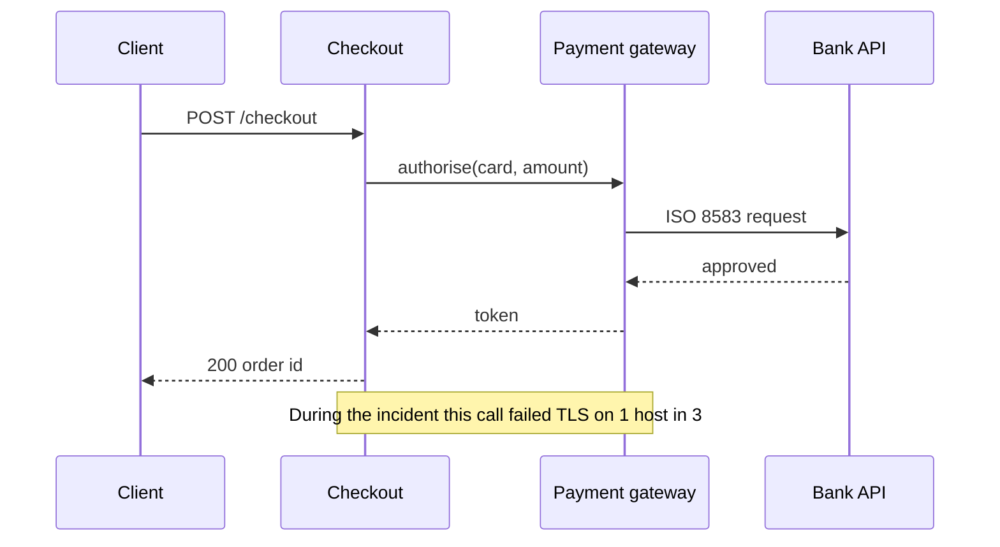
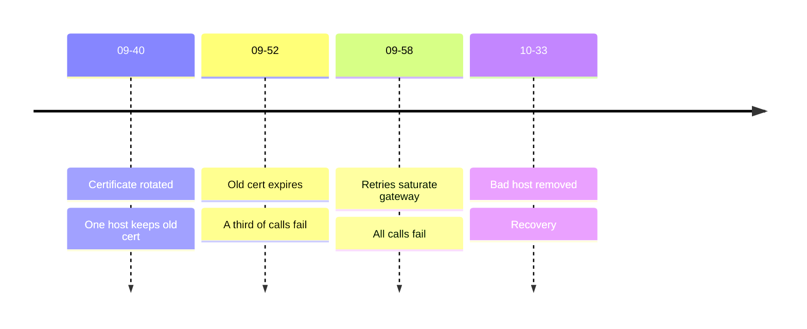
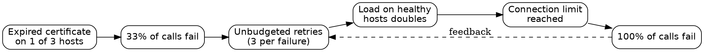
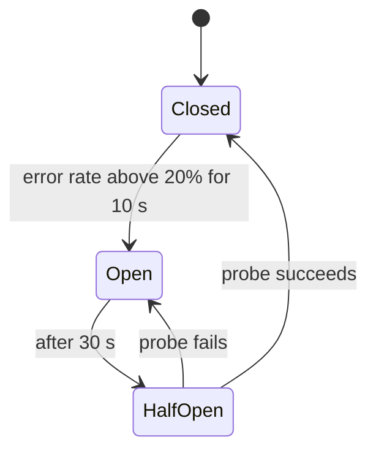

# What happened

On 9 November, checkout requests failed for 41 minutes. A certificate rotation on the payment gateway left one of three gateway hosts presenting an expired certificate. The checkout service retried failed calls without a budget, which tripled load on the two healthy hosts and pushed them past their connection limit.

# Request path

A checkout call crosses four services. The failure began at the gateway and spread backwards.



Figure: The normal checkout call sequence.

The retries are what turned a partial failure into a full one. Each failed call was retried three times, with no check on how many retries were already in flight.

# Timeline



Figure: Key moments on 9 November, in UTC.

Detection took six minutes because the alert watched the error rate averaged over all hosts, and one failing host in three stayed under the threshold.

# Why it spread



Figure: The causal chain from one bad host to a full outage.

The dashed edge is the important one. Once every call failed, every call was retried, and the gateway could not recover until the bad host was removed and the retry storm drained.

# Impact

```vega-lite
{
  "$schema": "https://vega.github.io/schema/vega-lite/v5.json",
  "width": 540, "height": 220,
  "data": {"values": [
    {"t": "09:40", "rate": 99.8}, {"t": "09:45", "rate": 99.7}, {"t": "09:50", "rate": 99.8},
    {"t": "09:55", "rate": 67.1}, {"t": "10:00", "rate": 4.2}, {"t": "10:05", "rate": 1.1},
    {"t": "10:10", "rate": 0.9}, {"t": "10:15", "rate": 1.3}, {"t": "10:20", "rate": 0.8},
    {"t": "10:25", "rate": 1.0}, {"t": "10:30", "rate": 2.4}, {"t": "10:35", "rate": 71.5},
    {"t": "10:40", "rate": 98.9}, {"t": "10:45", "rate": 99.7}
  ]},
  "mark": {"type": "area", "line": true, "opacity": 0.35},
  "encoding": {
    "x": {"field": "t", "type": "ordinal", "title": "time (UTC)", "axis": {"labelAngle": 0}},
    "y": {"field": "rate", "type": "quantitative", "title": "checkout success rate (%)"}
  }
}
```

Figure: Checkout success rate in five-minute buckets.

About 18,400 checkout attempts failed. Roughly 60% of those customers completed a purchase later the same day.

# Service states

The gateway client had no state between "healthy" and "retrying". The fix adds a circuit breaker.



Figure: The circuit breaker added to the gateway client.

# Changes

1. Retry budget of 10% on all calls from checkout to the gateway.
2. Circuit breaker as shown above.
3. Per-host error rate alerts, so one bad host in three pages someone.
4. Certificate rotation verifies every host before it reports success.
