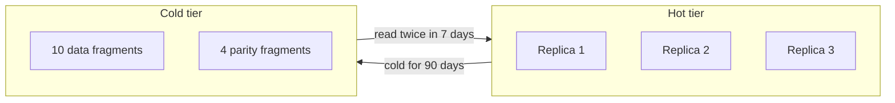

# Executive summary

Seventy-one percent of the bytes in the object store have not been read in ninety days. They are held at three-way replication on the same hardware as the data that is read every second. This proposal moves objects that are cold for ninety days to an erasure-coded tier on dense drives. It cuts raw capacity for that data by 53% and delays the next hardware purchase by about fourteen months.

The cost is slower first-byte time on a cold read, from 12 ms to roughly 85 ms, and a more involved repair path. Both are acceptable for data that is read less than once a quarter.

## What we are asking for

Approval to build the tier in the first half of 2027 and to begin migrating data in the third quarter. The work needs four engineers for two quarters and no new hardware until the migration is half complete.

## What we are not proposing

We are not changing the hot tier, the API, or the durability target. Clients will not need to change anything. An object's tier is not visible through the API, apart from the latency of the first read.

<!-- ziya:pagebreak -->

# Background

## How the store is laid out today

Every object is split into 64 MB chunks and each chunk is written to three storage nodes in different racks. A metadata service maps object names to chunk locations. Reads go to any one replica; writes go to all three and succeed when two acknowledge.

This layout is simple and fast. Its weakness is cost: every byte the customer stores takes three bytes of disk, whether it is read constantly or never.

## How the data is used

We sampled access logs for the whole of the third quarter. The pattern is strongly skewed.

Table: Share of stored bytes by time since last read.

| Last read | Share of bytes | Share of reads |
|---|---:|---:|
| Within 1 day | 6% | 81% |
| 1 to 7 days | 8% | 13% |
| 7 to 30 days | 9% | 4% |
| 30 to 90 days | 6% | 1.6% |
| Over 90 days | 71% | 0.4% |

Objects that go ninety days without a read are very unlikely to be read again soon. Of the objects that were cold at the start of the quarter, 1.9% were read during it.

## Why replication is the wrong tool for cold data

Replication buys two things: durability and read speed. Cold data needs the first and not the second. Erasure coding gives the same durability from far less disk by storing parity instead of copies, and it pays for that with more work on each read and each repair.

# Design

## Encoding

Cold chunks are encoded with a Reed–Solomon code of ten data fragments and four parity fragments. Any ten of the fourteen fragments rebuild the chunk. The overhead is 1.4 times the data, against 3 times for replication.

Figure: Objects move to the cold tier after ninety days and return if they become active.

## Placement

The fourteen fragments of a chunk go to fourteen different nodes across at least seven racks, with no more than two fragments in a rack. Losing a whole rack therefore costs at most two fragments, which the code tolerates twice over.

## Reads

A cold read fetches the ten data fragments in parallel and reassembles them. If one is slow or missing, the reader fetches parity fragments and decodes. The decode adds about 4 ms per 64 MB chunk on current hardware.

The larger cost is the tail. A read is as slow as its slowest fragment, so the reader requests twelve fragments and uses the first ten to arrive.

## Repair

When a node fails, each fragment it held must be rebuilt from ten others. This reads ten times as much data as a replica repair. We limit repair traffic to 20% of network capacity and prioritise chunks that have lost more than one fragment.

> **Note:** A chunk that has lost three fragments is one failure from being at risk and jumps the repair queue. In simulation this state occurs about once per 40,000 chunk-years.

## Migration

A background scanner walks the metadata service and queues chunks whose objects have been cold for ninety days. For each chunk it:

1. Reads one replica and verifies its checksum.
2. Encodes and writes the fourteen fragments.
3. Reads the fragments back and verifies them.
4. Updates the metadata to point at the cold tier.
5. Deletes the three replicas after a 48-hour hold.

The hold means a mistake in the cold write path can be undone by reverting metadata.

<!-- ziya:pagebreak -->

# Durability

## Target

The store promises eleven nines of annual durability per object. The cold tier must meet the same figure.

## Model

A chunk is lost if five of its fourteen fragments are lost before repair completes. With an annual node failure rate of 4% and a mean repair time of six hours, the model gives an annual loss probability per chunk well below the replicated tier's.

Table: Modelled annual chunk loss probability.

| Scheme | Overhead | Tolerates | Loss probability |
|---|---:|---:|---:|
| 3 replicas | 3.0× | 2 failures | 2 × 10⁻¹² |
| RS(10,4) | 1.4× | 4 failures | 9 × 10⁻¹⁵ |
| RS(12,3) | 1.25× | 3 failures | 4 × 10⁻¹² |

RS(12,3) would save a little more disk and still meet the target, with almost no margin. We chose RS(10,4) for the margin.

## Correlated failures

The model assumes independent failures. The real risk is correlated: a bad firmware release, a rack power fault, a bug in the encoder. Placement handles racks. For software faults we rely on the 48-hour hold, on a second encoder implementation used only for verification, and on a weekly scrub that decodes a sample of chunks from parity alone.

# Cost

## Capacity

The store holds 38 PB of customer data, which occupies 114 PB of raw disk. Moving the cold 71% to the new tier changes that as follows.

Table: Raw capacity before and after, in petabytes.

| Tier | Customer data | Before | After |
|---|---:|---:|---:|
| Hot, 3 replicas | 11 | 33 | 33 |
| Cold | 27 | 81 | 38 |
| **Total** | **38** | **114** | **71** |

The 43 PB released is about fourteen months of growth at the current rate.

## Engineering

Four engineers for two quarters to build the tier, and one engineer for a year to run the migration. The encoder library exists and is used by the backup service.

## Running cost

Cold reads cost more CPU. At the measured rate of cold reads the extra is under 1% of the fleet's compute. Repair traffic rises by roughly a factor of four for cold data, inside the existing network budget.

# Risks

1. **A burst of cold reads.** A customer who restores a large archive would see slow reads and trigger many promotions. We will rate-limit promotion and offer a bulk-restore call that warms data ahead of time.
2. **Repair falling behind.** If repair is slower than failures for long enough, chunks are lost. The scanner pauses migration whenever the repair queue exceeds one hour.
3. **Encoder defects.** Addressed by the verification read, the second implementation and the hold period.
4. **Small objects.** Objects under 1 MB make up 3% of cold bytes and 60% of cold objects. Encoding them individually wastes metadata. They stay replicated in this phase.

# Schedule

| Phase | When | Deliverable |
|---|---|---|
| Design review | January 2027 | This document, approved |
| Build | February to June 2027 | Cold tier in one region, shadow traffic |
| Pilot | July 2027 | 1 PB of internal data migrated |
| Migration | August 2027 onwards | 2 PB per week |

# Decision requested

Approve the build phase and the staffing above. A second review before the pilot will decide whether migration proceeds.
